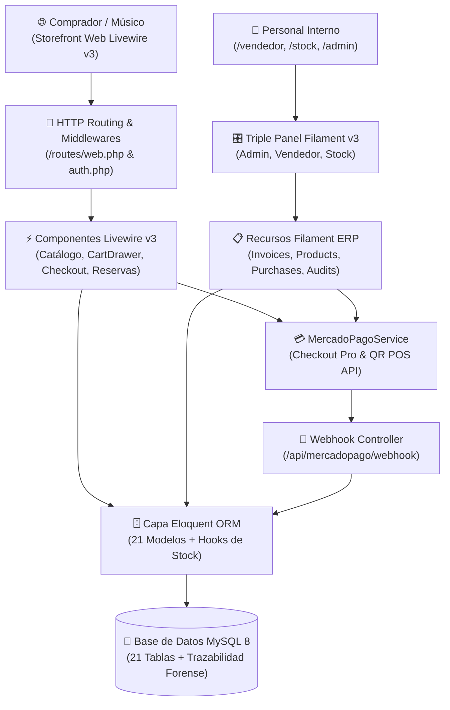

# Sound Heritage — Plataforma Integral E-Commerce, Reservas de Salón y ERP Multi-Panel

[](https://laravel.com)
[](https://php.net)
[](https://livewire.laravel.com)
[](https://filamentphp.com)
[](https://tailwindcss.com)
[](https://mysql.com)
[](https://www.mercadopago.com.ar/developers)
[-2ea44f?style=flat-square)](#-verificación-y-suite-de-pruebas-automatizadas)

> **Sound Heritage** es una solución monolítica modular de sobre **Laravel 11 y PHP 8.2+**. Integra en un único ecosistema un **Storefront de comercio electrónico reactivo** para instrumentos y audio profesional, un **motor de reservas de salas acústicas y auditorio** con cálculo dinámico de tarifas y señas, un **sistema de venta de entradas con códigos QR** para recitales en vivo, y un **Triple Panel ERP en Filament v3** especializado para Mostrador/Caja, Almacén/Stock y Dirección General con conciliación bancaria en tiempo real mediante **Mercado Pago**.

---

## 📑 Contenidos del Repositorio y Documentación

### 📚 Manuales Oficiales (Navegación Directa en GitHub)
Puedes hacer clic directamente en cualquiera de los manuales para visualizarlos con formato completo en GitHub:

| Documento | Audiencia Destinataria | Acceso Directo |
| :--- | :--- | :--- |
| **01. Manual de Vendedor y Caja** | Mostrador, cobros QR en Caja 1 y tickets térmicos de 80mm | [📘 Ver Manual](docs/01_MANUAL_VENDEDOR_Y_CAJA.md) |
| **02. Manual de Depósito y Stock** | Almacén, 8 familias de productos, compras y stock atómico | [📦 Ver Manual](docs/02_MANUAL_DEPOSITO_Y_STOCK.md) |
| **03. Manual de Administrador y Gerencia** | Dashboard, reporte PDF A4, RRHH, Spatie RBAC y reembolsos | [👑 Ver Manual](docs/03_MANUAL_ADMINISTRADOR_Y_GERENCIA.md) |
| **04. Manual del Cliente de la Tienda Web** | Catálogo online, carrito lateral, señas del 30% y entradas QR | [🛒 Ver Manual](docs/04_MANUAL_CLIENTE_TIENDA_WEB.md) |
| **05. Diccionario de Base de Datos y ERD** | 21 tablas relacionales, llaves foráneas, tipos y hooks de modelos | [🗄️ Ver Diccionario](docs/05_DICCIONARIO_BASE_DATOS.md) |
| **06. Manual Técnico y Arquitectura** | Laravel 11, Livewire v3, SDK Mercado Pago, Webhooks y crons | [🛠️ Ver Manual Técnico](docs/06_MANUAL_TECNICO_Y_ARQUITECTURA.md) |
| **00. Plan Forense y Alcance** | Metodología de 5 pasos, inventario del 100% y matriz de cobertura | [📋 Ver Plan y Alcance](docs/00_PLAN_Y_ALCANCE_DOCUMENTACION.md) |

### 📌 Secciones de este README
* [Arquitectura General y Mapa de Componentes](#-arquitectura-general-y-mapa-de-componentes)
* [Demostración de los 4 Módulos Operativos](#-demostración-de-los-4-módulos-operativos)
* [Integración Dual de Pagos (Mercado Pago)](#-integración-dual-de-pagos-mercado-pago)
* [Guía de Instalación y Despliegue Local](#-guía-de-instalación-y-despliegue-local)
* [Credenciales Predeterminadas del Sistema (Seeders)](#-credenciales-predeterminadas-del-sistema-seeders)
* [Verificación y Suite de Pruebas Automatizadas](#-verificación-y-suite-de-pruebas-automatizadas)
* [Matriz de Documentación Oficial del Proyecto](#-matriz-de-documentación-oficial-del-proyecto)

---

## 🏛️ Arquitectura General y Mapa de Componentes

La plataforma unifica el frontend público, los paneles administrativos especializados y las conexiones a servicios externos bajo un flujo jerárquico y desacoplado:



---

## 🎛️ Demostración de los 4 Módulos Operativos

### 1. Storefront Público y E-Commerce (`/app/Livewire/`)
* **Búsqueda Reactiva en Tiempo Real (`SearchBar.php`):** Autocompletado y coincidencia instantánea de instrumentos y marcas mientras el usuario escribe.
* **Catálogo y Fichas Técnicas (`CatalogoProductos.php` / `DetalleProducto.php`):** Filtros por 8 familias de productos, ordenamiento inteligente por precio, insignias de descuento (`10% OFF` a `25% OFF`) y visualización de stock real en local.
* **Carrito Deslizante con Optimistic UI (`CartDrawer.php` / `HasCartActions.php`):** Manipulación de unidades (`+` / `-`) y cálculo de subtotales con **0 ms de latencia perceptual** mediante sincronización híbrida Alpine.js + Livewire.
* **Checkout Integral (`CheckoutTienda.php`):** Flujo en pantalla única para retiro gratuito en el local de Posadas o despacho a domicilio, emisión de comprobantes fiscales y pago con Mercado Pago.
* **Motor de Reservas de Auditorio (`ReservarSalon.php`):**
  * Anticipación mínima obligatoria de 7 días para acondicionamiento técnico.
  * Turnos: Mañana (09:00 a 13:00), Tarde (15:00 a 19:00) y Noche (19:00 a 23:00 hs).
  * Calculadora de descuentos grupales en tramos de 5 personas (10% a 25% de ahorro).
  * Congelamiento de fecha con seña del 30% mediante Mercado Pago (saldo restante del 70% abonable en sala).
* **Entradas a Recitales y Portal Personal (`CatalogoEventos.php` / `MiCuenta.php`):** Venta de pases culturales con código QR digital para ingreso directo desde el celular y repositorio personal de facturas en PDF.

---

### 2. Panel de Ventas y Mostrador (`/vendedor`)
* **Entorno Ágil de Mostrador:** Diseñado específicamente para personal comercial en punto de venta físico.
* **Facturación Presencial y Cálculo de Vuelto:** Emisión de comprobantes fiscales oficiales tipo A y B con cálculo automático de vuelto para pagos en efectivo.
* **Cobro con QR Dinámico en Mostrador (Caja 1):** Modal reactivo que genera la orden en la API de Mercado Pago y proyecta el cobro en el cartel físico de caja con monitoreo en tiempo real (`wire:poll.2s`).
* **Impresión Térmica:** Generación automática de tickets de venta en formato continuo de 80mm con membrete fiscal y código de barras.
* **Recepción y Aprobación de Reservas:** Verificación física de bandas en mostrador y cobro del saldo pendiente del 70%.

---

### 3. Panel de Depósito y Stock (`/stock`)
* **Gestión de 8 Familias de Productos:** Guitarras, Bajos, Baterías y Percusión, Teclados y Pianos, Vientos, Audio Profesional, Iluminación y Accesorios.
* **Fichas Técnicas Dinámicas (`specs` JSON):** Carga flexible de especificaciones según el rubro (madera, micrófonos, pastillas, canales, potencia).
* **Padrón de Proveedores y Remitos:** Registro comercial de fabricantes y distribuidores mayoristas.
* **Actualización Atómica de Inventario:** El alta de órdenes de compra incrementa automáticamente las unidades en depósito; la anulación de remitos descuenta el stock mediante hooks de Eloquent.
* **Reportes de Abastecimiento en PDF:** Exportación formal de inventario para reposición de mercadería crítica.

---

### 4. Panel Maestro de Administración y Finanzas (`/admin`)
* **Dashboard Ejecutivo con Analítica en Tiempo Real:** 4 tarjetas KPI con sparklines (conversión de clientes, ticket promedio, ítems por venta y tasa de anulación) y 6 gráficos comparativos de ventas interanuales, segmentación en dona y alertas de stock mínimo (<= 5 unidades).
* **Reporte Balance en PDF A4:** Generación del informe imprimible membretado con CUIT oficial y balances directivos (`/resources/views/reports/pdf-dashboard.blade.php`).
* **Gestión de Recursos Humanos:** Padrón de legajos con alta automática de cuentas corporativas y DNI como clave provisional.
* **Control de Usuarios y Roles (Spatie RBAC):** Asignación granular de perfiles (`Administrador`, `Vendedor`, `Encargado de Stock`) y reseteo seguro de credenciales por email.
* **Anulación con Reembolso Automático:** La anulación de una factura en el panel dispara una reversión en la API de Mercado Pago, reintegrando los fondos de forma automática a la tarjeta del comprador y restituyendo el stock a depósito.
* **Auditoría Forense Inmutable:** Registro inmutable de IP, fecha al segundo, usuario responsable y diferencias entre valores anteriores y nuevos (`old_values` vs `new_values`).

---

## 💳 Integración Dual de Pagos (Mercado Pago)

La pasarela de pagos está implementada en `/app/Services/MercadoPagoService.php` y `/app/Http/Controllers/MercadoPagoWebhookController.php`:

```mermaid
flowchart TD
    subgraph OnlineChannel["1. Canal Online (Checkout Pro)"]
        WebCheckout["CheckoutTienda / Reservas"] -->|createCheckoutPreference| MP_Pref["API Preferences Mercado Pago"]
        MP_Pref --> Redireccion["Pasarela de Pago Segura (Cuotas / Saldo / Débito)"]
    end

    subgraph MostradorChannel["2. Canal Mostrador Físico (Caja 1)"]
        POS_Caja["InvoiceResource (Caja 1)"] --> ClearActive["cancelAnyActiveCajaOrder()\n(Libera órdenes previas en Caja 1)"]
        ClearActive --> MP_Orders["POST /v1/orders (Orders API)\nHeader: X-Idempotency-Key (UUID)"]
        MP_Orders --> QR_Totem["Tótem QR Físico de Mostrador"]
    end

    subgraph Conciliacion["3. Conciliación Asíncrona (Webhooks IPN)"]
        NotifMP["POST /api/mercadopago/webhook"] --> ValidaHMAC{"Validación de Firma\nHMAC-SHA256"}
        ValidaHMAC -->|Firma Válida| ParserRef["reconcileReference()\n• INV-{id} (Factura Pagada)\n• RES-{id} (Reserva Abonada)\n• ATT-{id} (Entrada Recital QR)"]
        ParserRef --> DespachoPDF["📩 Envío Automático de Comprobante PDF"]
    end

    subgraph Devoluciones["4. Reembolsos Automáticos"]
        AnularERP["Anular Factura en /admin"] --> MP_Refund["POST /v1/payments/{id}/refunds\nReintegro Directo a la Tarjeta"]
    end
```



---

## 💻 Guía de Instalación y Despliegue Local

### Requisitos Previos
* **PHP:** Versión 8.2 o superior con extensiones `pdo_mysql`, `mbstring`, `openssl`, `curl`, `gd`, `xml`.
* **Composer:** Versión 2.x.
* **Node.js & NPM:** Versión 18.x o superior.
* **MySQL:** Versión 8.0 o MariaDB 10.5+.

---

### Paso 1: Clonar el Repositorio
```bash
git clone https://github.com/tu-usuario/sound-heritage.git
cd sound-heritage
```

---

### Paso 2: Instalar Dependencias del Backend y Frontend
```bash
# Dependencias PHP
composer install

# Dependencias JavaScript y compilación de assets
npm install
npm run build
```

---

### Paso 3: Configuración de Variables de Entorno
```bash
cp .env.example .env
php artisan key:generate
```
Configura tus credenciales de base de datos MySQL en el archivo `.env`:
```ini
DB_CONNECTION=mysql
DB_HOST=127.0.0.1
DB_PORT=3306
DB_DATABASE=sound_heritage
DB_USERNAME=root
DB_PASSWORD=tu_password
```

---

### Paso 4: Ejecutar Migraciones y los 23 Seeders del Sistema
```bash
php artisan migrate --seed
```
*Este comando crea las 21 tablas relacionales, configura la matriz de roles y permisos Spatie y siembra el catálogo completo de instrumentos, sucursales, proveedores, empleados, eventos y reservas de muestra.*

---

### Paso 5: Enlace de Almacenamiento y Puesta en Marcha
```bash
# Crear enlace simbólico para imágenes de productos y comprobantes
php artisan storage:link

# Iniciar servidor de desarrollo
php artisan serve
```
La aplicación estará disponible en `http://localhost:8000`.

---

## 🔑 Credenciales Predeterminadas del Sistema (Seeders)

Para evaluar y auditar los diferentes entornos y puertas de acceso de Sound Heritage:

| Perfil / Rol | Puerta de Acceso | Correo Electrónico | Contraseña Predeterminada |
| :--- | :--- | :--- | :--- |
| **Administrador General** | `/admin` | `admin@soundheritage.com` | `admin123` |
| **Vendedor de Mostrador** | `/vendedor` | `vendedor@soundheritage.com` | `vendedor123` |
| **Encargado de Depósito** | `/stock` | `stock@soundheritage.com` | `stock123` |
| **Cliente de Tienda Web** | `/mi-cuenta` | `cliente@soundheritage.com` | `cliente123` |

---

## 🧪 Verificación y Suite de Pruebas Automatizadas

El proyecto cuenta con una cobertura integral de **92 pruebas unitarias y de integración** automatizadas desarrolladas sobre PHPUnit:

```bash
php artisan test
```

```text
   PASS  Tests\Unit\MercadoPagoTest
   PASS  Tests\Feature\CheckoutTiendaTest
   PASS  Tests\Feature\ReservarSalonTest
   PASS  Tests\Feature\CatalogoProductosTest
   PASS  Tests\Feature\CatalogoEventosTest
   PASS  Tests\Feature\AuditHistoryTest
   PASS  Tests\Feature\MiCuentaTest

  Tests:    92 passed (351 assertions)
  Duration: 4.82s
```

* **`MercadoPagoTest`:** Valida la creación de preferencias web, órdenes QR de mostrador con UUID de idempotencia, firma criptográfica HMAC-SHA256 del webhook, conciliación de comprobantes y reembolsos vía API.
* **`CheckoutTiendaTest` & `ReservarSalonTest`:** Certifican el cálculo de totales, prevención de colisiones en turnos de auditorio, escala de descuentos por tramos de 5 personas y retención de seña del 30%.
* **`AuditHistoryTest`:** Verifica el comportamiento inmutable de la tabla de auditorías y el comparador forense de cambios.

---

## 📚 Matriz de Documentación Oficial del Proyecto

La ingeniería y los manuales operativos de Sound Heritage se encuentran organizados en el directorio `docs/`. Puedes acceder a cada documento directamente desde GitHub haciendo clic en los siguientes enlaces:

| Documento | Audiencia Destinataria | Alcance y Contenido Principal |
| :--- | :--- | :--- |
| [📘 **01. Manual de Vendedor y Caja**](docs/01_MANUAL_VENDEDOR_Y_CAJA.md) | Personal de Mostrador y Caja | Facturación presencial, cobro con QR dinámico en Caja 1, tickets térmicos de 80mm y reservas en sala. |
| [📦 **02. Manual de Depósito y Stock**](docs/02_MANUAL_DEPOSITO_Y_STOCK.md) | Almacén y Abastecimiento | Clasificación en 8 familias de productos, fichas técnicas dinámicas, compras a proveedores y stock atómico. |
| [👑 **03. Manual de Administrador y Gerencia**](docs/03_MANUAL_ADMINISTRADOR_Y_GERENCIA.md) | Dirección y Finanzas | Dashboard con analítica, reporte PDF A4, RRHH, Spatie RBAC, reembolsos automáticos en Mercado Pago y auditoría. |
| [🛒 **04. Manual del Cliente de la Tienda Web**](docs/04_MANUAL_CLIENTE_TIENDA_WEB.md) | Compradores y Músicos | Guía de compra online, carrito lateral, checkout Mercado Pago, turnos con seña del 30%, entradas QR y Mi Cuenta. |
| [🗄️ **05. Diccionario de Base de Datos y ERD**](docs/05_DICCIONARIO_BASE_DATOS.md) | Desarrolladores y DBAs | Diagramas ERD modulares, catálogo de 21 tablas relacionales, tipos de datos, llaves foráneas y hooks `booted()`. |
| [🛠️ **06. Manual Técnico y Arquitectura de Código**](docs/06_MANUAL_TECNICO_Y_ARQUITECTURA.md) | Ingeniería y DevOps | Arquitectura Laravel 11 + Livewire v3, SDK Mercado Pago, Webhooks HMAC, crons, 21 policies y despliegue. |
| [📋 **00. Plan y Alcance de Documentación**](docs/00_PLAN_Y_ALCANCE_DOCUMENTACION.md) | Auditoría de Software | Pipeline forense de 5 pasos, inventario del 100% de archivos y checklist de cobertura verificado. |


---

> **Sound Heritage ERP & E-Commerce Platform**  
> Desarrollado con los más altos estándares de calidad de código, robustez tributaria y trazabilidad contable.  
> Distribución con fines profesionales e institucionales. Todos los derechos reservados.
