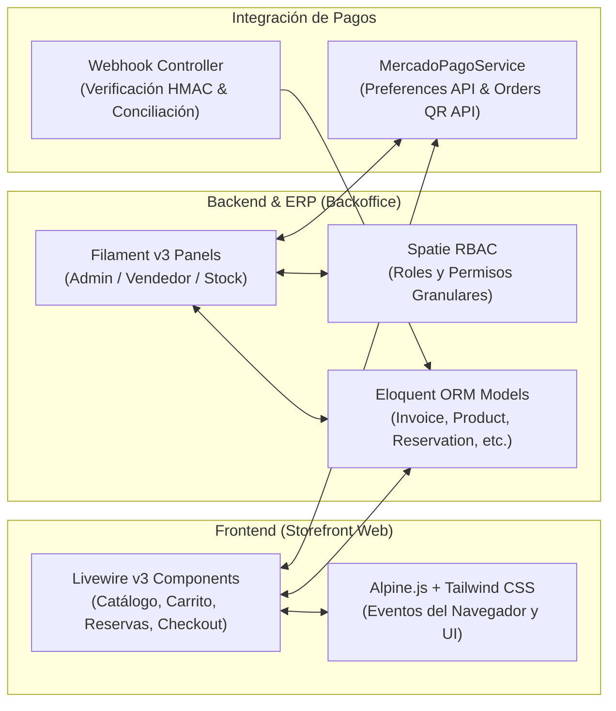
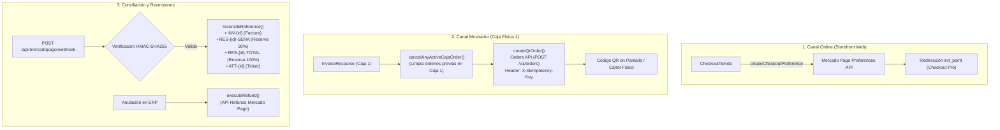

# Sound Heritage — Arquitectura del Software

[](https://laravel.com)
[](https://php.net)
[](https://livewire.laravel.com)
[](https://filamentphp.com)
[-2ea44f?style=flat-square)](#5-verificación-y-suite-de-pruebas)

> **Sistema Monolítico Modular desarrollado sobre Laravel 12.x y PHP 8.3**, compuesto por un **Storefront Reactivo en Livewire v3**, un **ERP Multi-Panel en Filament v3** y un **Módulo de Integración Dual con Mercado Pago**.

---

## 1. Arquitectura General

La aplicación unifica el backend, el panel administrativo y la tienda pública bajo el mismo kernel de Laravel:



---

## 2. Frontend Reactivo: Livewire v3

El frontend prescinde de frameworks SPA independientes (como React o Vue) y utiliza **Livewire v3**. Cada interacción del usuario ejecuta llamadas AJAX asíncronas hacia el backend que hidratan el componente PHP, recalculan el estado y devuelven las mutaciones de DOM mediante *DOM morphing*.

### Componentes de Página Completa (`app/Livewire/`)

* **`HomeTienda.php`** (`/`): Portada principal, catálogo de destacados y cálculo dinámico de precios de contado (10% OFF en cascada).
* **`CatalogoProductos.php`** (`/productos` y `/ofertas`): Pipeline de filtros reactivos que consultan las especificaciones técnicas estructuradas en JSON (`Product::specs`) y aíslan promociones activas (`discount_percentage > 0`).
* **`CatalogoEventos.php`** (`/eventos`): Listado de recitales con lectura de aforo en tiempo real (`capacity - attendances_count`) y venta de pases individuales o múltiples.
* **`ReservarSalon.php`** (`/reservar-salon`): Motor de disponibilidad con algoritmo anticolisión que bloquea fechas y turnos ya ocupados por eventos o reservas previas. Calcula tarifas por volumen de integrantes y permite señar (30%) o abonar el total.
* **`CheckoutTienda.php`** (`/checkout`): Gestión de compra en una sola pantalla:
  * Paso 1: Carrito de compras y control de unidades.
  * Paso 2: Datos del comprador.
  * Paso 3: Logística (Retiro en local o envío a domicilio).
  * Paso 4: Selección de medio de pago y conexión con pasarelas.
* **`MiCuenta.php`** (`/mi-cuenta`): Portal del cliente para consultar el historial de facturas en PDF, reimprimir tickets de eventos con código de barras y gestionar datos de contacto y entrega.

### Micro-Componentes y Eventos
* **`SearchBar.php`**: Micro-componente aislado incrustado en el navbar. Aplica `wire:model.live.debounce.300ms` y ejecuta consultas predictivas a partir de 2 caracteres.
* **Bus de Eventos**: Los componentes se comunican en el cliente mediante `$this->dispatch('cart-updated', count: $total)` y directivas `@cart-updated.window` de Alpine.js para sincronizar el badge del carrito sin recargar la página.
* **Trait `HasCartActions`**: Centraliza en sesión (`session('carrito')`) las operaciones de agregar, decrementar y remover productos o entradas.

---

## 3. Backend y Backoffice: Filament v3

El backoffice está implementado con **Filament v3**, organizado mediante el patrón de **Paneles Multi-Contexto** (`Providers/Filament/`) y securizado con **Spatie Laravel-Permission**.

### Estructura Multi-Panel

| Panel | Ruta Base | Provider | Propósito y Alcance |
| :--- | :--- | :--- | :--- |
| **Administración** | `/admin` | `AdminPanelProvider.php` | Control total del sistema: compras, RRHH, configuración, finanzas y auditorías forenses. |
| **Vendedor / Caja** | `/vendedor` | `VendedorPanelProvider.php` | Interfaz optimizada para el mostrador físico: facturación rápida, cobro con QR y consulta de stock. |
| **Stock / Depósito** | `/stock` | `StockPanelProvider.php` | Restringido al ingreso de mercadería, control de inventario y alertas de stock mínimo. |

### Recursos Principales del ERP (`app/Filament/Admin/Resources/`)

* **`InvoiceResource.php` (Facturación)**:
  * Emisión de Facturas tipo A y B bajo numeración correlativa fiscal de punto de venta.
  * Generación de tickets fiscales en formato térmico de 80mm con **DomPDF**.
  * Cobro presencial mediante código QR dinámico en mostrador (*Caja 1*), monitoreado mediante polling reactivo (`wire:poll.2s`).
  * Hook de anulación: el borrado de una factura cancela y reembolsa automáticamente el pago asociado en Mercado Pago.
* **`ReservationResource.php` (Salas y Auditorio)**:
  * Menú agrupado de acciones (`ActionGroup`) para cobro de seña (30%) o cancelación total en caja.
  * Circuito de aprobación operativa en dos fases: el pago mantiene el estado en `Pendiente` y la aprobación manual en el panel confirma la sala y despacha el correo transaccional.
* **`ProductResource.php` & `PurchaseResource.php` (Inventario)**:
  * Catálogo de instrumentos con especificaciones técnicas dinámicas en formato JSON.
  * El alta de órdenes de compra en `PurchaseResource` incrementa el inventario disponible de forma automática; la anulación de la compra descuenta el stock mediante hooks de Eloquent.
* **`AttendanceResource.php` & `EventResource.php` (Ticketing)**:
  * Administración de recitales, aforos y validación de accesos en puerta mediante escaneo de comprobantes.
* **`AuditResource.php` (Auditoría Forense)**:
  * Implementa `owen-it/laravel-auditing` sobre los modelos clave.
  * Incluye el método `getDiffDisplay()` que procesa los arrays `$old_values` y `$new_values` en eventos `updated`, generando una comparativa visual clara (*Valor Previo ➜ Valor Nuevo*) con formateo de moneda argentina. Las reservas están expresamente excluidas del libro de auditorías.

---

## 4. Capa de Pagos: Mercado Pago (`MercadoPagoService.php`)

Toda la comunicación con las APIs de Mercado Pago está encapsulada en [`app/Services/MercadoPagoService.php`](app/Services/MercadoPagoService.php), dividida en dos canales operativos:



1. **Canal Web (Checkout Pro)**:
   * Genera preferencias con `createCheckoutPreference()`.
   * Maneja las URLs de retorno (`success`, `failure`, `pending`), preservando el carrito en sesión ante rechazos de pago para que el usuario pueda reintentar.
2. **Canal Mostrador (Orders API / In-Store QR)**:
   * Publica la orden de cobro asociada a la terminal física `CAJA1` mediante `createQrOrder()`.
   * Aplica la cabecera estándar `X-Idempotency-Key` (UUIDv4) para prevenir cobros duplicados por fallas de conexión.
   * Ejecuta `cancelAnyActiveCajaOrder()` antes de emitir un nuevo cobro para garantizar que el cartel físico solo cobre la transacción activa.
3. **Webhooks y Conciliación Asíncrona (`MercadoPagoWebhookController.php`)**:
   * Valida la firma criptográfica HMAC-SHA256 en la cabecera `x-signature`.
   * Analizador de referencias compuestas (`reconcileReference`):
     * `INV-{id}`: Actualiza la factura a `completed` y despacha el correo con la factura PDF adjunta.
     * `RES-{id}-SENA`: Acredita la seña del 30% y calcula el saldo restante.
     * `RES-{id}-TOTAL`: Registra la cancelación total de la sala.
     * `ATT-{id}`: Emite la entrada troquelada con código de barras.
4. **Devoluciones Automáticas (Refunds API)**:
   * Al anular comprobantes en el ERP, `executeRefund()` devuelve automáticamente los fondos a la tarjeta o cuenta del comprador.

---

## 5. Verificación y Suite de Pruebas

El software cuenta con una suite de **92 pruebas automatizadas** (unitarias y de integración) ejecutadas bajo PHPUnit:

```bash
# Ejecutar todas las pruebas del proyecto (92 passed, 351 assertions)
/www/server/php/83/bin/php artisan test
```

* **`MercadoPagoTest`**: Certifica webhooks, órdenes QR físicas, conciliación de facturas, reservas y reembolsos automáticos.
* **`CheckoutTiendaTest` & `ReservarSalonTest`**: Validan cálculos financieros, flujo de compra, prevención de solapamientos y resguardo de datos.
* **`AuditHistoryTest`**: Valida contratos auditables, exclusión de reservas y el comparador de Diffs (`getDiffDisplay`).
* **`CatalogoProductosTest` & `CatalogoEventosTest`**: Evalúan el pipeline de filtros JSON, ordenamiento de inventario y venta de pases.
* **`MiCuentaTest`**: Verifica el portal de autogestión y la generación de documentos PDF.

