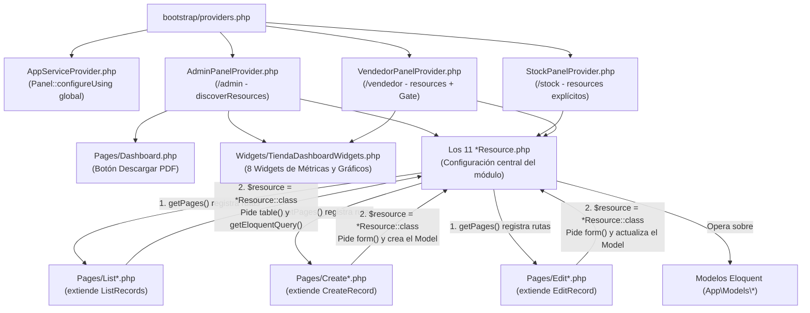

# Análisis Exhaustivo de la Arquitectura Filament (Sound Heritage ERP)

Este documento analiza **sin omitir ni una sola línea de código** los **46 archivos** que conforman el ecosistema de Filament en el proyecto (`AppServiceProvider`, los 3 `PanelProvider`, la página `Dashboard`, los 8 `Widgets` en `TiendaDashboardWidgets.php`, los 11 `Resources` y los 29 archivos dentro de las subcarpetas `Pages/`).

---

## 1. Del MVC Clásico a Filament: El Qué y el Cómo

### 1.1 ¿Cómo funcionaba el MVC Clásico en Laravel vs. Cómo lo hace Filament?

En una aplicación Laravel tradicional (como la parte pública del e-commerce en este mismo proyecto), el patrón **MVC (Modelo - Vista - Controlador)** separa responsabilidades manualmente en tres capas explícitas:

| Capa / Responsabilidad | En el MVC Clásico con Vistas y Rutas | En Filament v3 (Server-Driven UI sobre Livewire) |
| :--- | :--- | :--- |
| **1. Definición de Rutas** | Se escriben a mano en `routes/web.php` usando `Route::get('/productos', [ProductController::class, 'index'])`, `Route::post(...)`, etc. | **Rutas autogeneradas:** Los `PanelProvider` fijan el prefijo (`/admin`, `/stock`, `/vendedor`) y cada `Resource` declara sus sub-rutas en `getPages()` usando `Page::route('/...')`. Filament registra todas las rutas en Laravel automáticamente. |
| **2. Controlador (Recepción de HTTP, validación y persistencia)** | Un controlador (`ProductController`) recibe `Request $request`, ejecuta `$request->validate(...)`, llama a `Product::create(...)` y retorna `redirect()->route(...)`. | **Las clases dentro de `Pages/` (`ListRecords`, `CreateRecord`, `EditRecord`):** Cada archivo en `Pages/` es un **componente Livewire de página completa** que actúa como Controlador reactivo. Lee la configuración de su `Resource`, valida el estado en memoria (`$this->data`), ejecuta transacciones Eloquent y maneja redirecciones o modales. |
| **3. Vista (HTML / Formularios / Tablas)** | Archivos `.blade.php` escritos a mano con etiquetas `<form>`, `<input>`, `<table>`, `@foreach`, estilos CSS y scripts JS para interactividad. | **Esquemas Declarativos en PHP (`form()`, `table()`, `infolist()`):** En lugar de escribir HTML, el `Resource` instancia objetos PHP (`TextInput::make()`, `Select::make()`, `TextColumn::make()`). Filament convierte esos objetos PHP en HTML + Alpine.js + Tailwind CSS usando sus propias vistas internas. |
| **4. Consultas a Base de Datos** | En el controlador se escribe `Product::with(...)->where(...)->paginate(15)` y se pasa a la vista con `compact('products')`. | **Query Builder acoplado a la Tabla:** El `Resource` define la consulta base en `getEloquentQuery()`. El componente `ListRecords` le aplica dinámicamente la búsqueda (`searchable()`), el ordenamiento (`sortable()`), los filtros (`filters()`) y la paginación sin recargar la página. |
| **5. Interactividad Dinámica (AJAX)** | Había que escribir `fetch()` o `axios` en JavaScript y crear rutas API en Laravel para actualizar un campo según otro (ej. calcular totales o filtrar desplegables). | **Reactividad con Livewire (`live()`, `afterStateUpdated()`, `Get`, `Set`):** Al marcar un componente con `->live()`, cualquier cambio viaja por AJAX (`POST /livewire/update`) al servidor, ejecuta el closure PHP con `Get $get` y `Set $set`, y redibuja solo el fragmento del DOM afectado. |

---

### 1.2 Rutas Propias de Filament: Cómo se generan y cuáles existen en el proyecto

En Filament **no se declaran rutas CRUD en `routes/web.php`**. El registro ocurre en dos pasos durante el arranque de Laravel:

1. **Prefijo del Panel (`PanelProvider`):**
   - [`AdminPanelProvider`](file:///www/wwwroot/157.151.150.179/app/Providers/Filament/AdminPanelProvider.php#L48-L49): `->id('admin')->path('admin')` genera el prefijo URL `/admin` y el prefijo de nombres de ruta `filament.admin.*`.
   - [`StockPanelProvider`](file:///www/wwwroot/157.151.150.179/app/Providers/Filament/StockPanelProvider.php#L29-L30): `->id('stock')->path('stock')` genera el prefijo URL `/stock` y el prefijo de nombres `filament.stock.*`.
   - [`VendedorPanelProvider`](file:///www/wwwroot/157.151.150.179/app/Providers/Filament/VendedorPanelProvider.php#L84-L85): `->id('vendedor')->path('vendedor')` genera el prefijo URL `/vendedor` y el prefijo de nombres `filament.vendedor.*`.

2. **Slug del Recurso + método `getPages()` del `Resource`:**
   - Filament toma el nombre del modelo en plural y formato *kebab-case* (por ejemplo, `ProductResource` $\rightarrow$ `products`, `AttendanceResource` $\rightarrow$ `attendances`).
   - Luego lee el arreglo devuelto por `getPages()` en cada `Resource` y concatena la ruta definida en `PageClass::route(...)`.

#### Mapa Completo de Rutas Autogeneradas por Filament

| Recurso / Página | URI en Panel Admin (`/admin`) | Nombre de Ruta Interno en Laravel (Panel Admin) | Componente Livewire que atiende la ruta | ¿Disponible en `/stock`? | ¿Disponible en `/vendedor`? |
| :--- | :--- | :--- | :--- | :---: | :---: |
| **Autenticación** | `GET/POST /admin/login`, `POST /admin/logout` | `filament.admin.auth.login`, `filament.admin.auth.logout` | Componentes internos de Filament Auth | Sí (`/stock/...`) | Sí (`/vendedor/...`) |
| **Dashboard** | `GET /admin` | `filament.admin.pages.dashboard` | [`App\Filament\Admin\Pages\Dashboard`](file:///www/wwwroot/157.151.150.179/app/Filament/Admin/Pages/Dashboard.php#L14) | Sí (`Filament\Pages\Dashboard`) | Sí (`Filament\Pages\Dashboard`) |
| **AttendanceResource** | `GET /admin/attendances`<br>`GET /admin/attendances/create` | `filament.admin.resources.attendances.index`<br>`filament.admin.resources.attendances.create` | [`ListAttendances`](file:///www/wwwroot/157.151.150.179/app/Filament/Admin/Resources/AttendanceResource/Pages/ListAttendances.php#L9)<br>[`CreateAttendance`](file:///www/wwwroot/157.151.150.179/app/Filament/Admin/Resources/AttendanceResource/Pages/CreateAttendance.php#L8) | No | Sí (`/vendedor/attendances...`) |
| **CustomerResource** | `GET /admin/customers`<br>`GET /admin/customers/create`<br>`GET /admin/customers/{record}/edit` | `filament.admin.resources.customers.index`<br>`filament.admin.resources.customers.create`<br>`filament.admin.resources.customers.edit` | [`ListCustomers`](file:///www/wwwroot/157.151.150.179/app/Filament/Admin/Resources/CustomerResource/Pages/ListCustomers.php#L9)<br>[`CreateCustomer`](file:///www/wwwroot/157.151.150.179/app/Filament/Admin/Resources/CustomerResource/Pages/CreateCustomer.php#L9)<br>[`EditCustomer`](file:///www/wwwroot/157.151.150.179/app/Filament/Admin/Resources/CustomerResource/Pages/EditCustomer.php#L9) | No | Sí (`/vendedor/customers...`) |
| **EmployeeResource** | `GET /admin/employees`<br>`GET /admin/employees/create`<br>`GET /admin/employees/{record}/edit` | `filament.admin.resources.employees.index`<br>`filament.admin.resources.employees.create`<br>`filament.admin.resources.employees.edit` | [`ListEmployees`](file:///www/wwwroot/157.151.150.179/app/Filament/Admin/Resources/EmployeeResource/Pages/ListEmployees.php#L9)<br>[`CreateEmployee`](file:///www/wwwroot/157.151.150.179/app/Filament/Admin/Resources/EmployeeResource/Pages/CreateEmployee.php#L9)<br>[`EditEmployee`](file:///www/wwwroot/157.151.150.179/app/Filament/Admin/Resources/EmployeeResource/Pages/EditEmployee.php#L9) | No | No |
| **EventResource** | `GET /admin/events`<br>`GET /admin/events/create`<br>`GET /admin/events/{record}/edit` | `filament.admin.resources.events.index`<br>`filament.admin.resources.events.create`<br>`filament.admin.resources.events.edit` | [`ListEvents`](file:///www/wwwroot/157.151.150.179/app/Filament/Admin/Resources/EventResource/Pages/ListEvents.php#L9)<br>[`CreateEvent`](file:///www/wwwroot/157.151.150.179/app/Filament/Admin/Resources/EventResource/Pages/CreateEvent.php#L9)<br>[`EditEvent`](file:///www/wwwroot/157.151.150.179/app/Filament/Admin/Resources/EventResource/Pages/EditEvent.php#L9) | No | Sí (Solo lectura `index`) |
| **InvoiceResource** | `GET /admin/invoices`<br>`GET /admin/invoices/create` | `filament.admin.resources.invoices.index`<br>`filament.admin.resources.invoices.create` | [`ListInvoices`](file:///www/wwwroot/157.151.150.179/app/Filament/Admin/Resources/InvoiceResource/Pages/ListInvoices.php#L9)<br>[`CreateInvoice`](file:///www/wwwroot/157.151.150.179/app/Filament/Admin/Resources/InvoiceResource/Pages/CreateInvoice.php#L9) | No | Sí (`/vendedor/invoices...`) |
| **ProductResource** | `GET /admin/products`<br>`GET /admin/products/create`<br>`GET /admin/products/{record}/edit` | `filament.admin.resources.products.index`<br>`filament.admin.resources.products.create`<br>`filament.admin.resources.products.edit` | [`ListProducts`](file:///www/wwwroot/157.151.150.179/app/Filament/Admin/Resources/ProductResource/Pages/ListProducts.php#L9)<br>[`CreateProduct`](file:///www/wwwroot/157.151.150.179/app/Filament/Admin/Resources/ProductResource/Pages/CreateProduct.php#L9)<br>[`EditProduct`](file:///www/wwwroot/157.151.150.179/app/Filament/Admin/Resources/ProductResource/Pages/EditProduct.php#L9) | Sí (`/stock/products...`) | Sí (Solo lectura `index`) |
| **PurchaseResource** | `GET /admin/purchases`<br>`GET /admin/purchases/create` | `filament.admin.resources.purchases.index`<br>`filament.admin.resources.purchases.create` | [`ListPurchases`](file:///www/wwwroot/157.151.150.179/app/Filament/Admin/Resources/PurchaseResource/Pages/ListPurchases.php#L9)<br>[`CreatePurchase`](file:///www/wwwroot/157.151.150.179/app/Filament/Admin/Resources/PurchaseResource/Pages/CreatePurchase.php#L9) | Sí (`/stock/purchases...`) | No |
| **ReservationResource** | `GET /admin/reservations`<br>`GET /admin/reservations/create`<br>`GET /admin/reservations/{record}/edit` | `filament.admin.resources.reservations.index`<br>`filament.admin.resources.reservations.create`<br>`filament.admin.resources.reservations.edit` | [`ListReservations`](file:///www/wwwroot/157.151.150.179/app/Filament/Admin/Resources/ReservationResource/Pages/ListReservations.php#L9)<br>[`CreateReservation`](file:///www/wwwroot/157.151.150.179/app/Filament/Admin/Resources/ReservationResource/Pages/CreateReservation.php#L9)<br>[`EditReservation`](file:///www/wwwroot/157.151.150.179/app/Filament/Admin/Resources/ReservationResource/Pages/EditReservation.php#L9) | No | Sí (`/vendedor/reservations...`) |
| **SponsorResource** | `GET /admin/sponsors`<br>`GET /admin/sponsors/create`<br>`GET /admin/sponsors/{record}/edit` | `filament.admin.resources.sponsors.index`<br>`filament.admin.resources.sponsors.create`<br>`filament.admin.resources.sponsors.edit` | [`ListSponsors`](file:///www/wwwroot/157.151.150.179/app/Filament/Admin/Resources/SponsorResource/Pages/ListSponsors.php#L9)<br>[`CreateSponsor`](file:///www/wwwroot/157.151.150.179/app/Filament/Admin/Resources/SponsorResource/Pages/CreateSponsor.php#L9)<br>[`EditSponsor`](file:///www/wwwroot/157.151.150.179/app/Filament/Admin/Resources/SponsorResource/Pages/EditSponsor.php#L9) | No | No |
| **SupplierResource** | `GET /admin/suppliers`<br>`GET /admin/suppliers/create`<br>`GET /admin/suppliers/{record}/edit` | `filament.admin.resources.suppliers.index`<br>`filament.admin.resources.suppliers.create`<br>`filament.admin.resources.suppliers.edit` | [`ListSuppliers`](file:///www/wwwroot/157.151.150.179/app/Filament/Admin/Resources/SupplierResource/Pages/ListSuppliers.php#L9)<br>[`CreateSupplier`](file:///www/wwwroot/157.151.150.179/app/Filament/Admin/Resources/SupplierResource/Pages/CreateSupplier.php#L9)<br>[`EditSupplier`](file:///www/wwwroot/157.151.150.179/app/Filament/Admin/Resources/SupplierResource/Pages/EditSupplier.php#L9) | Sí (Solo lectura `index`) | No |
| **UserResource** | `GET /admin/users`<br>`GET /admin/users/{record}/edit` | `filament.admin.resources.users.index`<br>`filament.admin.resources.users.edit` | [`ListUsers`](file:///www/wwwroot/157.151.150.179/app/Filament/Admin/Resources/UserResource/Pages/ListUsers.php#L8)<br>[`EditUser`](file:///www/wwwroot/157.151.150.179/app/Filament/Admin/Resources/UserResource/Pages/EditUser.php#L9) | No | No |

> [!IMPORTANT]
> **¿Por qué no hay rutas `POST`, `PUT` ni `DELETE` para cada recurso?**
> Porque todas las páginas (`List...`, `Create...`, `Edit...`) son componentes **Livewire**. La carga inicial entra por `GET`, pero cuando el usuario presiona "Guardar", "Crear", "Anular", filtra una tabla o abre un modal, el navegador envía una petición AJAX `POST /livewire/update` al motor de Livewire, el cual ejecuta el método PHP correspondiente dentro de la clase `Page` o `Resource`.

---

## 2. Cómo se Relacionan y Trabajan Juntos los Archivos (Especialmente `Resources` y `Pages`)



### El Vínculo Bidireccional entre un `Resource` y sus `Pages`

Un `Resource` por sí solo **no es una página web ni una ruta**; es una **clase estática de definición y configuración** (define qué modelo Eloquent se usa, cómo es el formulario en `form()`, cómo es la tabla en `table()`, cómo es la vista de lectura en `infolist()` y cuál es la consulta base en `getEloquentQuery()`).

Para que el usuario pueda ver o interactuar con ese `Resource` en el navegador, el `Resource` y sus clases en `Pages/` trabajan juntos mediante un **enlace de ida y vuelta**:

1. **De `Resource` hacia `Pages` (El método `getPages()`):**
   Al final de cada `Resource` (ej. [`ProductResource.php`](file:///www/wwwroot/157.151.150.179/app/Filament/Admin/Resources/ProductResource.php#L624-L631)) está el método:
   ```php
   public static function getPages(): array
   {
       return [
           'index'  => Pages\ListProducts::route('/'),
           'create' => Pages\CreateProduct::route('/create'),
           'edit'   => Pages\EditProduct::route('/{record}/edit'),
       ];
   }
   ```
   - Aquí el `Resource` declara **qué acciones existen como pantallas completas** y bajo qué URL relativa.
   - **Efecto arquitectónico clave en este proyecto:**
     - En [`InvoiceResource`](file:///www/wwwroot/157.151.150.179/app/Filament/Admin/Resources/InvoiceResource.php#L678-L684) y [`PurchaseResource`](file:///www/wwwroot/157.151.150.179/app/Filament/Admin/Resources/PurchaseResource.php#L481-L487) **no existe `'edit'`** en `getPages()` (ni archivo `EditInvoice.php` / `EditPurchase.php`), porque contablemente una factura o compra cerrada no se edita (solo se anula). Además, como **tampoco existe `'view'`** en `getPages()`, cuando el usuario hace clic en `Tables\Actions\ViewAction::make()`, Filament detecta que no hay página `View` y **abre automáticamente el `infolist()` dentro de una ventana modal emergente** sin cambiar de URL.
     - En [`AttendanceResource`](file:///www/wwwroot/157.151.150.179/app/Filament/Admin/Resources/AttendanceResource.php#L309-L315) solo existen `'index'` y `'create'`, porque una inscripción no se edita: se crea o se cancela desde la tabla.
     - En [`UserResource`](file:///www/wwwroot/157.151.150.179/app/Filament/Admin/Resources/UserResource.php#L227-L233) solo existen `'index'` y `'edit'`, porque los usuarios no se dan de alta manualmente desde allí (`canCreate()` devuelve `false`).

2. **De `Pages` hacia `Resource` (La propiedad `$resource`):**
   Cada archivo dentro de `Pages/` tiene como primera propiedad:
   ```php
   protected static string $resource = ProductResource::class;
   ```
   Gracias a esa línea:
   - **`ListProducts` (que extiende `ListRecords`):**
     - Llama a `ProductResource::getEloquentQuery()` para armar el `SELECT` inicial.
     - Llama a `ProductResource::table($table)` para saber qué columnas, filtros, acciones de cabecera (`Exportar PDF`) y acciones por fila dibujar.
     - Define en su propio método `getHeaderActions()` el botón superior derecho `Actions\CreateAction::make()`, el cual busca la clave `'create'` en `ProductResource::getPages()` y redirige a `/admin/products/create`.
   - **`CreateProduct` (que extiende `CreateRecord`):**
     - Llama a `ProductResource::form($form)` para renderizar los inputs del formulario.
     - Cuando el usuario envía el formulario, `CreateRecord` valida las reglas definidas en los inputs del `Resource`, permite interceptar el array con `mutateFormDataBeforeCreate(array $data)` (como hace [`CreateInvoice.php`](file:///www/wwwroot/157.151.150.179/app/Filament/Admin/Resources/InvoiceResource/Pages/CreateInvoice.php#L15-L20)), hace `Model::create($data)`, guarda las relaciones de los `Repeater` (`relationship()`), dispara la notificación de `getCreatedNotificationTitle()` y redirige a la URL devuelta por `getRedirectUrl()` (por ejemplo `$this->getResource()::getUrl('index')` para volver al listado en lugar de quedarse en el formulario).
   - **`EditProduct` (que extiende `EditRecord`):**
     - Recibe el parámetro `{record}` de la URL (`/admin/products/{record}/edit`), busca el modelo usando `ProductResource::getEloquentQuery()->findOrFail($record)` y lo guarda en `$this->record`.
     - Rellena los campos de `ProductResource::form($form)` con los atributos actuales de `$this->record`.
     - Dibuja en la esquina superior derecha los botones de `getHeaderActions()` (por ejemplo, `Actions\DeleteAction::make()` o el botón de enviar email de reseteo en [`EditUser.php`](file:///www/wwwroot/157.151.150.179/app/Filament/Admin/Resources/UserResource/Pages/EditUser.php#L16-L25)).
     - Al guardar, ejecuta `$this->record->update($data)`, dispara hooks como `afterSave()` (usado en [`EditUser.php`](file:///www/wwwroot/157.151.150.179/app/Filament/Admin/Resources/UserResource/Pages/EditUser.php#L38-L41) para llamar a `$this->record->syncProfileFromRoles()`), muestra el mensaje de `getSavedNotificationTitle()` y redirige según `getRedirectUrl()`.

3. **Comunicación cruzada entre distintos `Resources` y `Widgets`:**
   Además de la relación `Resource <-> Pages`, los propios `Resources` reutilizan métodos estáticos entre sí para no duplicar código:
   - [`CustomerResource::getQuickCreateFormSchema()`](file:///www/wwwroot/157.151.150.179/app/Filament/Admin/Resources/CustomerResource.php#L133-L190) es invocado dentro de `createOptionForm()` en [`InvoiceResource`](file:///www/wwwroot/157.151.150.179/app/Filament/Admin/Resources/InvoiceResource.php#L320), [`AttendanceResource`](file:///www/wwwroot/157.151.150.179/app/Filament/Admin/Resources/AttendanceResource.php#L182) y [`EventResource`](file:///www/wwwroot/157.151.150.179/app/Filament/Admin/Resources/EventResource.php#L442) para abrir un modal de alta rápida de clientes sin salir de la venta o inscripción.
   - [`ProductResource::getProductTypeOptions()`](file:///www/wwwroot/157.151.150.179/app/Filament/Admin/Resources/ProductResource.php#L43-L55) y [`ProductResource::getProductSpecsFormSchema()`](file:///www/wwwroot/157.151.150.179/app/Filament/Admin/Resources/ProductResource.php#L59-L328) son reutilizados en [`InvoiceResource`](file:///www/wwwroot/157.151.150.179/app/Filament/Admin/Resources/InvoiceResource.php#L183), [`PurchaseResource`](file:///www/wwwroot/157.151.150.179/app/Filament/Admin/Resources/PurchaseResource.php#L148) y en el widget [`AlertasTiendaTable`](file:///www/wwwroot/157.151.150.179/app/Filament/Admin/Widgets/TiendaDashboardWidgets.php#L255).

---

## 3. Catálogo de Funciones: Propias de Filament vs. No Propias de Filament

### 3.1 Funciones y Métodos Propios de Filament usados en el proyecto

#### A) Configuración de Paneles (`Filament\Panel`)
- `Panel::configureUsing(Closure)`: Registra en `AppServiceProvider` una configuración base que se aplica automáticamente a todos los paneles del sistema.
- `->default()`: Marca al panel `admin` como el panel por defecto de Filament.
- `->id(string)` y `->path(string)`: Definen el identificador interno y el prefijo de la URL (`/admin`, `/stock`, `/vendedor`).
- `->brandName(string)`, `->brandLogo(Closure)`, `->darkModeBrandLogo(Closure)`, `->brandLogoHeight(string)`, `->favicon(string)`: Personalizan la identidad visual de la barra superior/lateral.
- `->font(string)` y `->colors(array)` con `Color::hex(...)` y constantes `Color::Slate`, `Color::Emerald`, etc.: Configuran la tipografía (Google Fonts `Figtree`) y la paleta semántica de Tailwind en Filament.
- `->userMenuItems(array)` con `MenuItem::make()->label()->url()->icon()`: Agrega ítems al menú desplegable del avatar del usuario (ej. "Volver a la Tienda").
- `->renderHook(string $hook, Closure)`: Inyecta HTML o componentes Blade en puntos específicos del layout de Filament (`PanelsRenderHook::USER_MENU_BEFORE` y `PanelsRenderHook::HEAD_END`).
- `->navigationGroups(array)`: Define el orden de los bloques colapsables del menú lateral (`Tienda`, `Eventos y Sala`, `Administración y RRHH`).
- `->discoverResources(in: ..., for: ...)` y `->discoverPages(in: ..., for: ...)`: Escanean directorios automáticamente para registrar recursos y páginas (usado en `AdminPanelProvider`).
- `->resources(array)`, `->pages(array)`, `->widgets(array)`: Registran explícitamente qué clases exponer en un panel (usado en `StockPanelProvider` y `VendedorPanelProvider` para acotar el alcance).
- `->middleware(array)` y `->authMiddleware(array)`: Asignan la pila de middlewares HTTP y el middleware de autenticación de Filament (`Filament\Http\Middleware\Authenticate`).

#### B) Estructura y Permisos del Recurso (`Filament\Resources\Resource`)
- Propiedades estáticas de configuración: `$model`, `$navigationIcon`, `$navigationGroup`, `$navigationSort`, `$navigationLabel`, `$modelLabel`, `$pluralModelLabel`.
- `getEloquentQuery()`: Devuelve el `Builder` base que Filament usará en la tabla y al buscar registros para editar/ver.
- `canCreate()`, `canEdit(Model $record)`, `canDelete(Model $record)`: Métodos de autorización de Filament que habilitan o bloquean el acceso y ocultan automáticamente los botones en la interfaz (usados en `UserResource` y `SupplierResource`).
- `form(Form $form)`, `table(Table $table)`, `infolist(Infolist $infolist)`, `getPages()`: Los 4 métodos estructurales de todo `Resource`.
- `Resource::getUrl(string $name)`: Genera la URL hacia una página registrada del recurso (ej. `$this->getResource()::getUrl('index')`).

#### C) Componentes de Formulario (`Filament\Forms\Components\*`) y Reactividad
- **Contenedores de diseño:**
  - `Grid::make(int $columns)->schema([...])`: Crea una grilla CSS de `$columns` columnas (ej. 12 columnas en `InvoiceResource`).
  - `Group::make()->columnSpan([...])->schema([...])`: Agrupa campos verticalmente ocupando una porción de la grilla padre.
  - `Section::make(string $heading)->description(...)->icon(...)->columns(...)->collapsible()->schema([...])`: Crea una tarjeta visual con título, ícono y grilla interna.
- **Campos de entrada:**
  - `TextInput::make(string $name)`: Campo de texto/número. Métodos propios usados: `->label()`, `->placeholder()`, `->required()`, `->nullable()`, `->numeric()`, `->email()`, `->tel()`, `->prefix()`, `->minValue()`, `->maxValue()`, `->maxLength()`, `->unique(ignoreRecord: true)`, `->default()`, `->readOnly()`, `->disabled()`, `->dehydrated(bool)`, `->validationMessages(array)`, `->extraInputAttributes(array)`.
  - `Textarea::make(string $name)->rows(int)`: Área de texto multilínea.
  - `DatePicker::make(string $name)`: Selector de fecha. Métodos propios: `->default()`, `->native(false)` (usa el calendario JS de Filament en vez del nativo del navegador), `->displayFormat('d/m/Y')`.
  - `Hidden::make(string $name)`: Input oculto (`<input type="hidden">`) que se envía a la BD.
  - `Placeholder::make(string $name)->content(Closure)`: Muestra texto informativo calculado sin guardar nada en la base de datos (usado en `CustomerResource`).
  - `Select::make(string $name)`: Menú desplegable. Métodos propios:
    - `->options(array)`: Carga opciones estáticas clave-valor.
    - `->relationship(string $name, string $titleAttribute, ?Closure $modifyQueryUsing)`: Conecta el desplegable directamente con una relación Eloquent (`BelongsTo` o `BelongsToMany`) y permite filtrar/ordenar la consulta SQL con `modifyQueryUsing`.
    - `->getOptionLabelFromRecordUsing(Closure)`: Personaliza cómo se formatea el texto de cada opción usando el modelo Eloquent.
    - `->searchable()` y `->preload()`: Habilita búsqueda en vivo y precarga opciones al abrir el formulario.
    - `->multiple()`: Permite elegir varias opciones (ej. múltiples roles en `UserResource`).
    - `->selectablePlaceholder(false)`: Impide elegir la opción vacía.
    - `->disableOptionsWhenSelectedInSiblingRepeaterItems()`: Impide elegir en otro renglón de un `Repeater` un ítem que ya fue seleccionado en un renglón hermano.
    - `->createOptionForm(array)` y `->createOptionAction(Closure)`: Agrega un botón `+` al lado del `Select` que abre un modal para crear un registro relacionado al vuelo.
  - `Repeater::make(string $name)`: Lista dinámica de sub-formularios repetibles. Métodos propios:
    - `->relationship()`: Sincroniza automáticamente cada ítem del repeater con una relación `HasMany` (`invoiceDetails`, `paymentDetails`, `purchaseDetails`, `eventSponsors`).
    - `->defaultItems(int)`, `->minItems(int)`, `->addActionLabel(string)`, `->grid(int)`, `->columns(int)`.
    - `->deleteAction(Closure)`: Permite enganchar lógica (`->after(...)`) cuando el usuario elimina un renglón del repeater.
- **Reactividad y Visibilidad Dinámica:**
  - `->live(onBlur: bool)`: Hace que el campo sincronice su estado con Livewire inmediatamente al cambiar (o al perder el foco si `onBlur: true`).
  - `->afterStateUpdated(Closure)`: Ejecuta una función PHP apenas el usuario cambia el valor del campo.
  - `Filament\Forms\Get` (`$get('campo')` o `$get('../../campo')`): Lee el valor actual de cualquier campo del formulario en memoria sin tocar la base de datos.
  - `Filament\Forms\Set` (`$set('campo', $valor)`): Modifica en vivo el valor de otro campo del formulario en pantalla.
  - `->visible(Closure)` / `->hidden(Closure)` / `->disabled(Closure)`: Muestra, oculta o bloquea un componente dinámicamente según el estado de otros campos o del registro.
  - `->dehydrated(bool)`: Indica si el valor del campo debe incluirse (`true`) o excluirse (`false`) del array `$data` que Filament guarda en la base de datos.
  - `->rules(array)`: Agrega reglas de validación de Laravel o Closures personalizados al campo.

#### D) Componentes de Tabla (`Filament\Tables\*`)
- `Table`: `->query(Builder)`, `->columns(array)`, `->defaultSort(string, string)`, `->defaultPaginationPageOption(int)`, `->filters(array)`, `->filtersFormColumns(int)`, `->filtersFormWidth(MaxWidth)`, `->headerActions(array)`, `->actions(array)`, `->bulkActions(array)`.
- `TextColumn::make(string $name)`:
  - `->label(string)`, `->sortable()`, `->searchable(bool | array | Closure)`.
  - `->formatStateUsing(Closure)`: Transforma visualmente el valor de la celda sin alterar el dato original.
  - `->state(Closure)` / `->getStateUsing(Closure)`: Calcula el valor de una columna virtual (que no existe en la tabla SQL, como `estado`, `ocupacion` o `nivel_vip`).
  - `->description(Closure)`: Agrega un subtítulo gris debajo del texto principal de la celda.
  - `->badge()`, `->color(string | Closure)`, `->icon(string | Closure)`, `->weight(FontWeight)`.
  - `->money('ARS')`, `->numeric()`, `->date('d/m/Y')`, `->dateTime('d/m/Y')`, `->placeholder(string)`.
  - `->limitList(int)` y `->expandableLimitedList()`: Cuando la columna muestra una relación `HasMany` (como los productos de una compra), muestra solo `N` badges y un enlace "+X más" desplegable.
  - `->toggleable(isToggledHiddenByDefault: bool)`: Permite al usuario mostrar/ocultar la columna desde el ícono de columnas de la tabla.
- **Filtros de Tabla (`Filament\Tables\Filters\*`):**
  - `TrashedFilter::make()`: Filtro nativo para `SoftDeletes` con `->placeholder()`, `->trueLabel()`, `->falseLabel()`.
  - `SelectFilter::make(string)`: Filtro desplegable con `->options()`, `->relationship()`, `->multiple()`, `->searchable()`, `->preload()`, `->query(Closure)`.
  - `TernaryFilter::make(string)`: Filtro de 3 estados (Todos / Sí / No) con `->queries(true: Closure, false: Closure)`.
  - `Filter::make(string)`: Filtro personalizado con su propio `->form([...])` y `->query(Closure)`.
- **Acciones (`Filament\Tables\Actions\*` y `Filament\Actions\*`):**
  - `CreateAction::make()`, `EditAction::make()`, `ViewAction::make()`, `DeleteAction::make()`, `RestoreAction::make()`.
  - `BulkActionGroup::make([...])`, `DeleteBulkAction::make()`, `RestoreBulkAction::make()`.
  - `Action::make(string $name)`: Acción personalizada con `->label()`, `->icon()`, `->color()`, `->requiresConfirmation()`, `->modalHeading()`, `->modalDescription()`, `->modalSubmitActionLabel()`, `->modalWidth()`, `->form([...])`, `->action(Closure)`.
- **Métodos del componente Livewire de Tabla (`$livewire`):**
  - `$livewire->getFilteredSortedTableQuery()`: Método propio del trait `InteractsWithTable` de Filament que devuelve el `Eloquent\Builder` con todos los filtros, búsquedas y ordenamientos que el usuario tiene aplicados en ese instante en pantalla (usado en todos los métodos `exportPdf($livewire)`).
  - `$livewire->getTable()->getFilterIndicators()`: Devuelve los objetos indicadores de los filtros activos para imprimirlos en el encabezado del PDF.

#### E) Infolists (`Filament\Infolists\Components\*`), Notificaciones y Widgets
- `Infolists\Components\Section::make()` y `RepeatableEntry::make()` con `TextEntry::make()` (`->hiddenLabel()`, `->prefix()`, `->suffix()`, `->money()`, `->badge()`): Construyen fichas de solo lectura para modales de auditoría en `InvoiceResource` y `PurchaseResource`.
- `Notification::make()->title()->body()->success() / ->warning() / ->danger()->send()`: Dispara alertas *toast* flotantes en la esquina superior derecha.
- `StatsOverviewWidget` y `Stat::make($label, $value)->description()->descriptionIcon()->color()->chart(array)`: Tarjetas KPI con minigráfico sparkline.
- `ChartWidget`: Clase base de gráficos Chart.js con `getType()`, `getData()`, `getOptions()`, `$heading`, `$sort`, `$columnSpan`, `$maxHeight`.
- `TableWidget`: Clase base para incrustar una tabla completa de Filament dentro del Dashboard.

---

### 3.2 Funciones que NO son de Filament y se usan dentro de los archivos de Filament

Dentro de las clases de Filament se combinan funciones de **Laravel Framework**, **Eloquent ORM**, **paquetes de terceros (DomPDF, Spatie Permission, Carbon)** y **funciones nativas de PHP**:

1. **Helpers Globales de Laravel:**
   - `asset('img/...')` / `asset('css/...')`: Genera la URL absoluta hacia archivos estáticos en la carpeta `public/`.
   - `app_path('...')`: Devuelve la ruta absoluta en el disco hacia la carpeta `/app/...`.
   - `auth()->user()` y `auth()->id()`: Obtiene la instancia del modelo `User` autenticado en la sesión actual o su ID.
   - `now()`: Devuelve una instancia de `Illuminate\Support\Carbon` con la fecha y hora actual.
   - `collect($array)`: Envuelve un array en una instancia de `Illuminate\Support\Collection` para encadenar `.map()`, `.filter()`, `.implode()`, `.take()`, `.pluck()`, `.sortByDesc()`.
   - `str($string)->limit(24)->toString()`: Helper fluido `Stringable` de Laravel para truncar textos.
   - `blank($value)`: Devuelve `true` si el valor es `null`, cadena vacía `''` o espacios en blanco.
   - `response()->streamDownload(Closure $callback, string $filename)`: Crea una respuesta HTTP `StreamedResponse` para descargar flujos binarios (los PDFs generados en memoria) a través de peticiones AJAX de Livewire.
   - `url(...)` y `route('password.reset', ...)`: Generan URLs a partir de rutas con nombre de Laravel.
   - `__($status)`: Traduce cadenas de idioma usando los archivos de `lang/`.

2. **Métodos de Eloquent ORM y Query Builder (`Illuminate\Database\Eloquent\Builder` / `Model`):**
   - `with([...])`, `withCount('...')`, `withSum('...', '...')`: Eager loading de relaciones y agregaciones SQL (`COUNT`, `SUM`) en una sola consulta para evitar el problema N+1.
   - `withoutGlobalScopes([SoftDeletingScope::class])`, `withTrashed()`, `onlyTrashed()`, `$record->trashed()`: Controlan e inspeccionan el borrado lógico (`deleted_at`).
   - `where()`, `orWhere()`, `whereNotIn()`, `whereBetween()`, `whereDate()`, `whereNull()`, `whereNotNull()`, `when()`, `orderBy()`, `orderByDesc()`, `orderByRaw()`, `whereRaw()`, `orWhereRaw()`.
   - `has('relacion', '>=', $n)`, `doesntHave('relacion')`, `whereHas('relacion', Closure)`, `orWhereHas(...)`: Filtran modelos padres según la existencia o condiciones de sus registros hijos relacionados.
   - `find($id)`, `first()`, `value('id')`, `get()`, `take($n)`, `count()`, `sum()`, `exists()`, `create([...])`, `$record->update([...])`.

3. **Facades de Laravel y Paquetes Externos:**
   - `Illuminate\Support\Facades\Gate::before(Closure)`: Intercepta todas las comprobaciones de autorización de Laravel/Filament antes de evaluar políticas individuales.
   - `Illuminate\Support\Facades\Blade::render(string)`: Compila código Blade en caliente desde un string PHP.
   - `Illuminate\Support\HtmlString`: Marca un string con etiquetas HTML como seguro para que Blade no lo escape con `htmlspecialchars`.
   - `Illuminate\Support\Facades\Password::sendResetLink(...)` y ` Illuminate\Validation\Rules\Password::defaults(...)`: Gestión y validación de contraseñas de Laravel.
   - `Barryvdh\DomPDF\Facade\Pdf::loadView(string $view, array $data)->setPaper(...)->output()`: Del paquete externo `barryvdh/laravel-dompdf`; renderiza una vista Blade (`resources/views/reports/*.blade.php`) y la convierte en un binario PDF.
   - `Carbon\Carbon::parse($date)->format('d/m/Y')` y `->translatedFormat('M Y')`: Librería de fechas Carbon para parsear y formatear fechas en español.
   - `$user->hasRole('...')`: Método provisto por el trait `HasRoles` del paquete **Spatie Laravel Permission** en el modelo `User`.
   - `$this->record->syncProfileFromRoles()`: Método personalizado propio del modelo `App\Models\User` de este proyecto.

4. **Funciones Nativas de PHP:**
   - `file_exists()`, `require_once`: Verifican e incluyen en memoria el archivo `TiendaDashboardWidgets.php` porque ese archivo agrupa 8 clases en un solo fichero y PSR-4 solo autocarga clases cuyo nombre coincide 1:1 con el nombre del archivo.
   - `is_object()`, `get_class()`, `in_array(..., true)`, `compact(...)`, `isset()`, `empty()`.
   - `number_format($num, $dec, ',', '.')`, `round()`, `max()`, `min()`.
   - `str_pad($str, $len, '0', STR_PAD_LEFT)`, `str_starts_with()`, `mb_strtolower()`, `ucfirst()`, `trim()`, `explode()`, `strip_tags()`, `date('Ymd-His')`, `print()`.


---

## 4. Análisis Línea por Línea: `AppServiceProvider` y los 3 `PanelProvider`

### 4.1 [`AppServiceProvider.php`](file:///www/wwwroot/157.151.150.179/app/Providers/AppServiceProvider.php#L1-L111) (111 líneas)

- **Líneas 1–3 (`<?php` y `namespace App\Providers;`):** Apertura de PHP y declaración del espacio de nombres de los proveedores de servicios de Laravel.
- **Líneas 5–8 (Imports de Filament):**
  - `use Filament\Navigation\MenuItem;`: Clase para construir ítems del menú de usuario de Filament.
  - `use Filament\Panel;`: Clase nuclear que representa un panel de Filament.
  - `use Filament\Support\Colors\Color;`: Helper de paletas de colores de Filament.
  - `use Filament\View\PanelsRenderHook;`: Enum/clase con las constantes de los puntos de inyección HTML (*Render Hooks*) del layout de Filament.
- **Líneas 9–16 (Imports de Laravel):**
  - `ResetPassword` y `VerifyEmail` (notificaciones de autenticación de Laravel), `MailMessage` (constructor de emails), `Blade` (facade del compilador de plantillas), `HtmlString` (envoltorio de HTML seguro), `ServiceProvider` (clase base de proveedores de Laravel) y `Password` (regla de validación de contraseñas).
- **Líneas 17–23 (`class AppServiceProvider extends ServiceProvider` y `public function register(): void`):**
  - El método `register()` se ejecuta antes de que los paquetes arranquen (`boot`). Es el lugar ideal para configurar `Panel::configureUsing(...)` para que afecte a los 3 paneles por igual.
- **Líneas 24–27 (`Panel::configureUsing(...)`, `favicon` y `brandLogoHeight`):**
  - **Línea 24:** `Panel::configureUsing(function (Panel $panel): void {` registra un callback global en Filament: cada vez que `AdminPanelProvider`, `StockPanelProvider` o `VendedorPanelProvider` creen su instancia `$panel`, primero pasará por esta función.
  - **Línea 25–26:** `$panel->favicon(asset('img/LogoTiendaNegro.png'))` usa el helper `asset()` de Laravel para fijar el ícono de la pestaña del navegador.
  - **Línea 27:** `->brandLogoHeight('3.2rem')` define la altura del contenedor del logo en la barra superior/lateral.
- **Líneas 28–33 (`->brandLogo(...)` - Logo en modo claro):**
  - Recibe una arrow function `fn (): HtmlString => new HtmlString(...)` que devuelve un `<div>` con `display: flex; align-items: center; gap: 10px;` combinando dos imágenes (`LogoTiendaNegro.png` de 44x44px y `LetrasTiendaNegro.png` de 24px de alto) para el tema claro.
- **Líneas 34–41 (`->darkModeBrandLogo(...)` - Logo en modo oscuro):**
  - Define el logo alternativo que Filament muestra automáticamente cuando el tema activo es `dark`, usando `LogoTiendaBlanco.png` (escalado a 92px con `transform: translate(1px, 11.5px)`) y `LetrasTiendaBlanco.png`.
- **Líneas 42–51 (`->font('Figtree')` y `->colors([...])`):**
  - **Línea 42:** Carga la tipografía `'Figtree'`.
  - **Líneas 43–51:** Sobrescribe la paleta semántica de Filament:
    - `'primary' => Color::hex('#b48d56')`: Convierte el hexadecimal dorado corporativo en una escala completa de tonos (50 al 950) para botones principales, enlaces activos y bordes de foco.
    - `'secondary' => Color::hex('#0b1031')`: Azul marino corporativo.
    - `'gray' => Color::Slate`, `'info' => Color::Blue`, `'success' => Color::Emerald`, `'warning' => Color::Amber`, `'danger' => Color::Rose`: Asigna paletas predefinidas de Tailwind a los estados semánticos.
- **Líneas 52–57 (`->userMenuItems([...])`):**
  - Agrega en el menú desplegable del perfil (arriba a la derecha) un botón creado con `MenuItem::make()`, etiqueta `'Volver a la Tienda'`, ruta `->url('/')` (que lleva al e-commerce público) e ícono `'heroicon-o-building-storefront'`.
- **Líneas 58–66 (`->renderHook(PanelsRenderHook::USER_MENU_BEFORE, ...)`):**
  - Inyecta justo antes del avatar del usuario un botón HTML compilado al vuelo con `Blade::render(...)`.
  - Ese botón utiliza directivas de **Alpine.js** (`x-data`, `@click="$dispatch('theme-changed', $store.theme === 'dark' ? 'light' : 'dark')"` y `x-show`) junto al componente Blade `<x-filament::icon>` para alternar entre el ícono de luna (`heroicon-o-moon`) y el de sol (`heroicon-o-sun`) con un solo clic, sin abrir el menú de usuario.
- **Líneas 67–72 (`->renderHook(PanelsRenderHook::HEAD_END, ...)` y cierre de `register()`):**
  - Inyecta al final del `<head>` de todas las páginas de Filament la hoja de estilos personalizada `<link rel="stylesheet" href="' . asset('css/filament-theme.css') . '" />`.
- **Líneas 74–85 (`public function boot(): void` y `Password::defaults(...)`):**
  - En `boot()`, las líneas 80–84 definen la regla global de contraseñas de Laravel: mínimo 8 caracteres (`Password::min(8)`), al menos una letra (`->letters()`) y al menos un número (`->numbers()`).
- **Líneas 86–94 (`VerifyEmail::toMailUsing(...)`):**
  - Personaliza el correo de verificación de cuenta de Laravel para que use la vista Blade corporativa `resources/views/emails/verify-email.blade.php` pasando `['user' => $notifiable, 'url' => $url]` con asunto `'Confirmá tu cuenta en Sound Heritage'`.
- **Líneas 96–111 (`ResetPassword::toMailUsing(...)`):**
  - **Líneas 98–101:** Construye la URL absoluta de reseteo usando los helpers de Laravel `url(route('password.reset', ['token' => $token, 'email' => $notifiable->getEmailForPasswordReset()], false))`.
  - **Líneas 103–109:** Devuelve un `MailMessage` con el asunto `'Restablecé tu contraseña - Sound Heritage'` y renderiza la plantilla `emails.reset-password`.

---

### 4.2 [`AdminPanelProvider.php`](file:///www/wwwroot/157.151.150.179/app/Providers/Filament/AdminPanelProvider.php#L1-L86) (86 líneas)

- **Líneas 1–27 (Namespace e Imports):**
  - Importa la página personalizada [`App\Filament\Admin\Pages\Dashboard`](file:///www/wwwroot/157.151.150.179/app/Filament/Admin/Pages/Dashboard.php#L14), las 8 clases de widgets del archivo `TiendaDashboardWidgets.php`, los 4 middlewares propios de Filament (`Authenticate`, `AuthenticateSession`, `DisableBladeIconComponents`, `DispatchServingFilamentEvent`), `Panel`, `PanelProvider`, los 6 middlewares estándar de sesión/cookies/CSRF/bindings de Laravel y el facade `Gate`.
- **Líneas 28–36 (`class AdminPanelProvider extends PanelProvider` y `boot()`):**
  - **Líneas 33–35:** `Gate::before(function ($user, $ability) { return $user->hasRole('Administrador') ? true : null; });`
  - Intercepta cualquier chequeo de permisos en Laravel/Filament: si el usuario autenticado tiene el rol `'Administrador'` (vía Spatie Permission), devuelve `true` (acceso total irrestricto); de lo contrario devuelve `null` para que sigan evaluándose otras reglas.
- **Líneas 39–45 (`public function panel(Panel $panel): Panel` y carga de widgets):**
  - **Línea 41:** `$widgetsFile = app_path('Filament/Admin/Widgets/TiendaDashboardWidgets.php');` obtiene la ruta física al archivo que contiene los 8 widgets.
  - **Líneas 42–44:** `if (file_exists($widgetsFile)) { require_once $widgetsFile; }` carga manualmente el archivo en memoria porque dentro de `TiendaDashboardWidgets.php` están declaradas 8 clases distintas (`TiendaStatsOverview`, `VentasInteranualesChart`, etc.) y el autoloader PSR-4 de Composer no las encontraría por nombre de archivo individual.
- **Líneas 46–55 (Identidad y Grupos de Navegación):**
  - **Línea 47:** `->default()` establece este panel como el predeterminado de Filament.
  - **Líneas 48–50:** `->id('admin')->path('admin')->brandName('Sound Heritage')` fija su ID, la ruta `/admin` y el nombre de marca.
  - **Líneas 51–55:** `->navigationGroups(['Tienda', 'Eventos y Sala', 'Administración y RRHH'])` fija el orden exacto en que aparecen los 3 grupos en el menú lateral izquierdo.
- **Líneas 56–60 (Descubrimiento automático de Resources y Pages):**
  - **Línea 56:** `->discoverResources(in: app_path('Filament/Admin/Resources'), for: 'App\\Filament\\Admin\\Resources')` escanea la carpeta `app/Filament/Admin/Resources` y registra automáticamente los **11 Resources** en el panel `/admin`.
  - **Línea 57:** `->discoverPages(in: app_path('Filament/Admin/Pages'), for: 'App\\Filament\\Admin\\Pages')` escanea `app/Filament/Admin/Pages`.
  - **Líneas 58–60:** `->pages([Dashboard::class])` registra explícitamente la clase `Dashboard` personalizada (que contiene el botón de exportar el reporte analítico en PDF).
- **Líneas 61–70 (`->widgets([...])`):**
  - Registra los 8 widgets analíticos que se dibujan en el Dashboard del Administrador: `TiendaStatsOverview`, `VentasInteranualesChart`, `CrecimientoClientesChart`, `AlertasTiendaTable`, `TopProductosIngresosChart`, `SegmentacionClientesChart`, `DistribucionMontoFacturasChart` y `AnalisisMargenProductosChart`.
- **Líneas 71–85 (`->middleware([...])` y `->authMiddleware([...])`):**
  - **Líneas 71–81:** Asigna la pila web de Laravel (`EncryptCookies`, `AddQueuedCookiesToResponse`, `StartSession`, `AuthenticateSession`, `ShareErrorsFromSession`, `VerifyCsrfToken`, `SubstituteBindings`) más dos middlewares de Filament: `DisableBladeIconComponents` (optimiza rendimiento desactivando componentes Blade de íconos dinámicos fuera de Filament) y `DispatchServingFilamentEvent` (dispara el evento `ServingFilament` en cada petición al panel).
  - **Líneas 82–84:** `->authMiddleware([Authenticate::class])` exige que el usuario haya iniciado sesión y que su método `$user->canAccessPanel($panel)` devuelva `true`.

---

### 4.3 [`StockPanelProvider.php`](file:///www/wwwroot/157.151.150.179/app/Providers/Filament/StockPanelProvider.php#L1-L59) (59 líneas)

- **Líneas 1–22 (Namespace e Imports):**
  - Importa únicamente los 3 recursos del área de depósito: [`ProductResource`](file:///www/wwwroot/157.151.150.179/app/Filament/Admin/Resources/ProductResource.php#L18), [`PurchaseResource`](file:///www/wwwroot/157.151.150.179/app/Filament/Admin/Resources/PurchaseResource.php#L22) y [`SupplierResource`](file:///www/wwwroot/157.151.150.179/app/Filament/Admin/Resources/SupplierResource.php#L17), junto con `Filament\Pages`, `Filament\Widgets` y los middlewares.
- **Líneas 23–34 (`class StockPanelProvider extends PanelProvider` y configuración de ruta/página):**
  - **Líneas 29–31:** `->id('stock')->path('stock')->brandName('Sound Heritage - Stock')` crea el segundo panel independiente en la URL `/stock`.
  - **Líneas 32–34:** `->pages([Pages\Dashboard::class])` usa el Dashboard estándar de Filament.
- **Líneas 35–39 (`->resources([...])`):**
  - En lugar de usar `discoverResources` (que expondría los 11 módulos), registra **manualmente solo 3 recursos**: `ProductResource::class`, `PurchaseResource::class` y `SupplierResource::class`. Así, un usuario en `/stock` ni siquiera tiene rutas generadas para Facturas, Clientes, Empleados o Usuarios.
- **Líneas 40–43 (`->widgets([...])`):**
  - Muestra los dos widgets informativos nativos de Filament (`Widgets\AccountWidget::class` con la tarjeta de bienvenida del usuario logueado y `Widgets\FilamentInfoWidget::class`).
- **Líneas 44–59 (`->middleware([...])` y `->authMiddleware([...])`):**
  - Aplica exactamente la misma pila de seguridad de sesión, CSRF y autenticación que el panel Admin.

---

### 4.4 [`VendedorPanelProvider.php`](file:///www/wwwroot/157.151.150.179/app/Providers/Filament/VendedorPanelProvider.php#L1-L123) (123 líneas)

- **Líneas 1–35 (Namespace e Imports):**
  - Importa los 6 `Resources` comerciales (`AttendanceResource`, `CustomerResource`, `EventResource`, `InvoiceResource`, `ProductResource`, `ReservationResource`), los 4 `Widgets` operativos del salón de ventas, los 6 modelos Eloquent correspondientes (`Attendance`, `Customer`, `Event`, `Invoice`, `Product`, `Reservation`), `Gate` y los middlewares.
- **Líneas 36–73 (`boot()` y matriz de permisos con `Gate::before`):**
  - **Línea 41:** `Gate::before(function ($user, string $ability, array $arguments = []) {` intercepta cada acción que un usuario intenta realizar sobre un modelo en Filament (`viewAny` para ver el menú/listado, `view` para ver detalle, `create` para crear, `update` para editar, `delete` para borrar/anular).
  - **Líneas 42–44:** Si `$user->hasRole('Administrador')`, retorna `true`.
  - **Líneas 46–69:** Si `$user->hasRole('Vendedor')`:
    - **Líneas 47–48:** Obtiene el primer argumento `$target = $arguments[0] ?? null;` y extrae el nombre de la clase con `is_object($target) ? get_class($target) : $target` (porque en `viewAny` o `create` Filament pasa el string `'App\Models\Invoice'`, mientras que en `update` o `delete` pasa la instancia del objeto `$invoice`).
    - **Líneas 51–53 (`Invoice::class`):** `return in_array($ability, ['viewAny', 'view', 'create'], true);` $\rightarrow$ El vendedor puede listar facturas, ver su detalle/ticket y emitir nuevas ventas, pero **no puede editarlas ni anularlas** (`delete` da `false`, por lo que Filament oculta automáticamente el botón "Anular" en `/vendedor/invoices`).
    - **Líneas 56–58 (`Customer::class` y `Reservation::class`):** `return in_array($ability, ['viewAny', 'view', 'create', 'update'], true);` $\rightarrow$ Puede listar, ver, dar de alta y editar clientes y reservas de sala, pero **no darlos de baja** (`delete` bloqueado).
    - **Líneas 61–63 (`Attendance::class`):** `return in_array($ability, ['viewAny', 'view', 'create', 'delete'], true);` $\rightarrow$ Puede listar, inscribir asistentes y cancelar inscripciones (`delete`).
    - **Líneas 66–68 (`Product::class` y `Event::class`):** `return in_array($ability, ['viewAny', 'view'], true);` $\rightarrow$ **Solo lectura**: el vendedor puede consultar el catálogo de productos (precios, stock, specs) y la cartelera de eventos, pero Filament le oculta los botones de "Nuevo Producto", "Editar" y "Dar de baja".
  - **Línea 71:** `return null;` para cualquier otro caso.
- **Líneas 76–123 (`panel(Panel $panel): Panel`):**
  - **Líneas 78–81:** Incluye `TiendaDashboardWidgets.php` con `require_once` igual que en `AdminPanelProvider`.
  - **Líneas 83–90:** Configura `->id('vendedor')->path('vendedor')->brandName('Sound Heritage - Ventas')` y los 2 grupos de navegación pertinentes (`'Tienda'` y `'Eventos y Sala'`).
  - **Líneas 91–101:** Registra `Pages\Dashboard::class` y los **6 recursos comerciales** (`InvoiceResource`, `CustomerResource`, `ProductResource`, `ReservationResource`, `EventResource`, `AttendanceResource`).
  - **Líneas 102–107:** Registra los **4 widgets comerciales** (`TiendaStatsOverview`, `VentasInteranualesChart`, `TopProductosIngresosChart`, `AlertasTiendaTable`).
  - **Líneas 108–122:** Registra los middlewares web y de autenticación.

---

## 5. Análisis Línea por Línea: `Dashboard.php` y `TiendaDashboardWidgets.php`

### 5.1 [`app/Filament/Admin/Pages/Dashboard.php`](file:///www/wwwroot/157.151.150.179/app/Filament/Admin/Pages/Dashboard.php#L1-L124) (124 líneas)

- **Líneas 1–13 (Namespace e Imports):**
  - Importa los modelos `Customer`, `Invoice`, `InvoiceDetail`, `Product`, el facade `Barryvdh\DomPDF\Facade\Pdf`, `Carbon\Carbon`, `Filament\Actions\Action` y la clase base `Filament\Pages\Dashboard as BaseDashboard`.
- **Líneas 14–23 (`class Dashboard extends BaseDashboard` y `getHeaderActions()`):**
  - Extiende el Dashboard nativo de Filament para agregar en la cabecera superior derecha el botón `Action::make('exportar_pdf')` con etiqueta `'Descargar Reporte Dashboard (PDF)'`, ícono `'heroicon-m-document-arrow-down'`, color `'primary'` y un closure en `->action(function () { ... })`.
- **Líneas 24–42 (Bloque 1 del PDF: Cálculo de las 4 Tarjetas KPI):**
  - **Líneas 25–27:** Cuenta el total de clientes (`Customer::count()`), cuántos tienen al menos una factura (`Customer::whereHas('invoices')->count()`) y calcula el porcentaje de conversión `$conversionRate`.
  - **Líneas 29–31:** Cuenta facturas activas (`Invoice::count()`), facturas anuladas (`Invoice::onlyTrashed()->count()`) y la suma de ambas (`$totalInvoicesWithTrashed`).
  - **Líneas 33–34:** Suma todas las unidades vendidas en facturas no anuladas (`InvoiceDetail::whereHas('invoice')->sum('quantity')`) y las divide por `$activeInvoices` para obtener el promedio de ítems por venta (`$avgItemsPerOrder`).
  - **Líneas 36–38:** Calcula la tasa de anulación (`$cancelRate`) dividiendo `$trashedInvoices / $totalInvoicesWithTrashed * 100`.
  - **Líneas 40–41:** Suma la facturación activa (`Invoice::sum('total')`) y obtiene el ticket promedio (`$avgOrderValue`).
- **Líneas 43–61 (Bloque 2 del PDF: Evolución mensual de ventas - últimos 12 meses vs anteriores):**
  - **Líneas 44–47:** Trae `issue_date` y `total` de las facturas y las agrupa en una colección por año-mes (`Carbon::parse($inv->issue_date)->format('Y-m')`).
  - **Líneas 48–49:** Define los arrays históricos de base `$baselineCurrent` y `$baselinePrior` para los 12 meses.
  - **Líneas 51–61:** Recorre un bucle `for ($i = 11; $i >= 0; $i--)` desde hace 11 meses hasta el mes actual (`now()->subMonths($i)`), formatea el nombre del mes en español con `$monthDate->translatedFormat('M Y')`, cuenta las ventas reales del mes (`$realCount`) y arma el arreglo `$ventasMensuales`.
- **Líneas 63–85 (Bloque 3 del PDF: Top 10 productos por facturación):**
  - **Líneas 64–71:** Trae los renglones de venta (`InvoiceDetail::with('product')->whereHas('invoice')->get()`), los agrupa por `product_id` y suma el `subtotal` facturado por cada producto.
  - **Líneas 73–82:** Si hay menos de 10 productos con ventas registradas, completa la lista hasta 10 tomando productos del catálogo ordenados por mayor precio (`Product::whereNotIn('name', $existingNames)->orderByDesc('price')->take(...)`).
  - **Líneas 83–84:** Ordena de mayor a menor facturación (`sortByDesc('revenue')->take(10)->values()`) y guarda el máximo en `$maxRev` (o `1` para evitar división por cero al dibujar las barras de progreso en el PDF).
- **Líneas 86–92 (Bloque 4 del PDF: Segmentación de Clientes):**
  - Cuenta la cantidad de facturas de cada cliente con `Customer::withCount('invoices')->get()` y los clasifica en 4 segmentos: única compra (`1`), ocasional (`2` a `3`), frecuente (`4` a `9`) y VIP (`>= 10`), calculando el total `$totalSeg`.
- **Líneas 94–100 (Bloque 5 del PDF: Distribución por rango de ticket):**
  - Filtra la colección `$invoices` en 6 escalas monetarias (`< 25000`, `25k-75k`, `75k-150k`, `150k-300k`, `300k-750k`, `>= 750k`) guardando las frecuencias en `$r1` a `$r6`.
- **Líneas 102–103 (Bloque 6 del PDF: Alertas de reposición de stock):**
  - Consulta los 10 productos con menor stock (`Product::where('stock', '<=', 5)->orderBy('stock', 'asc')->take(10)->get()`).
- **Líneas 105–123 (Generación del PDF con DomPDF y descarga por streaming):**
  - **Líneas 105–115:** Llama a `Pdf::loadView('reports.pdf-dashboard', compact(...))->setPaper('a4', 'portrait')` pasando todas las variables calculadas a la vista Blade `resources/views/reports/pdf-dashboard.blade.php`.
  - **Líneas 117–120:** Retorna `response()->streamDownload(fn () => print($pdf->output()), 'reporte-dashboard-analitico-' . now()->format('Ymd-His') . '.pdf')`.

---

### 5.2 [`app/Filament/Admin/Widgets/TiendaDashboardWidgets.php`](file:///www/wwwroot/157.151.150.179/app/Filament/Admin/Widgets/TiendaDashboardWidgets.php#L1-L597) (597 líneas — 8 Clases de Widgets)

- **Líneas 1–18 (Namespace e Imports):**
  - Declara `namespace App\Filament\Admin\Widgets;` e importa `ProductResource`, los modelos `Customer`, `Invoice`, `InvoiceDetail`, `Product`, `Carbon`, `FontWeight`, `Tables`, `Table`, `ChartWidget`, `StatsOverviewWidget`, `Stat` y `TableWidget as BaseTableWidget`.

#### Widget 1: [`TiendaStatsOverview`](file:///www/wwwroot/157.151.150.179/app/Filament/Admin/Widgets/TiendaDashboardWidgets.php#L22-L77) (Líneas 19–77)
- **Línea 22:** `class TiendaStatsOverview extends StatsOverviewWidget` — Extiende el widget de tarjetas KPI de Filament.
- **Línea 24:** `protected static ?int $sort = 1;` — Lo posiciona primero arriba de todo en el Dashboard.
- **Líneas 26–29:** `protected function getColumns(): int { return 4; }` — Divide la fila en 4 columnas iguales para mostrar las 4 tarjetas alineadas horizontalmente.
- **Líneas 31–50 (`protected function getStats(): array`):** Calcula en tiempo real mediante Eloquent las 4 métricas: `$conversionRate` (% de clientes que compraron), `$avgItemsPerOrder` (unidades promedio por factura activa), `$cancelRate` (% de facturas con SoftDelete sobre el total emitido) y `$avgOrderValue` (ticket promedio en pesos junto con `$totalRevenue`).
- **Líneas 51–76:** Devuelve un array con 4 objetos `Stat::make($titulo, $valor)`:
  - **Líneas 52–56:** Tarjeta `'Clientes Activos'` con subtítulo `description()`, ícono `heroicon-m-arrow-path`, color `'success'` y minigráfico `->chart([14, 18, 16, 22, 19, 25, 23, 28])`.
  - **Líneas 58–62:** Tarjeta `'Ítems por Venta'` con ícono `heroicon-m-shopping-cart`, color `'info'` y sparkline.
  - **Líneas 64–68:** Tarjeta `'Tasa de Anulación'` con ícono `heroicon-m-x-circle`, color `'danger'` y sparkline.
  - **Líneas 70–74:** Tarjeta `'Ticket Promedio'` formateada con `number_format($avgOrderValue, 2, ',', '.')`, descripción de facturación total, ícono `heroicon-m-currency-dollar`, color `'success'` y sparkline.

#### Widget 2: [`VentasInteranualesChart`](file:///www/wwwroot/157.151.150.179/app/Filament/Admin/Widgets/TiendaDashboardWidgets.php#L82-L157) (Líneas 79–157)
- **Líneas 82–87:** Extiende `ChartWidget`. Define `$heading = 'Ventas Interanuales (Últimos 12 Meses)'`, `$sort = 2`, `$columnSpan = 1` (ocupa la mitad izquierda de la fila 2) y `$maxHeight = '300px'`.
- **Líneas 89–92:** `getType(): string` retorna `'line'` (gráfico de líneas de Chart.js).
- **Líneas 94–144 (`getData(): array`):**
  - Agrupa las facturas por mes (`Y-m`), recorre los últimos 12 meses con `for ($i = 11; $i >= 0; $i--)` y construye dos series en `'datasets'`:
    1. `'Últimos 12 Meses'` (línea azul sólida `#3b82f6` con área sombreada `rgba(59, 130, 246, 0.12)`, `fill => true`, curva suave `tension => 0.3`).
    2. `'12 Meses Anteriores'` (línea gris punteada `#94a3b8` con `borderDash => [5, 5]` y `fill => false`).
- **Líneas 146–156 (`getOptions(): array`):** Configura Chart.js para mostrar la leyenda abajo (`'position' => 'bottom'`).

#### Widget 3: [`CrecimientoClientesChart`](file:///www/wwwroot/157.151.150.179/app/Filament/Admin/Widgets/TiendaDashboardWidgets.php#L162-L223) (Líneas 159–223)
- **Líneas 162–167:** Extiende `ChartWidget`. Define `$heading = 'Crecimiento de Clientes'`, `$sort = 3`, `$columnSpan = 1` (mitad derecha de la fila 2) y `$maxHeight = '300px'`.
- **Líneas 169–172:** `getType(): string` retorna `'line'`.
- **Líneas 174–210 (`getData(): array`):**
  - Consulta `Customer::withTrashed()->get(['created_at'])`, agrupa por mes de alta (`Y-m`), recorre los últimos 12 meses sumando los nuevos clientes reales a la base histórica `$baselineGrowth`, y devuelve un dataset en color verde esmeralda (`#10b981` con relleno `rgba(16, 185, 129, 0.16)`).
- **Líneas 212–222 (`getOptions(): array`):** Ubica la leyenda en `'bottom'`.

#### Widget 4: [`AlertasTiendaTable`](file:///www/wwwroot/157.151.150.179/app/Filament/Admin/Widgets/TiendaDashboardWidgets.php#L228-L319) (Líneas 225–319)
- **Líneas 228–232:** Extiende `BaseTableWidget` (`Filament\Widgets\TableWidget`). Define `$heading = 'Productos en Seguimiento y Alertas de Reposición'`, `$sort = 4` y `$columnSpan = 'full'` (ocupa todo el ancho de la fila 3).
- **Líneas 234–240 (`public function table(Table $table): Table`):**
  - Define la consulta `Product::query()->orderBy('stock', 'asc')` (primero los agotados y críticos) y pagina de a 5 registros (`->defaultPaginationPageOption(5)`).
- **Líneas 241–317 (`->columns([...])`):**
  - **Líneas 242–246 (`id`):** Formatea el ID como código SKU `'SH-' . str_pad((string) $record->id, 4, '0', STR_PAD_LEFT)` en negrita (`FontWeight::Bold`).
  - **Líneas 248–251 (`name`):** Nombre del producto con búsqueda y ordenamiento.
  - **Líneas 253–257 (`type`):** Rubro traducido mediante `ProductResource::getProductTypeOptions()[$state] ?? ucfirst($state)` como badge gris.
  - **Líneas 259–284 (`estado_operativo`):** Columna calculada con `getStateUsing()`: devuelve `'Agotado'` si `stock <= 0`, `'En Reposición'` si `stock <= 5` o `'Disponible'` si es mayor a 5, asignando ícono (`heroicon-m-x-circle`, `heroicon-m-arrow-path`, `heroicon-m-sparkles`) y color (`danger`, `warning`, `info`) mediante expresiones `match`.
  - **Líneas 286–294 (`price` y `stock`):** Precio unitario formateado en pesos (`->money('ARS')`) y unidades numéricas (`->numeric()`).
  - **Líneas 296–316 (`diagnostico`):** Badge de diagnóstico que muestra `'Sin stock en depósito'` (rojo), `'Stock crítico (<= 5 u.)'` (amarillo) o `'Rotación normal'` (verde).

#### Widget 5: [`TopProductosIngresosChart`](file:///www/wwwroot/157.151.150.179/app/Filament/Admin/Widgets/TiendaDashboardWidgets.php#L324-L399) (Líneas 321–399)
- **Líneas 324–334:** Extiende `ChartWidget`, `$sort = 5`, `$columnSpan = 1`, `$maxHeight = '340px'`, tipo `'bar'`.
- **Líneas 336–385 (`getData(): array`):**
  - Calcula los 10 productos con mayor facturación acumulada en `InvoiceDetail` (completando con productos del catálogo si hay menos de 10), y trunca los nombres de las etiquetas a 24 caracteres con `str($item['name'])->limit(24)->toString()`.
- **Líneas 387–398 (`getOptions(): array`):** Configura `'indexAxis' => 'y'` en Chart.js para que las barras se dibujen **horizontalmente**.

#### Widget 6: [`SegmentacionClientesChart`](file:///www/wwwroot/157.151.150.179/app/Filament/Admin/Widgets/TiendaDashboardWidgets.php#L404-L461) (Líneas 401–461)
- **Líneas 404–414:** Extiende `ChartWidget`, `$sort = 6`, `$columnSpan = 1`, `$maxHeight = '340px'`, tipo `'doughnut'` (gráfico de anillo).
- **Líneas 416–447 (`getData(): array`):**
  - Consulta los clientes excluyendo el cliente genérico de mostrador (`Customer::where('document_number', '!=', '0')->withCount('invoices')->get()`) y los agrupa en 4 porciones: `'Única compra (1)'`, `'Ocasional (2-3)'`, `'Frecuente (4-9)'` y `'VIP (10+)'`.
- **Líneas 449–460 (`getOptions(): array`):** Define el grosor del anillo con `'cutout' => '64%'` y la leyenda inferior.

#### Widget 7: [`DistribucionMontoFacturasChart`](file:///www/wwwroot/157.151.150.179/app/Filament/Admin/Widgets/TiendaDashboardWidgets.php#L466-L527) (Líneas 463–527)
- **Líneas 466–476:** Extiende `ChartWidget`, `$sort = 7`, `$columnSpan = 1`, `$maxHeight = '320px'`, tipo `'bar'`.
- **Líneas 478–514 (`getData(): array`):** Clasifica los comprobantes emitidos según su monto `total` en 6 rangos de ticket (`$0-$25k` hasta `$750k+`) con una paleta multicolor de violeta a rosa.
- **Líneas 516–526 (`getOptions(): array`):** Muestra la leyenda en la parte inferior.

#### Widget 8: [`AnalisisMargenProductosChart`](file:///www/wwwroot/157.151.150.179/app/Filament/Admin/Widgets/TiendaDashboardWidgets.php#L532-L597) (Líneas 529–597)
- **Líneas 532–542:** Extiende `ChartWidget`, `$sort = 8`, `$columnSpan = 1`, `$maxHeight = '320px'`, tipo `'scatter'` (gráfico de dispersión XY).
- **Líneas 544–575 (`getData(): array`):**
  - Toma hasta 50 productos con sus detalles de compra (`Product::with('purchaseDetails')->take(50)->get()`).
  - Para cada producto, compara su precio de venta (`$salePrice`) contra el último costo de compra registrado (`$product->purchaseDetails->last()?->unit_price ?? ($salePrice * 0.62)`) para calcular el porcentaje de margen bruto (`x`) y el precio escalado en decenas de miles (`y`).
- **Líneas 577–596 (`getOptions(): array`):** Fija la escala del eje X entre `20` y `70` (% de margen) y el eje Y comenzando en cero (`'beginAtZero' => true`).


---

## 6. Análisis Línea por Línea: Los 11 `Resources` y sus 29 archivos en `Pages/`

### 6.1 Módulo de Inscripciones a Eventos (`AttendanceResource` y sus 2 `Pages`)

#### A) [`AttendanceResource.php`](file:///www/wwwroot/157.151.150.179/app/Filament/Admin/Resources/AttendanceResource.php#L1-L317) (317 líneas)
- **Líneas 1–19 (Namespace e Imports):** Declara `namespace App\Filament\Admin\Resources;` e importa `Pages`, los modelos `Attendance` y `Event`, `Pdf`, `Carbon`, `Closure`, `Forms`, `Form`, `Get`, `Resource`, `MaxWidth`, `Tables`, `Table` y `Builder`.
- **Líneas 20–32 (Configuración de Modelo y Menú):**
  - Vincula `$model = Attendance::class`, grupo `'Eventos y Sala'`, orden `3`, ícono `'heroicon-o-ticket'`, etiqueta `'Inscripciones'`, singular `'Inscripción'` y plural `'Inscripciones a Eventos'`.
- **Líneas 34–38 (`getEloquentQuery()`):**
  - Retorna `parent::getEloquentQuery()->with(['event.venue', 'customer'])` para precargar en una sola consulta el evento, su salón y el cliente asistente.
- **Líneas 45–52 (`private static function formatEventOptionLabel(Event $record): string`):**
  - Calcula los cupos ocupados (`$record->attendances_count ?? $record->attendances()->count()`), resta contra `$record->capacity` (`max(0, ...)`), formatea la fecha con `Carbon::parse($record->date)->format('d/m/Y')` y devuelve el string `"Nombre (dd/mm/aaaa) — Cupos restantes: X de Y"`.
- **Líneas 55–72 (`private static function validateEventCapacity(?Attendance $record): Closure`):**
  - Regla de validación personalizada que busca `Event::withCount('attendances')->find($value)`. Si se está editando el mismo evento resta 1 a `$occupiedSpots`, y si `$occupiedSpots >= $event->capacity`, ejecuta `$fail("El evento seleccionado ya completó su capacidad máxima...")`.
- **Líneas 75–92 (`private static function validateUniqueAttendance(Get $get, ?Attendance $record): Closure`):**
  - Lee el evento elegido en vivo con `$eventId = $get('event_id')`. Verifica con `Attendance::where('event_id', $eventId)->where('customer_id', $value)->when($record, ...)->exists()` si el cliente ya está anotado en ese evento; si existe, dispara `$fail('Este cliente ya se encuentra inscripto en este evento.')`.
- **Líneas 95–135 (`private static function exportPdf($livewire)`):**
  - **Líneas 97–99:** Obtiene los registros filtrados y ordenados en pantalla con `$livewire->getFilteredSortedTableQuery()->with(['customer', 'event'])->get()`.
  - **Líneas 101–116:** Arma el array `$rows` numerando cada fila `'#' . ($index + 1)` con apellido/nombre, DNI, teléfono, email, nombre del evento y fecha formateada.
  - **Líneas 118–128:** Genera el PDF con `Pdf::loadView('reports.pdf-generic', [...])->setPaper('a4', 'landscape')`, extrayendo las etiquetas de los filtros aplicados mediante `$livewire->getTable()->getFilterIndicators()`.
  - **Líneas 131–134:** Descarga el archivo vía AJAX usando `response()->streamDownload(...)`.
- **Líneas 140–199 (`public static function form(Form $form): Form`):**
  - **Líneas 144–147:** Crea una `Section::make('Datos de la Entrada / Inscripción')` con descripción e ícono `heroicon-m-ticket`.
  - **Líneas 148–165 (`Select::make('event_id')`):** Conecta con la relación `'event'`, precarga el conteo de inscriptos (`withCount('attendances')->orderBy('date', 'desc')`), usa `getOptionLabelFromRecordUsing` llamando a `self::formatEventOptionLabel($record)`, habilita `searchable()`, `preload()`, `required()`, `live()`, aplica la regla `self::validateEventCapacity($record)` y ocupa el ancho completo (`columnSpanFull()`).
  - **Líneas 167–190 (`Select::make('customer_id')`):** Conecta con `'customer'`, excluye al cliente de mostrador (`where('document_number', '!=', '0')`), muestra `"Apellido, Nombre (DNI: ...)"`, permite buscar por nombre, apellido o DNI, **integra el modal de alta rápida** llamando a `CustomerResource::getQuickCreateFormSchema()` y aplica la validación `self::validateUniqueAttendance($get, $record)`.
  - **Líneas 192–198 (`DatePicker::make('registration_date')`):** Fecha de inscripción por defecto en `now()`, obligatorio, en grilla de 2 columnas.
- **Líneas 204–304 (`public static function table(Table $table): Table`):**
  - **Líneas 210–250 (Columnas):**
    - `id` formateado con `str_pad` a 4 dígitos (`#0001`).
    - `event.name` con la fecha del evento como subtítulo (`description()`).
    - `customer.last_name` formateado como `"Apellido, Nombre"` y el DNI en `description()`, buscable por nombre, apellido y DNI.
    - `customer.phone` con el email en `description()`.
    - `registration_date` formateado como fecha `d/m/Y`, ordenando la tabla por `id desc`.
  - **Líneas 255–281 (Filtros):**
    - `SelectFilter::make('event_id')` por relación `'event'`.
    - `Filter::make('registration_date')` con dos `DatePicker` (`desde` y `hasta`) que aplican `whereDate('registration_date', '>=', ...)` y `'<='`.
  - **Líneas 286–292 (`headerActions`):** Botón `'Exportar Lista de Puerta (PDF)'` que invoca `self::exportPdf($livewire)`.
  - **Líneas 297–303 (`actions`):** `DeleteAction::make()` renombrado a `'Cancelar Inscripción'` con textos de confirmación personalizados.
- **Líneas 309–316 (`getPages()`):**
  - Registra únicamente `'index' => Pages\ListAttendances::route('/')` y `'create' => Pages\CreateAttendance::route('/create')`.

#### B) [`AttendanceResource/Pages/CreateAttendance.php`](file:///www/wwwroot/157.151.150.179/app/Filament/Admin/Resources/AttendanceResource/Pages/CreateAttendance.php#L1-L23) (23 líneas)
- **Líneas 1–10:** Declara el namespace, importa `AttendanceResource` y `CreateRecord`, y vincula `protected static string $resource = AttendanceResource::class;`.
- **Líneas 12–15 (`getRedirectUrl()`):** Sobrescribe la redirección post-creación para volver al listado (`$this->getResource()::getUrl('index')`).
- **Líneas 17–21 (`getCreatedNotificationTitle()`):** Personaliza el mensaje toast de éxito a `'Asistente inscripto con éxito al evento.'`.

#### C) [`AttendanceResource/Pages/ListAttendances.php`](file:///www/wwwroot/157.151.150.179/app/Filament/Admin/Resources/AttendanceResource/Pages/ListAttendances.php#L1-L23) (23 líneas)
- **Líneas 1–11:** Vincula `ListAttendances` (que extiende `ListRecords`) con `AttendanceResource::class`.
- **Líneas 13–21 (`getHeaderActions()`):** Dibuja el botón superior `Actions\CreateAction::make()->label('Inscribir Asistente')->icon('heroicon-m-plus')`.

---

### 6.2 Módulo de Cartera de Clientes (`CustomerResource` y sus 3 `Pages`)

#### A) [`CustomerResource.php`](file:///www/wwwroot/157.151.150.179/app/Filament/Admin/Resources/CustomerResource.php#L1-L480) (480 líneas)
- **Líneas 1–29 (Imports y Configuración de Menú):**
  - Vincula el modelo `Customer::class`, ícono `'heroicon-o-user-group'`, grupo `'Tienda'`, orden `3`, etiquetas `'Cliente'` y `'Clientes'`.
- **Líneas 32–40 (`getEloquentQuery()`):**
  - Precarga `with(['city.province', 'user'])`, agrega conteo de facturas `withCount('invoices')` y suma gastada `withSum('invoices', 'total')`, quita el `SoftDeletingScope` para ver clientes dados de baja y ordena primero al cliente genérico de mostrador (`orderByRaw("CASE WHEN document_number = '0' THEN 0 ELSE 1 END")`).
- **Líneas 45–53 (`getTaxConditionOptions()`):**
  - Devuelve las 4 condiciones fiscales de AFIP/ARCA: `'Consumidor Final'`, `'Responsable Inscripto'`, `'Monotributista'` y `'Exento'`.
- **Líneas 56–75 (`getCommercialCategory(Customer $record): string`):**
  - Calcula en vivo el segmento del cliente: si su DNI es `'0'` devuelve `'Mostrador'`; si gastó `>= $300.000` o tiene `>= 3` compras devuelve `'Cliente VIP'`; si tiene `>= 1` compra devuelve `'Regular'`; si no, `'Sin Compras'`.
- **Líneas 78–128 (`exportPdf($livewire)`):**
  - Toma la consulta filtrada de la tabla, calcula el total facturado, total de órdenes y cantidad de clientes VIP, arma las filas con `self::getCommercialCategory($customer)` y descarga el PDF horizontal `reporte-clientes-...pdf`.
- **Líneas 133–190 (`getQuickCreateFormSchema(): array`):**
  - Devuelve un `Grid::make(2)` con los 9 campos (`first_name`, `last_name`, `document_number`, `email`, `phone`, `city_id`, `address`, `tax_condition`, `tax_id`) para ser incrustado dentro de los modales de alta rápida en Facturas, Eventos e Inscripciones.
- **Líneas 195–281 (`form(Form $form): Form`):**
  - **Líneas 198–263 (Sección 1: `'Datos Personales y de Contacto'`):**
    - Inputs de `first_name`, `last_name`, `document_number` (con `unique(ignoreRecord: true)`), `email` (nullable y `unique(ignoreRecord: true)`), `phone`.
    - **Líneas 230–249 (`Select::make('city_id')`):** Selector de ciudad con `createOptionForm([...])` que permite crear una nueva ciudad eligiendo su provincia en un modal sin salir del alta del cliente.
    - **Líneas 251–262:** Input `address` y un `Placeholder::make('cuenta_usuario_activa')` que informa si el cliente ya tiene cuenta web vinculada (`$record?->user_id`) o si se creará al guardar.
  - **Líneas 266–280 (Sección 2: `'Datos Fiscales para Facturación'`):**
    - `Select::make('tax_condition')` y `TextInput::make('tax_id')` (CUIT/CUIL).
- **Líneas 286–470 (`table(Table $table): Table`):**
  - **Líneas 292–356 (Columnas):** `id`, `last_name` (con email en `description`), `document_number` (con CUIT en `description`), `tax_condition` (badge coloreado según IVA), `city.name` (con provincia en `description`), `invoices_count` (badge de cantidad de compras), `invoices_sum_total` (formateado en `ARS`), `nivel_vip` (calculado con `self::getCommercialCategory($record)`) y `estado` (`trashed()` $\rightarrow$ `'De Baja'` o `'Activo'`).
  - **Líneas 362–439 (Filtros):**
    - `TrashedFilter::make()` (Activos / Todos / Dados de baja).
    - `SelectFilter::make('segmento_comercial')`: Filtra con Eloquent puro (`has('invoices', '>=', 3)`, `orWhereHas('invoices', ...)`, `doesntHave('invoices')`, `has('reservations')`, `has('attendances')`).
    - `SelectFilter::make('tax_condition')`.
    - `SelectFilter::make('provincia')` usando relación anidada `'city.province'`.
    - `SelectFilter::make('city_id')`.
    - `Filter::make('rango_gasto')` con inputs `gasto_min` y `gasto_max` evaluados con `whereHas('invoices', ...)`.
  - **Líneas 444–450 (`headerActions`):** Botón `'Exportar PDF'`.
  - **Líneas 455–469 (`actions`):** `EditAction` (oculto si está dado de baja), `DeleteAction` (`'Dar de baja'`, oculto si ya está en baja) y `RestoreAction` (`'Reactivar'`, visible solo si está dado de baja).
- **Líneas 472–479 (`getPages()`):** Registra `'index'`, `'create'` y `'edit'`.

#### B) `Pages/` de `CustomerResource`
- [`CreateCustomer.php`](file:///www/wwwroot/157.151.150.179/app/Filament/Admin/Resources/CustomerResource/Pages/CreateCustomer.php#L1-L13) (13 líneas): Extiende `CreateRecord` y vincula `$resource = CustomerResource::class`.
- [`EditCustomer.php`](file:///www/wwwroot/157.151.150.179/app/Filament/Admin/Resources/CustomerResource/Pages/EditCustomer.php#L1-L20) (20 líneas): Extiende `EditRecord`, vincula `$resource = CustomerResource::class` y agrega `Actions\DeleteAction::make()` en `getHeaderActions()`.
- [`ListCustomers.php`](file:///www/wwwroot/157.151.150.179/app/Filament/Admin/Resources/CustomerResource/Pages/ListCustomers.php#L1-L20) (20 líneas): Extiende `ListRecords`, vincula `$resource = CustomerResource::class` y agrega `Actions\CreateAction::make()` en `getHeaderActions()`.

---

### 6.3 Módulo de Recursos Humanos y Legajos (`EmployeeResource` y sus 3 `Pages`)

#### A) [`EmployeeResource.php`](file:///www/wwwroot/157.151.150.179/app/Filament/Admin/Resources/EmployeeResource.php#L1-L221) (221 líneas)
- **Líneas 1–28 (Imports y Configuración de Menú):**
  - Vincula `$model = Employee::class`, grupo `'Administración y RRHH'`, orden `1`, ícono `'heroicon-o-identification'`, etiquetas `'Empleado'` / `'Empleados'`.
- **Líneas 30–39 (`getEloquentQuery()`):**
  - Precarga `with(['city.province', 'employeeCategory', 'user.roles'])`, cuenta las ventas emitidas por cada empleado con `withCount('invoices')`, suma el monto vendido con `withSum('invoices', 'total')` y desactiva `SoftDeletingScope`.
- **Líneas 44–115 (`form(Form $form): Form`):**
  - Crea la sección `'Legajo del Empleado'` explicando en `description()` que al crear el empleado su observer/modelo genera automáticamente su cuenta `User` con el DNI como clave inicial.
  - Incluye: `first_name`, `last_name`, `document_number` (`unique(ignoreRecord: true)`), `Select::make('employee_category_id')` (con `createOptionForm` para dar de alta un nuevo puesto en el acto), `phone`, `Select::make('city_id')` (con `createOptionForm` para crear ciudad + provincia) y `address`.
- **Líneas 120–208 (`table(Table $table): Table`):**
  - **Líneas 126–173 (Columnas):** `id` formateado como legajo (`#0001`), `last_name` (`"Apellido, Nombre"`), `document_number`, `employeeCategory.name` (badge `'info'`), `user.email` (con ícono de sobre), `invoices_count` (cantidad de ventas), `invoices_sum_total` (monto total facturado en `ARS`) y `estado` (`'De Baja'` / `'Activo'`).
  - **Líneas 178–189 (Filtros):** `TrashedFilter::make()` y `SelectFilter::make('employee_category_id')`.
  - **Líneas 194–207 (Acciones por fila):** `EditAction`, `DeleteAction` (`'Dar de baja'`, que suspende también su acceso al sistema) y `RestoreAction` (`'Reactivar'`).
- **Líneas 213–220 (`getPages()`):** Registra `'index'`, `'create'` y `'edit'`.

#### B) `Pages/` de `EmployeeResource`
- [`CreateEmployee.php`](file:///www/wwwroot/157.151.150.179/app/Filament/Admin/Resources/EmployeeResource/Pages/CreateEmployee.php#L1-L13) (13 líneas): Extiende `CreateRecord` y apunta a `EmployeeResource::class`.
- [`EditEmployee.php`](file:///www/wwwroot/157.151.150.179/app/Filament/Admin/Resources/EmployeeResource/Pages/EditEmployee.php#L1-L20) (20 líneas): Extiende `EditRecord` con `Actions\DeleteAction::make()` en la cabecera.
- [`ListEmployees.php`](file:///www/wwwroot/157.151.150.179/app/Filament/Admin/Resources/EmployeeResource/Pages/ListEmployees.php#L1-L20) (20 líneas): Extiende `ListRecords` con `Actions\CreateAction::make()` en la cabecera.

---

### 6.4 Módulo de Eventos Culturales Propios (`EventResource` y sus 3 `Pages`)

#### A) [`EventResource.php`](file:///www/wwwroot/157.151.150.179/app/Filament/Admin/Resources/EventResource.php#L1-L483) (483 líneas)
- **Líneas 1–35 (Imports y Configuración de Menú):**
  - Vincula `$model = Event::class`, ícono `'heroicon-o-ticket'`, grupo `'Eventos y Sala'`, orden `1`, etiquetas `'Evento Propio'` / `'Eventos Propios'`.
- **Líneas 38–44 (`getEloquentQuery()`):**
  - Precarga `with(['venue', 'eventSponsors.sponsor'])`, `withCount('attendances')` y desactiva `SoftDeletingScope`.
- **Líneas 51–60 (`getEventTypeOptions()`):**
  - Devuelve las 5 categorías culturales: `'Recital'`, `'Taller/Clínica'`, `'Presentación'`, `'Encuentro Cultural'` y `'Feria'`.
- **Líneas 63–90 (`validateVenueAvailability(Get $get, ?Model $record): Closure`):**
  - Verifica que en la fecha seleccionada (`$value`) y salón (`$venueId`):
    1. No exista otro `Event` activo (excluyendo `$record->id` si se está editando).
    2. No exista una `Reservation` de terceros con estado `'Confirmada'`. Si hay choque, lanza `$fail(...)`.
- **Líneas 93–130 (`registerAttendee(Event $record, array $data): void`):**
  - Método ejecutado por la acción rápida de fila `'inscribir'`. Verifica si `$record->attendances()->count() >= $record->capacity` (disparando notificación `danger()` si se agotó), verifica si el cliente ya estaba inscripto (disparando notificación `warning()`), o crea el registro en `Attendance::create(...)` y envía notificación `success()`.
- **Líneas 133–182 (`exportPdf($livewire)`):**
  - Genera el reporte PDF horizontal `reporte-eventos-...pdf` calculando el porcentaje de ocupación de cada evento (`round(($event->attendances_count / $event->capacity) * 100)`) y concatenando los nombres de sus sponsors.
- **Líneas 187–258 (`form(Form $form): Form`):**
  - **Líneas 193–231 (Sección 1: `'Información del Evento'`):** `name`, `Select::make('type')`, `Select::make('venue_id')` (por defecto `1`, sin placeholder vacío), `DatePicker::make('date')` (con la regla `self::validateVenueAvailability`) y `TextInput::make('capacity')` (numérico entre 1 y 100 personas).
  - **Líneas 236–256 (Sección 2: `'Auspiciantes del Evento (EventSponsors)'`):**
    - Usa un `Repeater::make('eventSponsors')->relationship()` que guarda directamente en la tabla pivote/intermedia `event_sponsors`, con un `Select::make('sponsor_id')` que incluye `->disableOptionsWhenSelectedInSiblingRepeaterItems()` para impedir repetir el mismo sponsor dos veces en el mismo evento.
- **Líneas 263–470 (`table(Table $table): Table`):**
  - **Líneas 269–317 (Columnas):** `id`, `name`, `type` (badge), `date`, `ocupacion` (`"inscriptos / capacidad"`, con semáforo de color: rojo si está lleno, amarillo si supera el 70%, verde si hay lugar), `eventSponsors.sponsor.name` (badges de sponsors) y `estado` (`'Cancelado'` o `'Activo'`).
  - **Líneas 324–402 (Filtros):**
    - `SelectFilter::make('nivel_ocupacion')` (usando `has('attendances', '>=', 5)`, `doesntHave('attendances')`, etc.).
    - `TrashedFilter::make()`.
    - `SelectFilter::make('type')`.
    - `SelectFilter::make('sponsor')` con relación anidada `'eventSponsors.sponsor'`.
    - `SelectFilter::make('vigencia')` (compara `date >= now()->toDateString()` para separar próximos eventos de finalizados).
    - `Filter::make('date')` por rango `desde` / `hasta`.
  - **Líneas 407–413 (`headerActions`):** Botón `'Exportar PDF'`.
  - **Líneas 418–469 (`actions`):**
    - Acción modal personalizada `Action::make('inscribir')` (líneas 419–454): abre un modal desde la misma fila del evento para elegir el cliente (o crearlo con `CustomerResource::getQuickCreateFormSchema()`) e inscribirlo al instante ejecutando `self::registerAttendee($record, $data)`.
    - `EditAction`, `DeleteAction` (`'Cancelar Evento'`) y `RestoreAction` (`'Reactivar'`).
- **Líneas 475–482 (`getPages()`):** Registra `'index'`, `'create'` y `'edit'`.

#### B) `Pages/` de `EventResource`
- [`CreateEvent.php`](file:///www/wwwroot/157.151.150.179/app/Filament/Admin/Resources/EventResource/Pages/CreateEvent.php#L1-L13) (13 líneas), [`EditEvent.php`](file:///www/wwwroot/157.151.150.179/app/Filament/Admin/Resources/EventResource/Pages/EditEvent.php#L1-L20) (20 líneas) y [`ListEvents.php`](file:///www/wwwroot/157.151.150.179/app/Filament/Admin/Resources/EventResource/Pages/ListEvents.php#L1-L20) (20 líneas): Conocen a `EventResource::class` y habilitan la creación, edición con borrado y listado con botón de alta.

---

### 6.5 Módulo de Facturación y Punto de Venta POS (`InvoiceResource` y sus 2 `Pages`)

#### A) [`InvoiceResource.php`](file:///www/wwwroot/157.151.150.179/app/Filament/Admin/Resources/InvoiceResource.php#L1-L685) (685 líneas)
- **Líneas 1–39 (Imports y Configuración de Menú):**
  - Importa modelos (`City`, `Customer`, `Employee`, `EmployeeCategory`, `Invoice`, `PaymentMethod`, `Product`, `Store`), `Pdf`, `Forms`, `Infolists`, `Tables`, etc. Configura el recurso en el grupo `'Tienda'` con orden `2`.
- **Líneas 45–70 (`getCurrentEmployee(): ?Employee`):**
  - Obtiene el usuario autenticado con `auth()->user()`. Busca su legajo en `Employee::where('user_id', $user->id)->first()`. Si es un Administrador que aún no tenía legajo en la tabla `employees`, lo crea automáticamente (`Employee::create([...])`) para que toda factura tenga siempre un cajero/vendedor válido asignado.
- **Líneas 73–87 (`calculateTotal(Forms\Get $get, Forms\Set $set): void`):**
  - Lee los renglones del repeater tanto si se dispara desde el padre (`$get('invoiceDetails')`) como desde un input hijo (`$get('../../invoiceDetails')`), multiplica `quantity * unit_price` de cada renglón y actualiza el campo `total` en vivo con `$set('total', ...)` y `$set('../../total', ...)`.
- **Líneas 90–102 (`downloadTicketPdf(Invoice $invoice)`):**
  - Calcula dinámicamente el alto del papel térmico en puntos tipográficos (`$height = 430 + ($itemCount * 38)`) para un rollo de 80mm (`226.77pt` de ancho) y descarga el comprobante `reports.invoice-ticket-pdf` mediante `streamDownload`.
- **Líneas 105–142 (`exportPdf($livewire)`):**
  - Genera el reporte gerencial de ventas en A4 apaisado separando las facturas activas (`whereNull('deleted_at')`) de las anuladas para que el total recaudado sea contablemente exacto.
- **Líneas 145–150 (`getEloquentQuery()`):**
  - Precarga `with(['customer', 'employee', 'paymentDetails.paymentMethod'])` y desactiva `SoftDeletingScope`.
- **Líneas 156–422 (`form(Form $form): Form` — Diseño POS en 12 columnas):**
  - **Líneas 164–284 (Columna Izquierda — 7 de 12 columnas: Productos y Total):**
    - `Repeater::make('invoiceDetails')->relationship()->live()`:
      - **Líneas 181–189 (`Select::make('category_filter')`):** Selector de rubro en memoria (`dehydrated(false)`) que al cambiar limpia el producto elegido (`$set('product_id', null)`).
      - **Líneas 191–231 (`Select::make('product_id')`):** Se habilita tras elegir categoría (`disabled(fn (Get $get) => blank($get('category_filter')))`), filtra por el rubro elegido y por `stock > 0` (o el ID ya seleccionado), impide duplicar el producto en otro renglón (`disableOptionsWhenSelectedInSiblingRepeaterItems()`), y en `afterStateUpdated` busca el precio del producto en la BD, completa `unit_price`, calcula `subtotal` y llama a `self::calculateTotal($get, $set)`.
      - **Líneas 233–250 (`TextInput::make('quantity')`):** Limita el tope máximo al stock real en depósito (`maxValue(fn (Get $get) => Product::find($get('product_id'))?->stock ?? 9999)`) y recalcula el subtotal al cambiar.
      - **Líneas 253–270 (`unit_price` y `subtotal`):** Marcados como `readOnly()->dehydrated()` para que el vendedor no pueda adulterar precios a mano pero Filament sí envíe los valores a la base de datos.
    - **Líneas 276–282 (`TextInput::make('total')`):** Muestra el total general en tipografía grande y negrita (`text-xl font-bold`).
  - **Líneas 289–419 (Columna Derecha — 5 de 12 columnas: Cabecera Fiscal y Pago):**
    - **Líneas 295–326 (`Select::make('customer_id')`):** Pone primero al cliente de mostrador (`DNI 0`) con una estrella `★`, lo selecciona por defecto, permite crear un cliente nuevo en un modal (`CustomerResource::getQuickCreateFormSchema()`) y, al cambiar de cliente (`afterStateUpdated`), evalúa su condición de IVA: si es `'Responsable Inscripto'` asigna automáticamente **Factura A**, y si no, **Factura B**.
    - **Líneas 329–398 (Campos de cajero, tipo de factura, sucursal, punto de venta, número correlativo y fechas):** Usa campos `Hidden` para `employee_id`, `invoice_type` y `store_id` acompañados de `TextInput` informativos bloqueados (`disabled()->dehydrated(false)`), y calcula el número correlativo fiscal con `Invoice::withTrashed()->count() + 1` formateado a 8 dígitos (`00000001`).
    - **Líneas 402–418 (`Repeater::make('paymentDetails')`):** Permite registrar uno o varios medios de pago por venta.
- **Líneas 427–507 (`infolist(Infolist $infolist): Infolist`):**
  - Construye la vista de auditoría de la factura que se abre en modal al pulsar "Ver": muestra una sección superior de 4 columnas con los datos fiscales y una sección inferior con un `RepeatableEntry::make('invoiceDetails')` compacto de una línea por artículo.
- **Líneas 512–672 (`table(Table $table): Table`):**
  - Define las 7 columnas (`receipt_number`, `issue_date`, `customer.last_name`, `employee.last_name`, `paymentDetails.paymentMethod.name`, `total`, `estado`), 7 filtros avanzados (`TrashedFilter`, `invoice_type`, `customer_id`, `employee_id`, `payment_method`, rango de `issue_date` y rango de `total`), el botón de cabecera `'Exportar PDF'` y las 3 acciones por fila: `'Ticket'` (descarga el PDF térmico de 80mm), `ViewAction` (abre el `infolist` en modal) y `DeleteAction` renombrado a `'Anular'` (que ejecuta SoftDelete y dispara en el modelo la devolución del stock al depósito).
- **Líneas 678–684 (`getPages()`):** Registra `'index'` y `'create'`.

#### B) [`InvoiceResource/Pages/CreateInvoice.php`](file:///www/wwwroot/157.151.150.179/app/Filament/Admin/Resources/InvoiceResource/Pages/CreateInvoice.php#L1-L35) (35 líneas) y [`ListInvoices.php`](file:///www/wwwroot/157.151.150.179/app/Filament/Admin/Resources/InvoiceResource/Pages/ListInvoices.php#L1-L20) (20 líneas)
- En **`CreateInvoice.php`**:
  - **Línea 13:** `protected static bool $canCreateAnother = false;` oculta el botón secundario "Crear y crear otro" para simplificar la pantalla de caja.
  - **Líneas 15–20 (`mutateFormDataBeforeCreate(array $data): array`):** Hook del ciclo de vida de Filament que intercepta el array `$data` un instante antes de hacer el `INSERT`, asegurando en el backend que `$data['employee_id']` sea siempre el empleado de la sesión actual (`InvoiceResource::getCurrentEmployee()?->id`).
  - **Líneas 22–27 (`getCreateFormAction(): Action`):** Personaliza el botón principal de envío del formulario con el texto `'Registrar Venta y Emitir Ticket'` y el ícono de impresora `'heroicon-m-printer'`.
  - **Líneas 29–34 (`getRedirectUrlParameters(): array`):** Pasa el parámetro `'action' => 'ticket_pdf'` en la redirección tras crear la venta.
- En **`ListInvoices.php`**: Extiende `ListRecords`, vincula `InvoiceResource::class` y muestra el botón `Actions\CreateAction::make()`.


---

### 6.6 Módulo de Catálogo e Inventario de Productos (`ProductResource` y sus 3 `Pages`)

#### A) [`ProductResource.php`](file:///www/wwwroot/157.151.150.179/app/Filament/Admin/Resources/ProductResource.php#L1-L632) (632 líneas)
- **Líneas 1–37 (Imports, Configuración de Menú y Query Base):**
  - Vincula `$model = Product::class`, ícono `'heroicon-o-musical-note'`, grupo `'Tienda'`, orden `1`, etiqueta `'Productos / Catálogo'`. En `getEloquentQuery()` desactiva `SoftDeletingScope`.
- **Líneas 43–55 (`getProductTypeOptions(): array`):**
  - Define las 8 familias de instrumentos y equipos de audio: `'cuerda'`, `'teclado'`, `'percusion'`, `'viento'`, `'amplificacion'`, `'procesador_interfase'`, `'microfono'` y `'accesorio'`.
- **Líneas 59–328 (`getProductSpecsFormSchema(): array` — Ficha Técnica Dinámica en JSON):**
  - Devuelve 8 bloques `Forms\Components\Section::make(...)`, cada uno asociado a una familia de productos mediante `->visible(fn (Get $get): bool => $get('type') === '...')`.
  - Todos los campos internos usan **notación de punto sobre la columna JSON `specs`** (que en el modelo `Product` está casteada a `'array'`):
    1. **Cuerda (líneas 63–109):** `specs.cuerda_tipo`, `specs.cuerda_cantidad`, `specs.orientacion`, `specs.amplificacion`, `specs.material_cuerpo`.
    2. **Teclado (líneas 112–151):** `specs.teclas_cantidad`, `specs.teclas_accion`, `specs.sensibilidad`, `specs.polifonia`, `specs.conectividad_datos`.
    3. **Percusión (líneas 154–181):** `specs.percusion_naturaleza`, `specs.piezas_cantidad`, `specs.parche_material`, `specs.aleacion`.
    4. **Viento (líneas 184–214):** `specs.viento_familia`, `specs.afinacion`, `specs.digitacion`, `specs.viento_material`.
    5. **Amplificación (líneas 217–251):** `specs.potencia_rms`, `specs.tecnologia_amp`, `specs.altavoces_config`, `specs.impedancia`, `specs.canales`.
    6. **Procesadores e Interfaces (líneas 254–275):** `specs.conectividad_pc`, `specs.canales_entrada`, `specs.procesamiento`, `specs.phantom_power`.
    7. **Micrófonos (líneas 278–307):** `specs.transductor_tipo`, `specs.patron_polar`, `specs.respuesta_frecuencia`, `specs.spl_maximo`.
    8. **Accesorios (líneas 310–326):** `specs.subcategoria_accesorio`, `specs.accesorios_incluidos`.
- **Líneas 331–367 (`exportPdf($livewire)`):**
  - Calcula la valorización total del inventario multiplicando `$product->price * max(0, $product->stock)` para cada artículo filtrado y genera el PDF horizontal `reporte-productos-...pdf`.
- **Líneas 372–410 (`form(Form $form): Form`):**
  - Crea la sección `'Información General del Producto'` con `name`, `Select::make('type')->live()` (para que al cambiar el tipo de instrumento aparezca instantáneamente la sección de especificaciones correspondiente), `price` y `stock`, y desempaqueta las 8 secciones dinámicas con el operador *spread* de PHP `...self::getProductSpecsFormSchema()`.
- **Líneas 415–619 (`table(Table $table): Table`):**
  - **Líneas 421–471 (Columnas):**
    - `name`: Incluye un closure personalizado en `searchable(query: ...)` (líneas 425–431) que busca tanto en la columna `name` como dentro de todos los atributos de la columna JSON `specs` usando `orWhereRaw('LOWER(CAST(specs AS CHAR)) LIKE ?', ['%' . mb_strtolower($search) . '%'])`. Además, en `description()` toma los primeros 3 atributos del JSON `specs` y los muestra separados por ` • `.
    - `type` (traducido con `self::getProductTypeOptions()`), `price` (`money('ARS')`), `stock` (badge rojo si `<= 0`, amarillo si `<= 5`, verde si `> 5`) y `estado` (`'De Baja'` / `'Activo'`).
  - **Líneas 478–588 (Los 8 Filtros de Inventario):**
    - `TrashedFilter::make()`.
    - `SelectFilter::make('type')->multiple()`.
    - `SelectFilter::make('semaforo_stock')` (`> 5`, `between 1 and 5`, `<= 0`).
    - `SelectFilter::make('proveedor')` atravesando 3 relaciones con notación de punto: `'purchaseDetails.purchase.supplier'`.
    - `TernaryFilter::make('rotacion')` que cruza con `has('invoiceDetails')` y `doesntHave('invoiceDetails')` para detectar mercadería sin rotación (stock inmovilizado).
    - `Filter::make('rango_precio')`, `Filter::make('rango_stock')` (comparando contra `null` y `''` para admitir el número `0`) y `Filter::make('created_at')`.
  - **Líneas 593–618 (`headerActions` y `actions`):** Botón `'Exportar PDF'`, `EditAction`, `DeleteAction` (`'Dar de baja'`) y `RestoreAction` (`'Reactivar'`).
- **Líneas 624–631 (`getPages()`):** Registra `'index'`, `'create'` y `'edit'`.

#### B) `Pages/` de `ProductResource`
- [`CreateProduct.php`](file:///www/wwwroot/157.151.150.179/app/Filament/Admin/Resources/ProductResource/Pages/CreateProduct.php#L1-L18) (18 líneas): Extiende `CreateRecord`, apunta a `ProductResource::class` y redirige al listado `index` en `getRedirectUrl()`.
- [`EditProduct.php`](file:///www/wwwroot/157.151.150.179/app/Filament/Admin/Resources/ProductResource/Pages/EditProduct.php#L1-L20) (20 líneas): Extiende `EditRecord` y agrega `Actions\DeleteAction::make()`.
- [`ListProducts.php`](file:///www/wwwroot/157.151.150.179/app/Filament/Admin/Resources/ProductResource/Pages/ListProducts.php#L1-L21) (21 líneas): Extiende `ListRecords` y define el botón `Actions\CreateAction::make()->label('Nuevo Producto')`.

---

### 6.7 Módulo de Compras y Abastecimiento a Proveedores (`PurchaseResource` y sus 2 `Pages`)

#### A) [`PurchaseResource.php`](file:///www/wwwroot/157.151.150.179/app/Filament/Admin/Resources/PurchaseResource.php#L1-L488) (488 líneas)
- **Líneas 1–42 (Imports, Menú y Query Base):**
  - Vincula `$model = Purchase::class`, ícono `'heroicon-o-shopping-cart'`, grupo `'Tienda'`, orden `4`. En `getEloquentQuery()` precarga `with(['supplier', 'purchaseDetails.product'])` y desactiva `SoftDeletingScope`.
- **Líneas 49–62 (`calculateTotal(Get $get, Set $set): void`):**
  - Recorre los ítems de `purchaseDetails`, multiplica `quantity * price` y actualiza el campo `total` redondeado a 2 decimales.
- **Líneas 65–108 (`exportPdf($livewire)`):**
  - Separa las órdenes de compra activas (`whereNull('deleted_at')`), suma las unidades totales ingresadas al depósito y el costo total invertido, y descarga el PDF horizontal `reporte-compras-...pdf`.
- **Líneas 113–246 (`form(Form $form): Form`):**
  - **Líneas 116–129 (Sección 1):** `Select::make('supplier_id')` y `DatePicker::make('purchase_date')`.
  - **Líneas 131–244 (Sección 2: `'Detalle de Mercadería Ingresada'`):**
    - `Repeater::make('purchaseDetails')->relationship()->live()`:
      - Incluye el filtro auxiliar `category_filter` (`dehydrated(false)`).
      - `Select::make('product_id')` que muestra el stock actual de cada artículo, impide duplicar el mismo producto en dos renglones (`disableOptionsWhenSelectedInSiblingRepeaterItems()`) e **incluye un modal `createOptionForm` completo** (líneas 176–209) que reutiliza `...ProductResource::getProductSpecsFormSchema()` con `Hidden::make('stock')->default(0)` para dar de alta un producto nuevo recién llegado del proveedor sin salir de la orden de compra.
      - Inputs `quantity` y `price` con `live(onBlur: true)` que actualizan `self::calculateTotal($get, $set)`.
    - `TextInput::make('total')->readOnly()->dehydrated()`.
- **Líneas 252–321 (`infolist(Infolist $infolist): Infolist`):**
  - Ficha de auditoría para el modal "Ver" con el resumen de la orden y la lista compacta `RepeatableEntry::make('purchaseDetails')`.
- **Líneas 326–474 (`table(Table $table): Table`):**
  - **Líneas 332–368 (Columnas):** `id`, `supplier.name`, `purchaseDetails.product.name` (con `->badge()->limitList(2)->expandableLimitedList()` para mostrar hasta 2 artículos y un botón desplegable si el remito tiene más), `purchase_date`, `total` y `estado` (`'Anulada'` / `'Activa'`).
  - **Líneas 374–446 (Filtros):** `TrashedFilter`, `supplier_id`, `producto_comprado` (`purchaseDetails.product`), `categoria_producto` (usando `whereHas('purchaseDetails.product', ...)`), rango de `purchase_date` y rango de `total`.
  - **Líneas 451–473 (`headerActions` y `actions`):** Botón `'Exportar PDF'`, `ViewAction` (modal) y `DeleteAction` renombrado a `'Anular'` (que al ejecutarse revierte del stock las unidades ingresadas en esa compra).
- **Líneas 481–487 (`getPages()`):** Registra únicamente `'index'` y `'create'` (sin `'edit'`, para proteger la trazabilidad del inventario).

#### B) `Pages/` de `PurchaseResource`
- [`CreatePurchase.php`](file:///www/wwwroot/157.151.150.179/app/Filament/Admin/Resources/PurchaseResource/Pages/CreatePurchase.php#L1-L18) (18 líneas): Extiende `CreateRecord` y redirige a `'index'` tras guardar.
- [`ListPurchases.php`](file:///www/wwwroot/157.151.150.179/app/Filament/Admin/Resources/PurchaseResource/Pages/ListPurchases.php#L1-L20) (20 líneas): Extiende `ListRecords` con el botón `'Nueva Compra'`.

---

### 6.8 Módulo de Reservas de Sala a Terceros (`ReservationResource` y sus 3 `Pages`)

#### A) [`ReservationResource.php`](file:///www/wwwroot/157.151.150.179/app/Filament/Admin/Resources/ReservationResource.php#L1-L347) (347 líneas)
- **Líneas 1–39 (Imports, Menú y Query Base):**
  - Vincula `$model = Reservation::class`, ícono `'heroicon-o-calendar-days'`, grupo `'Eventos y Sala'`, orden `2`. En `getEloquentQuery()` precarga `with(['customer', 'venue'])`.
- **Líneas 46–66 (`getReservationTypeOptions()` y `getReservationStatusOptions()`):**
  - Define los 6 motivos de alquiler (`'Ensayo de Banda'`, `'Ensayo General'`, `'Grabación Acústica'`, `'Lanzamiento de Videoclip'`, `'Masterclass Externa'`, `'Evento Privado'`) y los 3 estados (`'Pendiente'`, `'Confirmada'`, `'Cancelada'`).
- **Líneas 69–96 (`validateVenueAvailability(Get $get, ?Model $record): Closure`):**
  - Verifica que en la fecha solicitada el salón no esté ocupado ni por un `Event` propio del local ni por otra `Reservation` con estado `'Confirmada'`.
- **Líneas 99–139 (`exportPdf($livewire)`):**
  - Genera el reporte PDF de alquileres de sala con resumen de totales por estado (`Confirmadas`, `Pendientes`, `Canceladas`).
- **Líneas 144–195 (`form(Form $form): Form`):**
  - Sección con `Select::make('customer_id')` (excluyendo DNI `'0'`), `Select::make('venue_id')` (por defecto `1`), `Select::make('type')`, `DatePicker::make('date')` (con `self::validateVenueAvailability`) y `Select::make('status')` (por defecto `'Pendiente'`).
- **Líneas 200–334 (`table(Table $table): Table`):**
  - **Líneas 206–239 (Columnas):** `date`, `customer.last_name` (con teléfono en `description`), `type`, `venue.name` (`toggleable()`) y `status` (badge verde/amarillo/rojo).
  - **Líneas 245–281 (Filtros):** `status`, `type`, `customer_id` y rango de `date`.
  - **Líneas 286–333 (`headerActions` y `actions`):**
    - Botón `'Exportar PDF'`.
    - Acción rápida `Action::make('confirmar')` (`'Aprobar'`, visible solo si `status === 'Pendiente'`, pide confirmación modal y ejecuta `$record->update(['status' => 'Confirmada'])`).
    - Acción rápida `Action::make('cancelar')` (`'Cancelar'`, visible si `status !== 'Cancelada'`, cambia el estado a `'Cancelada'` liberando la fecha en el calendario).
    - `EditAction::make()`.
- **Líneas 339–346 (`getPages()`):** Registra `'index'`, `'create'` y `'edit'`.

#### B) `Pages/` de `ReservationResource`
- [`CreateReservation.php`](file:///www/wwwroot/157.151.150.179/app/Filament/Admin/Resources/ReservationResource/Pages/CreateReservation.php#L1-L13) (13 líneas), [`EditReservation.php`](file:///www/wwwroot/157.151.150.179/app/Filament/Admin/Resources/ReservationResource/Pages/EditReservation.php#L1-L20) (20 líneas) y [`ListReservations.php`](file:///www/wwwroot/157.151.150.179/app/Filament/Admin/Resources/ReservationResource/Pages/ListReservations.php#L1-L20) (20 líneas): Vinculan `ReservationResource::class` con sus respectivas clases base de Filament.

---

### 6.9 Módulo de Auspiciantes y Marcas (`SponsorResource` y sus 3 `Pages`)

#### A) [`SponsorResource.php`](file:///www/wwwroot/157.151.150.179/app/Filament/Admin/Resources/SponsorResource.php#L1-L179) (179 líneas)
- **Líneas 1–37 (Imports, Menú y Query Base):**
  - Vincula `$model = Sponsor::class`, grupo `'Eventos y Sala'`, orden `4`, ícono `'heroicon-o-sparkles'`. En `getEloquentQuery()` precarga `withCount('eventSponsors')` y desactiva `SoftDeletingScope`.
- **Líneas 44–54 (`getSponsorTypeOptions()`):**
  - Devuelve los 6 rubros de patrocinadores: `'Instrumentos'`, `'Accesorios'`, `'Prensa y Medios'`, `'Bebidas'`, `'Productora'` y `'Otro'`.
- **Líneas 59–91 (`form(Form $form): Form`):**
  - Sección `'Datos del Auspiciante / Marca'` con `name`, `Select::make('type')`, `phone` y `email` en 2 columnas.
- **Líneas 96–166 (`table(Table $table): Table`):**
  - **Líneas 102–134 (Columnas):** `name`, `type` (badge), `phone`, `email`, `event_sponsors_count` (cantidad de eventos auspiciados) y `estado` (`'De Baja'` / `'Activo'`).
  - **Líneas 139–149 (Filtros):** `TrashedFilter::make()` y `SelectFilter::make('type')`.
  - **Líneas 154–165 (Acciones):** `EditAction`, `DeleteAction` (`'Dar de baja'`) y `RestoreAction` (`'Reactivar'`).
- **Líneas 171–178 (`getPages()`):** Registra `'index'`, `'create'` y `'edit'`.

#### B) `Pages/` de `SponsorResource`
- [`CreateSponsor.php`](file:///www/wwwroot/157.151.150.179/app/Filament/Admin/Resources/SponsorResource/Pages/CreateSponsor.php#L1-L13) (13 líneas), [`EditSponsor.php`](file:///www/wwwroot/157.151.150.179/app/Filament/Admin/Resources/SponsorResource/Pages/EditSponsor.php#L1-L20) (20 líneas) y [`ListSponsors.php`](file:///www/wwwroot/157.151.150.179/app/Filament/Admin/Resources/SponsorResource/Pages/ListSponsors.php#L1-L20) (20 líneas).

---

### 6.10 Módulo de Proveedores (`SupplierResource` y sus 3 `Pages`)

#### A) [`SupplierResource.php`](file:///www/wwwroot/157.151.150.179/app/Filament/Admin/Resources/SupplierResource.php#L1-L220) (220 líneas)
- **Líneas 1–37 (Imports, Menú y Query Base):**
  - Vincula `$model = Supplier::class`, grupo `'Tienda'`, orden `5`, ícono `'heroicon-o-building-storefront'`. En `getEloquentQuery()` desactiva `SoftDeletingScope`.
- **Líneas 43–61 (Control de Permisos por Rol dentro del Resource):**
  - Define `private static function isAdminUser(): bool { return auth()->user()?->hasRole('Administrador') ?? false; }`.
  - Sobrescribe `canCreate()`, `canEdit(Model $record)` y `canDelete(Model $record)` retornando `self::isAdminUser()`.
  - **Efecto clave:** Como `SupplierResource` se comparte entre el panel `/admin` y el panel `/stock` (ver `StockPanelProvider.php`), gracias a estos 3 métodos el **Encargado de Stock** puede entrar a `/stock/suppliers` y ver la lista de proveedores (teléfonos, correos, contactos), pero tiene bloqueados y ocultos los botones de crear, editar o dar de baja proveedores. Solo el Administrador puede modificarlos.
- **Líneas 66–108 (`form(Form $form): Form`):**
  - Sección en grilla de 3 columnas con `name` (span 2), `contact_name` (span 1), `phone` (span 1), `email` (span 2) y `Textarea::make('address')` (ancho completo).
- **Líneas 113–206 (`table(Table $table): Table`):**
  - **Líneas 119–154 (Columnas):** `name`, `contact_name`, `phone`, `email`, `estado` (`'De Baja'` / `'Activo'`) y `created_at` (oculta por defecto con `toggleable(isToggledHiddenByDefault: true)`).
  - **Líneas 159–165 (Filtros):** `TrashedFilter::make()`.
  - **Líneas 170–205 (Acciones por fila y Acciones Masivas `bulkActions`):**
    - Por fila: `EditAction`, `DeleteAction` (`'Dar de baja'`) y `RestoreAction` (`'Reactivar'`).
    - Masivas (`bulkActions`, líneas 191–205): `BulkActionGroup::make([DeleteBulkAction::make(...), RestoreBulkAction::make(...)])` para dar de baja o reactivar múltiples proveedores seleccionados con checkboxes.
- **Líneas 211–218 (`getPages()`):** Registra `'index'`, `'create'` y `'edit'`.

#### B) `Pages/` de `SupplierResource`
- [`CreateSupplier.php`](file:///www/wwwroot/157.151.150.179/app/Filament/Admin/Resources/SupplierResource/Pages/CreateSupplier.php#L1-L23) (23 líneas): Redirige a `'index'` en `getRedirectUrl()` y personaliza `getCreatedNotificationTitle()` a `'Proveedor registrado exitosamente'`.
- [`EditSupplier.php`](file:///www/wwwroot/157.151.150.179/app/Filament/Admin/Resources/SupplierResource/Pages/EditSupplier.php#L1-L34) (34 líneas): Personaliza el `DeleteAction` de la cabecera con textos en español, redirige a `'index'` en `getRedirectUrl()` y personaliza `getSavedNotificationTitle()` a `'Proveedor actualizado exitosamente'`.
- [`ListSuppliers.php`](file:///www/wwwroot/157.151.150.179/app/Filament/Admin/Resources/SupplierResource/Pages/ListSuppliers.php#L1-L20) (20 líneas): Muestra el botón `'Nuevo Proveedor'`.

---

### 6.11 Módulo de Seguridad, Usuarios y Roles (`UserResource` y sus 2 `Pages`)

#### A) [`UserResource.php`](file:///www/wwwroot/157.151.150.179/app/Filament/Admin/Resources/UserResource.php#L1-L234) (234 líneas)
- **Líneas 1–30 (Imports y Configuración de Menú):**
  - Vincula `$model = User::class`, grupo `'Administración y RRHH'`, orden `2`, ícono `'heroicon-o-shield-check'`, etiqueta `'Usuarios y Roles'`.
- **Líneas 32–35 (`canCreate(): bool`):**
  - Retorna `false` para deshabilitar la creación manual de cuentas aisladas, ya que todo usuario nace vinculado desde `Employee`, `Customer` o el registro de la tienda online.
- **Líneas 38–45 (`getEloquentQuery()`):**
  - Precarga `with(['roles', 'employee', 'customer'])` y desactiva `SoftDeletingScope`.
- **Líneas 51–63 (`getLinkedProfileLabel(User $record): string`):**
  - Inspecciona si el usuario tiene relación `$record->employee` (`'Empleado (DNI ...)'`), `$record->customer` (`'Cliente (DNI ...)'`) o si es `'Cuenta de Sistema / Web'`.
- **Líneas 66–84 (`sendPasswordResetLink(User $record): void`):**
  - Usa el broker de Laravel `Password::sendResetLink(['email' => $record->email])`. Si retorna `Password::RESET_LINK_SENT`, muestra una notificación verde de éxito; si falla, muestra una notificación roja traduciendo el error con `__($status)`.
- **Líneas 89–124 (`form(Form $form): Form`):**
  - **Líneas 93–108 (Sección 1):** Muestra `name` y `email` bloqueados (`disabled()->dehydrated(false)`).
  - **Líneas 110–123 (Sección 2):** `Select::make('roles')->relationship('roles', 'name')->multiple()->preload()->searchable()->required()` para asignar o quitar roles de Spatie Permission.
- **Líneas 129–222 (`table(Table $table): Table`):**
  - **Líneas 135–172 (Columnas):** `name`, `email`, `origen` (ficha vinculada calculada con `self::getLinkedProfileLabel($record)`), `roles.name` (badges coloreados según rol: `'Administrador'` rojo, `'Vendedor'` amarillo, `'Encargado de Stock'` azul, `'Cliente'` verde) y `estado` (`'Suspendido'` / `'Activo'`).
  - **Líneas 177–188 (Filtros):** `TrashedFilter::make()` y `SelectFilter::make('roles')->relationship('roles', 'name')`.
  - **Líneas 193–221 (Acciones por fila):**
    - `EditAction::make()->label('Roles')`.
    - `Action::make('enviar_reset')->label('Resetear Clave')`: Pide confirmación modal y llama a `self::sendPasswordResetLink($record)`.
    - `DeleteAction::make()->label('Suspender')`: Incluye la protección `->hidden(fn (User $record): bool => $record->trashed() || $record->id === auth()->id())` para **impedir que el Administrador logueado suspenda su propia cuenta por accidente**.
    - `RestoreAction::make()->label('Reactivar')`.
- **Líneas 227–233 (`getPages()`):** Registra únicamente `'index'` y `'edit'`.

#### B) `Pages/` de `UserResource`
- [`EditUser.php`](file:///www/wwwroot/157.151.150.179/app/Filament/Admin/Resources/UserResource/Pages/EditUser.php#L1-L43) (43 líneas):
  - **Líneas 13–31 (`getHeaderActions()`):** Agrega en la barra superior de la pantalla de edición el botón `'Enviar Recuperación por Email'` (que llama a `UserResource::sendPasswordResetLink($this->record)`) y el botón `'Suspender'` (oculto si `$this->record->id === auth()->id()`).
  - **Líneas 33–36 (`getRedirectUrl()`):** Redirige al listado de usuarios tras guardar.
  - **Líneas 38–41 (`afterSave(): void`):** Hook de Filament que se ejecuta inmediatamente después de guardar los cambios y sincronizar la relación `roles`. Invoca `$this->record->syncProfileFromRoles()` en el modelo `User`, asegurando que si a un usuario se le asigna un rol interno (ej. `Vendedor` o `Encargado de Stock`), se cree o reactive automáticamente su legajo en `employees`.
- [`ListUsers.php`](file:///www/wwwroot/157.151.150.179/app/Filament/Admin/Resources/UserResource/Pages/ListUsers.php#L1-L12) (12 líneas): Extiende `ListRecords` y vincula `UserResource::class` sin botón de alta en la cabecera.
