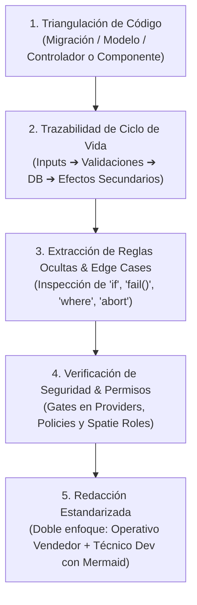
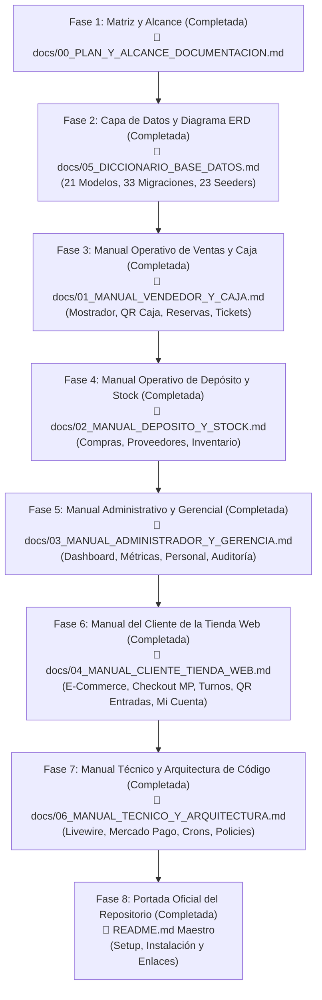

# 📋 Documento de Trabajo Interno: Plan, Alcance y Metodología de Documentación
## Sistema Sound Heritage (E-Commerce, Reservas de Salón y Triple Panel de Gestión)

[⬅️ Volver al README Principal](../README.md)

> **Nota Interna:** Este documento es una herramienta de trabajo técnico y de control interno para el agente. No forma parte de los manuales entregables a usuarios o clientes. Su propósito es garantizar la consistencia, el rigor metodológico y la cobertura del 100% de los archivos del repositorio.

---

## 🔬 0. Flujo Sistemático de Análisis de Archivos (Pipeline Interno de Consistencia)

Para asegurar una **coherencia y profundidad minuciosa** en cada uno de los manuales y evitar que se pasen por alto reglas o comportamientos del sistema, se aplicará de forma estricta el siguiente **pipeline de análisis en 5 pasos** sobre cada archivo antes de redactar su sección:



### Protocolo de Análisis Detallado por Componente (Auditoría Forense de Código):
Al principio de cada fase se realizara una lectura minuciosa de este md y se actualizara mostrando el plan de implementacion de cada fase a realizar
#### Paso 1: Triangulación de Código (Code Triangulation)
* **La regla:** *Ningún archivo se analiza de forma aislada; todo archivo tiene dependencias que deben contrastarse en simultáneo.*
* **Cómo opera técnicamente:**  
  Si se audita un componente Livewire (ej. `ReservarSalon.php`), no se lee únicamente ese archivo. Se abren en paralelo:
  1. **La Base de Datos:** Las migraciones de `reservations`, `venues` y `customers` en `database/migrations/`.
  2. **El Modelo Eloquent:** `app/Models/Reservation.php` (para verificar relaciones, casts, scopes y qué campos son `$fillable`).
  3. **La Vista Blade:** `resources/views/livewire/reservar-salon.blade.php` (para analizar qué campos visualiza el usuario, qué modales existen y qué directivas de Alpine.js interactúan con el DOM).
* **Por qué evita omisiones:** Si un campo existe en la base de datos (por ejemplo, `notes` o `mercadopago_preference_id`) pero no se percibe a simple vista en el componente, la triangulación lo detecta de inmediato. Es imposible que un dato o columna quede huérfano o indocumentado.

#### Paso 2: Trazabilidad de Ciclo de Vida (Lifecycle Trace & Side Effects)
* **La regla:** *Rastrear los datos desde que nacen hasta que mueren, identificando cada efecto colateral.*
* **Cómo opera técnicamente:** Se rastrea el código en 4 estaciones cronológicas:
  1. **Inicialización (`mount` / estado inicial):** Con qué variables arranca la pantalla (ej. fecha por defecto calculada a 7 días en el futuro `now()->addDays(7)`, y precarga de datos del cliente si existe sesión activa `Auth::user()`).
  2. **Mutaciones reactivas (`updated*`):** Qué consultas se disparan en vivo mientras el usuario interactúa (ej. `updatedDate()` valida inmediatamente la disponibilidad del turno seleccionado).
  3. **Persistencia / Transacción (`DB::transaction`):** En qué orden exacto se guardan los datos en base de datos (verificación de cliente, creación de reserva, registro de seña).
  4. **Efectos Secundarios (Side Effects):** Qué sucede inmediatamente después de persistir:
     * ¿Se emite un evento Livewire (`$this->dispatch`)?
     * ¿Se dispara una llamada externa (SDK de Mercado Pago para generar el `init_point`)?
     * ¿Se encola un correo transaccional (`ReservationPendingMail` o `ReservationConfirmedMail`)?
     * ¿Se descuenta stock o se bloquea un cupo?
* **Por qué evita omisiones:** Porque no solo documenta el formulario visible, sino absolutamente todo lo que el sistema desencadena en segundo plano (pagos, correos, eventos en tiempo real).

#### Paso 3: Extracción de Reglas Ocultas y Casos de Borde (Edge Cases)
* **La regla:** *El 80% de la lógica real no está en lo que el sistema hace cuando todo va bien, sino en los `if`, validaciones duras y excepciones.*
* **Cómo opera técnicamente:** Búsqueda e inspección exhaustiva de:
  * **Cláusulas de guarda (`if ... abort / fail / return`):** Barreras que impiden continuar la operación (ej. si el DNI ingresado ya pertenece a un usuario registrado pero el cliente no inició sesión, el sistema bloquea la reserva con un mensaje específico para prevenir suplantación o fraude).
  * **Límites duros y fórmulas de negocio:** Capacidad mínima de 1 y máxima de 150 asistentes; cobro del 30% obligatorio para seña; fechas posteriores a hoy.
  * **Comandos en segundo plano (Cron Jobs):** Análisis de comandos como `app/Console/Commands/CancelExpiredQrOrders.php` para documentar exactamente el tiempo de espera antes de cancelar un pedido impago y cómo se restituye el stock al inventario.
* **Por qué evita omisiones:** Porque convierte las "reglas invisibles" que solo conoce quien programó el código en especificaciones explícitas. Si un vendedor o cliente se pregunta *"¿por qué el sistema no me deja hacer esto?"*, el manual tendrá la respuesta exacta.

#### Paso 4: Verificación de Seguridad, Permisos y Auditoría (RBAC & Audit)
* **La regla:** *No todos los usuarios ven ni pueden hacer lo mismo; documentar quién tiene permiso y qué queda registrado.*
* **Cómo opera técnicamente:** Cruce sistemático contra 3 capas de control:
  1. **Los 3 Paneles de Filament:** Inspección de `AdminPanelProvider`, `VendedorPanelProvider` y `StockPanelProvider` (ej. en `VendedorPanelProvider` está codificado que el vendedor puede crear facturas pero **NO anularlas ni editarlas**; puede ver productos pero no modificar precios).
  2. **Las 21 Policies (`app/Policies/`):** Qué métodos (`viewAny`, `create`, `update`, `delete`) están permitidos para cada rol.
  3. **Auditoría Forense (`config/audit.php`):** Documentar si esa acción queda grabada en la tabla `audits` (quién la hizo, a qué hora, desde qué IP y qué valores modificó).
* **Por qué evita omisiones:** Evita escribir manuales ingenuos que asuman que cualquier usuario puede realizar cualquier acción. Deja claro qué perfil operativo tiene la potestad de ejecutar cada proceso.

#### Paso 5: Estandarización de Salida y Generación de Diagramas (Dual Output)
* **La regla:** *El conocimiento extraído se traduce a dos formatos complementarios que no se mezclan.*
* **Cómo opera técnicamente:** Cada módulo analizado se plasma en dos formatos:
  1. **Para el Usuario / Vendedor / Almacén:** Pasos numerados en pantalla, reglas del negocio explicadas en lenguaje humano y solución rápida a errores cotidianos.
  2. **Para el Programador / Arquitecto:** Tablas técnicas con tipos de datos, llaves foráneas, modelos y **diagramas de secuencia Mermaid (`sequenceDiagram`)** representando el flujo cronológico exacto: `Usuario ➔ Livewire ➔ Validación ➔ DB ➔ Mercado Pago API ➔ Correo`.
* **Por qué evita omisiones:** Porque una vez redactado el módulo, se marca la casilla correspondiente `[x]` en el checklist maestro de este documento. Si una casilla no está marcada, el trabajo no se da por concluido.

---

## 🎯 1. Metodología de Documentación

Para garantizar que **no se omitan detalles** y que los manuales sean comprensibles tanto para el personal de negocio como para los desarrolladores, la documentación se estructurará bajo las siguientes reglas:

1. **Separación por Audiencia (Doble Enfoque):**
   * **Manuales Operativos:** Redactados en lenguaje de negocio claro, paso a paso, con capturas o flujos en pantalla, políticas de cobro, prevención de errores comunes y sin tecnicismos innecesarios (para Vendedores, Encargados de Stock y Administradores).
   * **Manuales Técnicos:** Redactados con nivel de ingeniería profunda: trazabilidad de métodos, consultas Eloquent/SQL, estados reactivos de Livewire, hooks de pasarelas de pago (Mercado Pago), eventos, cron jobs y esquemas relacionales.
2. **Docs-as-Code:** Toda la documentación se versiona dentro del repositorio en formato Markdown (`.md`), enriquecida con diagramas interactivos en formato **Mermaid.js**.
3. **Criterio de Aceptación (Verificación 100%):** Ningún componente, modelo o script quedará indocumentado. Cada ítem del checklist debe ser completado antes de dar por cerrado el proyecto.
4. **Regla Estricta de Nomenclatura de Archivos y Carpetas (Eliminación Total de Rutas del Servidor):** Queda terminantemente prohibido incluir la ruta del servidor local (`/www/wwwroot/...` o prefijos `file:///`). Se debe eliminar absolutamente todo lo que esté antes de las carpetas del proyecto (`/app`, `/database`, `/routes`, `/resources`, `/docs`, `/config`). Toda referencia a archivos se escribirá partiendo directamente desde la carpeta del proyecto en formato de código (ejemplo: `/app/Models/PaymentMethod.php`, `/app/Livewire/ReservarSalon.php`, `/docs/01_MANUAL_...md`), evitando el uso de hipervínculos markdown que los editores o navegadores expandan a rutas absolutas del equipo local.
5. **Diagramas ERD Limpios y Organizados (Cero Spaghetti):** Los diagramas Entidad-Relación deben estructurarse de forma modular por subdominios, con alineaciones directas, jerárquicas y líneas rectas, evitando terminantemente el cruce caótico de líneas para garantizar una lectura arquitectónica clara.

---

## 📚 2. Estructura de Entregables Finales

```text
/
├── README.md                                  # Portada oficial para GitHub (Pitch, Stack, Setup y Links)
└── docs/
    ├── 00_PLAN_Y_ALCANCE_DOCUMENTACION.md      # Este documento (Hoja de ruta interna y checklist de auditoría)
    ├── 01_MANUAL_VENDEDOR_Y_CAJA.md           # Guía operativa para Personal Comercial y Mostrador
    ├── 02_MANUAL_DEPOSITO_Y_STOCK.md          # Guía operativa para Almacén, Compras y Proveedores
    ├── 03_MANUAL_ADMINISTRADOR_Y_GERENCIA.md  # Guía operativa para Dueños, Finanzas y Auditoría
    ├── 04_MANUAL_CLIENTE_TIENDA_WEB.md        # Guía operativa y visual para el Comprador Web (100% Sin tecnicismos)
    ├── 05_DICCIONARIO_BASE_DATOS.md           # Diagrama ERD modular y especificación técnica de 21 tablas
    └── 06_MANUAL_TECNICO_Y_ARQUITECTURA.md    # Especificación técnica profunda para Desarrolladores y DevOps
```

---

## 📝 3. Propuestas Detalladas de Contenido Previas a Implementación

### Propuesta Fase 2: `05_DICCIONARIO_BASE_DATOS.md` (Completada ✅)
* Archivo generado y verificado: `/docs/05_DICCIONARIO_BASE_DATOS.md`.
* Contiene: 21 tablas relacionales, diagrama ERD en Mermaid, reglas reactivas en `booted()` de stock y sincronización de perfiles, foreign keys y políticas de borrado.

### Propuesta Fase 3: `docs/01_MANUAL_VENDEDOR_Y_CAJA.md` (Completada ✅)
* Archivo generado y verificado: `/docs/01_MANUAL_VENDEDOR_Y_CAJA.md`.
* Contiene: Manual 100% operativo de mostrador, cobro efectivo con cálculo de vuelto, cobro QR dinámico Caja 1 (modal `qr-caja1`), emisión de tickets térmicos 80mm, tarifario de salón, escala de descuentos grupales (10% a 25%), seña obligatoria del 30%, venta de entradas a recitales con QR y límites de seguridad del rol Vendedor.

### Propuesta Fase 4: `docs/02_MANUAL_DEPOSITO_Y_STOCK.md` (Completada ✅)
* Archivo generado y verificado: `/docs/02_MANUAL_DEPOSITO_Y_STOCK.md`.
* Contiene: Manual 100% operativo de depósito, alta y clasificación de productos en 8 familias, ficha técnica dinámica (`specs`), fijación de precios y descuentos, padrón de proveedores, compras y remitos de fábrica, actualización atómica automática de inventario (ingreso y anulación), y exportación de reportes PDF de abastecimiento.

### Propuesta Fase 5: `docs/03_MANUAL_ADMINISTRADOR_Y_GERENCIA.md` (Completada ✅)
* **Archivo generado y verificado:** `/docs/03_MANUAL_ADMINISTRADOR_Y_GERENCIA.md`.
* **Contiene:** Manual 100% operativo gerencial y directivo: acceso y navegación por los 3 grupos de menú (`/admin`), tablero central de métricas (KPIs, ventas interanuales, segmentación y ticket promedio), generación de reporte ejecutivo en PDF A4 membretado, padrón y legajos de empleados con alta automática de cuentas, administración de roles Spatie y suspensión de accesos, auditoría forense inmutable con registro de IP y comparador de diferencias, supervisión y procedimiento de anulación con reembolso automático en Mercado Pago, y convenios con auspiciantes de eventos.


1. **Capítulo 1: Acceso, Navegación y Perfil del Administrador General**
   * URL de acceso al panel maestro (`/admin`).
   * Inicio de sesión con credenciales de rol `'Administrador'`.
   * Visión panorámica de todos los módulos del sistema (Tienda, Eventos, Personal, Logística, Seguridad).

2. **Capítulo 2: Tablero de Control y Métricas Ejecutivas (Dashboard)**
   * **Indicadores Clave de Desempeño (KPIs):** Facturación total consolidada, volumen de ventas de la tienda, ingresos por alquiler de auditorio y ocupación de espectáculos.
   * **Gráficos Analíticos de Decisión:**
     * *Ventas Interanuales (`VentasInteranualesChart`):* Evolución de ingresos mes a mes comparado con el año anterior.
     * *Top Productos Más Rentables (`TopProductosIngresosChart`):* Instrumentos con mayor retorno de inversión y rotación.
   * **Exportación del Reporte Gerencial en PDF:** Generación del informe imprimible `/resources/views/reports/pdf-dashboard.blade.php` para balances directivos.

3. **Capítulo 3: Gestión de Personal y Estructura Organizacional**
   * Padrón de empleados (`EmployeeResource`): Legajos, datos de contacto, sueldos y cargos.
   * Categorías laborales (`EmployeeCategoryResource`): Escalas de puestos (Cajeros, Almaceneros, Administración).
   * Generación automática de cuentas corporativas y vinculación con usuarios del sistema.

4. **Capítulo 4: Gestión de Usuarios, Roles y Seguridad de Acceso (RBAC)**
   * Administración de cuentas (`UserResource`): Alta de operadores, reseteo seguro de claves y suspensión de accesos.
   * Asignación de Roles: Concesión de perfiles `'Administrador'`, `'Vendedor'` y `'Encargado de Stock'`.
   * Control de acceso a las puertas de enlace (`/admin`, `/vendedor`, `/stock`).

5. **Capítulo 5: Módulo de Auditoría Forense y Trazabilidad (`AuditResource`)**
   * Cómo auditar la tabla `audits` ante discrepancias contables o sospechas de fraude.
   * Inspección de eventos: quién modificó el precio de un instrumento, quién anuló una factura o canceló una reserva.
   * Registro inmutable de fecha, hora, dirección IP, usuario responsable y diferencias entre valores anteriores y nuevos.

6. **Capítulo 6: Supervisión de Facturación, Cancelaciones y Reembolsos**
   * Consulta global de facturas emitidas por caja o web.
   * Procedimiento administrativo de **Anulación y Reembolso**: Cómo autorizar la reversión de una venta con reintegro automático de dinero en Mercado Pago.
   * Gestión de Patrocinadores corporativos de eventos (`SponsorResource`).

7. **Capítulo 7: Preguntas Frecuentes y Decisiones Gerenciales**
   * *¿Cómo dar de baja a un empleado y revocarle el acceso en el acto?*
   * *¿Cómo exportar el balance mensual de ventas para el contador?*
   * *¿Cómo reasignar a un vendedor para que también pueda acceder al depósito?*

### Propuesta Fase 6: `docs/04_MANUAL_CLIENTE_TIENDA_WEB.md` (Completada ✅)
* **Archivo generado y verificado:** `/docs/04_MANUAL_CLIENTE_TIENDA_WEB.md`.
* **Contiene:** Manual 100% amigable y sin tecnicismos para el comprador online: registro tradicional y acceso en 1 clic con Google (`SocialAuth`), regla de protección de identidad por DNI, búsqueda en tiempo real (`SearchBar`), catálogo con filtros y etiquetas de descuento, ficha técnica con stock en vivo, carrito deslizante (`CartDrawer`), proceso de checkout seguro con Mercado Pago (retiro gratis en Posadas o envío a domicilio), motor de reservas de sala acústica (anticipación de 7 días, descuentos grupales en tramos de 5 hasta 25%, seña obligatoria del 30%), compra de entradas a recitales con código QR para escaneo en puerta, y portal de autogestión "Mi Cuenta" con descarga directa de facturas y pases.

### Propuesta Fase 7: `docs/06_MANUAL_TECNICO_Y_ARQUITECTURA.md` (Completada ✅)
* **Archivo generado y verificado:** `/docs/06_MANUAL_TECNICO_Y_ARQUITECTURA.md`.
* **Contiene:** Especificación técnica de ingeniería profunda: topología de Laravel 11, Livewire v3 y Triple Panel Filament v3, ciclo de vida reactivo, Optimistic UI en carrito lateral con Alpine.js, integración completa con Mercado Pago (Checkout Pro, QR Dinámico Caja 1 y reembolsos vía API), controlador de Webhooks IPN con validación HMAC-SHA256 y conciliación multi-tópico (`INV-`, `RES-`, `ATT-`), comando cron de cancelación de órdenes QR expiradas (`CancelExpiredQrOrders`), matriz de seguridad Spatie RBAC con las 21 Policies y bypass `Gate::before`, flujo OAuth 2.0 con Google, configuración de auditoría forense inmutable (`owen-it/laravel-auditing`), hooks de consistencia en modelos (`booted`), motor de reportes DomPDF (tickets 80mm, reportes A4 y pases QR), mailables con adjuntos en memoria y manual de despliegue y troubleshooting para DevOps.

### Propuesta Fase 8: `README.md` (Portada Oficial del Repositorio 🚀 - Completada ✅)
* **Archivo generado y verificado:** `/README.md`.
* **Contiene:** Portada oficial y vitrina técnica (*showcase*) para GitHub: pitch y alcance del proyecto, insignias dinámicas del stack tecnológico, demostración visual de los 4 módulos operativos (Storefront, Vendedor, Depósito y Administrador), flujo de integración dual con Mercado Pago (Checkout Pro, QR Caja 1, Webhooks IPN y reembolsos), guía detallada de instalación y puesta en marcha en 5 pasos, credenciales de prueba predeterminadas para los 3 paneles, resultados de la suite de 92 tests automatizados y matriz completa de enlaces a los 6 manuales oficiales del repositorio.


---

## 🔍 4. Inventario Exhaustivo y Checklist de Cobertura (100% Real)

A continuación se listan **todos y cada uno de los archivos del sistema** que serán inspeccionados, revisados y documentados:

### A. Capa de Datos (Modelos, Migraciones y Seeders) - [Completado 100% en docs/05_DICCIONARIO_BASE_DATOS.md]
- [x] **21 Modelos Eloquent (`app/Models/`):**
  - [x] `Attendance.php` (Asistencia y control de entradas a eventos)
  - [x] `City.php` (Ciudades de clientes y sedes)
  - [x] `Customer.php` (Clientes, DNI, datos de contacto y enlace a User)
  - [x] `Employee.php` (Personal, legajo y asignación de categoría)
  - [x] `EmployeeCategory.php` (Puestos laborales y escalas salariales)
  - [x] `Event.php` (Eventos culturales, recitales y cupos)
  - [x] `EventSponsor.php` (Relación evento-patrocinador)
  - [x] `Invoice.php` (Cabecera de facturas y ventas)
  - [x] `InvoiceDetail.php` (Líneas de factura, precios y cantidades)
  - [x] `PaymentDetail.php` (Detalles de cobro y transacciones)
  - [x] `PaymentMethod.php` (Medios de pago disponibles)
  - [x] `Product.php` (Catálogo de instrumentos/productos, precios, descuentos)
  - [x] `Province.php` (Provincias geográficas)
  - [x] `Purchase.php` (Órdenes de compra a proveedores)
  - [x] `PurchaseDetail.php` (Detalle de mercadería ingresada a depósito)
  - [x] `Reservation.php` (Reservas de salón, turnos, señas y saldos)
  - [x] `Sponsor.php` (Empresas auspiciantes)
  - [x] `Store.php` (Sucursales/Tiendas físicas)
  - [x] `Supplier.php` (Proveedores comerciales)
  - [x] `User.php` (Usuarios del sistema y roles de acceso)
  - [x] `Venue.php` (Salones y auditorios disponibles)
- [x] **Migraciones Maestras (`database/migrations/`):**
  - [x] Esquemas base de tablas relacionales
  - [x] `create_permission_tables.php` (Roles y permisos Spatie)
  - [x] `create_audits_table.php` (Registro de auditoría de cambios)
  - [x] Migraciones críticas de negocio: `add_mercadopago_fields...`, `add_payment_fields_to_reservations...`, `add_discount_percentage_to_products...`, `add_refund_and_attendance_payment_fields...`
- [x] **23 Seeders del Sistema (`database/seeders/`):**
  - [x] `DatabaseSeeder.php` (Secuencia de inicio global)
  - [x] `RoleSeeder.php` (Matriz de roles y permisos base)
  - [x] `UserSeeder.php`, `EmployeeSeeder.php`, `CustomerSeeder.php`
  - [x] `ProductSeeder.php`, `StoreSeeder.php`, `SupplierSeeder.php`
  - [x] `EventSeeder.php`, `VenueSeeder.php`, `ReservationSeeder.php`, `AttendanceSeeder.php`
  - [x] `PaymentMethodSeeder.php`, `InvoiceSeeder.php`, `PurchaseSeeder.php`
  - [x] `ProvinceSeeder.php`, `CitySeeder.php`

---

### B. Capa Frontend Público / Storefront (Laravel Livewire v3 & Blade)
- [x] **Componentes Reactivos (`app/Livewire/` y `resources/views/livewire/`):**
  - [x] `HomeTienda.php` (Página de inicio, productos destacados y eventos - en `/docs/04_MANUAL_CLIENTE_TIENDA_WEB.md`)
  - [x] `CatalogoProductos.php` (Filtros, categorías, ordenamiento y paginación - en `/docs/04_MANUAL_CLIENTE_TIENDA_WEB.md`)
  - [x] `DetalleProducto.php` (Ficha técnica, cálculo de descuentos y selector de cantidad - en `/docs/04_MANUAL_CLIENTE_TIENDA_WEB.md`)
  - [x] `CatalogoEventos.php` (Cartelera cultural y fechas disponibles - en `/docs/04_MANUAL_CLIENTE_TIENDA_WEB.md`)
  - [x] `DetalleEvento.php` (Información del evento y compra de entradas - en `/docs/04_MANUAL_CLIENTE_TIENDA_WEB.md`)
  - [x] `ReservarSalon.php` (Motor de reserva de auditorio, validación de turnos y seña 30% - en `/docs/04_MANUAL_CLIENTE_TIENDA_WEB.md`)
  - [x] `SearchBar.php` (Buscador reactivo global con comunicación de eventos - en `/docs/04_MANUAL_CLIENTE_TIENDA_WEB.md`)
  - [x] `CartDrawer.php` (Carrito lateral deslizable y cálculo de subtotal - en `/docs/04_MANUAL_CLIENTE_TIENDA_WEB.md`)
  - [x] `CheckoutTienda.php` (Formulario de entrega, datos de facturación y pasarela - en `/docs/04_MANUAL_CLIENTE_TIENDA_WEB.md`)
  - [x] `MiCuenta.php` (Portal de autogestión de compras, tickets y reservas del cliente - en `/docs/04_MANUAL_CLIENTE_TIENDA_WEB.md`)
  - [x] `Concerns/HasCartActions.php` (Lógica transversal de persistencia de carrito - en `/docs/04_MANUAL_CLIENTE_TIENDA_WEB.md`)
- [x] **Layouts y Vistas Transversales (`resources/views/`):**
  - [x] `layouts/app.blade.php`, `layouts/guest.blade.php` (Layouts principales de tienda y checkout)
  - [x] `components/storefront-navbar.blade.php`, `components/storefront-footer.blade.php` (Navegación pública de tienda)
  - [x] Vistas de autenticación (`resources/views/auth/*.blade.php`) (Login con Google, registro y recuperación)

---

### C. Paneles de Operación y Administración (Filament v3)
- [x] **Configuración de los 3 Paneles (`/app/Providers/Filament/`):**
  - [x] `AdminPanelProvider.php` (Panel de Administración General - ruta `/admin`, documentado en `/docs/03_MANUAL_ADMINISTRADOR_Y_GERENCIA.md`)
  - [x] `VendedorPanelProvider.php` (Panel de Ventas y Mostrador - ruta `/vendedor`, documentado en `/docs/01_MANUAL_VENDEDOR_Y_CAJA.md`)
  - [x] `StockPanelProvider.php` (Panel de Depósito y Compras - ruta `/stock`, documentado en `/docs/02_MANUAL_DEPOSITO_Y_STOCK.md`)
- [x] **Recursos Administrativos (`/app/Filament/Admin/Resources/`):**
  - [x] `ReservationResource.php` (Listado, creación, edición y confirmación de reservas - en `/docs/01_MANUAL_VENDEDOR_Y_CAJA.md`)
  - [x] `ProductResource.php` (Gestión de catálogo, precios y descuentos - en `/docs/02_MANUAL_DEPOSITO_Y_STOCK.md`)
  - [x] `CustomerResource.php` (Gestión de clientes, historial y segmentación - en `/docs/01_MANUAL_VENDEDOR_Y_CAJA.md` y `/docs/03_MANUAL_ADMINISTRADOR_Y_GERENCIA.md`)
  - [x] `InvoiceResource.php` (Control de ventas, tickets, facturación y reembolsos - en `/docs/01_MANUAL_VENDEDOR_Y_CAJA.md` y `/docs/03_MANUAL_ADMINISTRADOR_Y_GERENCIA.md`)
  - [x] `PurchaseResource.php` (Carga de compras a proveedores y reposición - en `/docs/02_MANUAL_DEPOSITO_Y_STOCK.md`)
  - [x] `SupplierResource.php` (Padrón de proveedores - en `/docs/02_MANUAL_DEPOSITO_Y_STOCK.md`)
  - [x] `EventResource.php` y `AttendanceResource.php` (Agenda cultural y control de entradas - en `/docs/01_MANUAL_VENDEDOR_Y_CAJA.md`)
  - [x] `EmployeeResource.php` y `UserResource.php` (Equipo de trabajo, legajos y roles de acceso Spatie - en `/docs/03_MANUAL_ADMINISTRADOR_Y_GERENCIA.md`)
  - [x] `SponsorResource.php` (Gestión de auspiciantes de eventos - en `/docs/03_MANUAL_ADMINISTRADOR_Y_GERENCIA.md`)
  - [x] `AuditResource.php` (Inspección de logs de auditoría forense inmutable - en `/docs/03_MANUAL_ADMINISTRADOR_Y_GERENCIA.md`)
- [x] **Dashboard y Widgets:**
  - [x] `Dashboard.php` (Página principal del panel y exportación PDF - en `/docs/03_MANUAL_ADMINISTRADOR_Y_GERENCIA.md`)
  - [x] `TiendaDashboardWidgets.php` (`TiendaStatsOverview`, `AlertasTiendaTable`, `VentasInteranualesChart`, `TopProductosIngresosChart`, `SegmentacionClientesChart`, `DistribucionMontoFacturasChart` - en `/docs/01_MANUAL_VENDEDOR_Y_CAJA.md` y `/docs/03_MANUAL_ADMINISTRADOR_Y_GERENCIA.md`)
- [x] **Modales Operativos Especiales:**
  - [x] `/resources/views/filament/modals/qr-caja1.blade.php` (Modal de cobro presencial con QR de Mercado Pago - en `/docs/01_MANUAL_VENDEDOR_Y_CAJA.md`)

---

### D. Capa Backend, Servicios, Tareas en Segundo Plano y APIs
- [x] **Servicios e Integraciones Externas:**
  - [x] `app/Services/MercadoPagoService.php` (Generación de preferencias, credenciales, QR y conexión API - en `/docs/06_MANUAL_TECNICO_Y_ARQUITECTURA.md`)
  - [x] `app/Http/Controllers/MercadoPagoWebhookController.php` (Recepción de webhooks IPN, conciliación y acreditación - en `/docs/06_MANUAL_TECNICO_Y_ARQUITECTURA.md`)
  - [x] `app/Http/Controllers/Auth/SocialAuthController.php` (Flujo OAuth Google para clientes y sincronización de perfil - en `/docs/06_MANUAL_TECNICO_Y_ARQUITECTURA.md`)
- [x] **Automatizaciones y Tareas Programadas (Console / Crons):**
  - [x] `app/Console/Commands/CancelExpiredQrOrders.php` (Liberación automática de órdenes y stock impagos - en `/docs/06_MANUAL_TECNICO_Y_ARQUITECTURA.md`)
  - [x] `routes/console.php` (Definición del cron scheduler de Laravel - en `/docs/06_MANUAL_TECNICO_Y_ARQUITECTURA.md`)
- [x] **Validación y Formularios (Form Requests):**
  - [x] `app/Http/Requests/*.php` (Reglas de validación para reservas, compras, clientes y eventos - en `/docs/06_MANUAL_TECNICO_Y_ARQUITECTURA.md`)
- [x] **Enrutamiento del Sistema:**
  - [x] `routes/web.php` (Rutas públicas, callbacks de pago y pasarela - en `/docs/06_MANUAL_TECNICO_Y_ARQUITECTURA.md`)
  - [x] `routes/api.php` (Endpoints API y webhooks - en `/docs/06_MANUAL_TECNICO_Y_ARQUITECTURA.md`)
  - [x] `routes/auth.php` (Rutas de login, registro y recuperación - en `/docs/06_MANUAL_TECNICO_Y_ARQUITECTURA.md`)

---

### E. Seguridad, Políticas y Auditoría
- [x] **21 Políticas de Acceso (`app/Policies/`):**
  - [x] `AttendancePolicy.php`, `CityPolicy.php`, `CustomerPolicy.php`, `EmployeeCategoryPolicy.php`, `EmployeePolicy.php`, `EventPolicy.php`, `EventSponsorPolicy.php`, `InvoiceDetailPolicy.php`, `InvoicePolicy.php`, `PaymentDetailPolicy.php`, `PaymentMethodPolicy.php`, `ProductPolicy.php`, `ProvincePolicy.php`, `PurchaseDetailPolicy.php`, `PurchasePolicy.php`, `ReservationPolicy.php`, `SponsorPolicy.php`, `StorePolicy.php`, `SupplierPolicy.php`, `UserPolicy.php`, `VenuePolicy.php` (en `/docs/06_MANUAL_TECNICO_Y_ARQUITECTURA.md`)
- [x] **Infraestructura de Permisos y Auditoría:**
  - [x] `bootstrap/app.php` (Registro de middlewares de Spatie `role`, `permission` - en `/docs/06_MANUAL_TECNICO_Y_ARQUITECTURA.md`)
  - [x] `config/permission.php` y `config/audit.php` (Auditoría de cambios por usuario - en `/docs/06_MANUAL_TECNICO_Y_ARQUITECTURA.md`)

---

### F. Comprobantes, Reportes PDF y Correos Transaccionales
- [x] **Motor de Reportes PDF (`/resources/views/reports/`):**
  - [x] `invoice-ticket-pdf.blade.php` (Ticket/Factura fiscal descargable e imprimible - en `/docs/01_MANUAL_VENDEDOR_Y_CAJA.md`)
  - [x] `event-ticket-pdf.blade.php` (Entrada digital con código QR para escaneo - en `/docs/01_MANUAL_VENDEDOR_Y_CAJA.md`)
  - [x] `pdf-dashboard.blade.php` (Reporte ejecutivo consolidado de métricas - en `/docs/03_MANUAL_ADMINISTRADOR_Y_GERENCIA.md`)
- [x] **Mails Transaccionales (`/app/Mail/` y `/resources/views/emails/`):**
  - [x] `PurchaseConfirmationMail.php` (Confirmación de compra en tienda online - en `/docs/04_MANUAL_CLIENTE_TIENDA_WEB.md`)
  - [x] `ReservationConfirmedMail.php` (Comprobante de reserva confirmada de salón - en `/docs/01_MANUAL_VENDEDOR_Y_CAJA.md`)
  - [x] `ReservationPendingMail.php` (Aviso de reserva registrada pendiente de seña - en `/docs/06_MANUAL_TECNICO_Y_ARQUITECTURA.md`)
  - [x] `EventTicketsMail.php` (Envío de entradas adjuntas tras compra de evento - en `/docs/01_MANUAL_VENDEDOR_Y_CAJA.md`)
  - [x] `WelcomeUserMail.php` (Email de bienvenida al crear cuenta - en `/docs/04_MANUAL_CLIENTE_TIENDA_WEB.md`)

---

## 🚀 5. Cronograma de Implementación (Fase por Fase)



---

## 📌 6. Estado Actual del Plan
* **Fase 1 (Metodología y Alcance):** Completada ✅. Preservado como documento de trabajo interno en `/docs/00_PLAN_Y_ALCANCE_DOCUMENTACION.md`.
* **Fase 2 (Diccionario de Datos y ERD):** Completada ✅. Archivo generado en `/docs/05_DICCIONARIO_BASE_DATOS.md`.
* **Fase 3 (Manual de Vendedor y Caja):** Completada ✅. Archivo generado en `/docs/01_MANUAL_VENDEDOR_Y_CAJA.md`.
* **Fase 4 (Manual de Depósito y Stock):** Completada ✅. Archivo generado en `/docs/02_MANUAL_DEPOSITO_Y_STOCK.md`.
* **Fase 5 (Manual Administrativo y Gerencial):** Completada ✅. Archivo generado en `/docs/03_MANUAL_ADMINISTRADOR_Y_GERENCIA.md`.
* **Fase 6 (Manual del Cliente de la Tienda Web):** Completada ✅. Archivo generado en `/docs/04_MANUAL_CLIENTE_TIENDA_WEB.md`.
* **Fase 7 (Manual Técnico y Arquitectura de Código):** Completada ✅. Archivo generado en `/docs/06_MANUAL_TECNICO_Y_ARQUITECTURA.md`.
* **Fase 8 (Portada Oficial del Repositorio):** Completada ✅. Archivo generado en `/README.md`.

> **🏁 ESTADO FINAL:** **100% de la Documentación Completada y Auditada con Éxito.** Todos los archivos, modelos, políticas, crons, pasarelas de pago y vistas del repositorio se encuentran formalmente cubiertos y referenciados.
