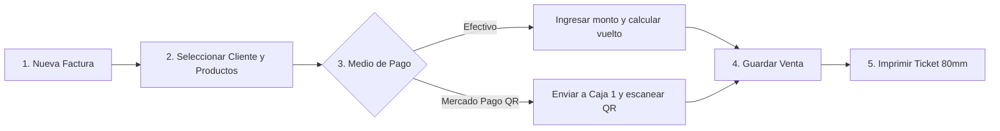
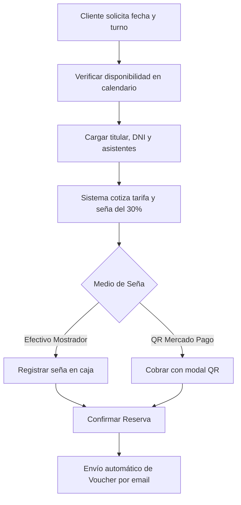
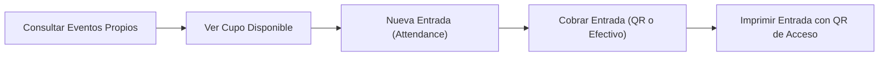

# 🏪 Manual Operativo de Ventas, Mostrador y Caja
## Sistema Sound Heritage (Panel Comercial `/vendedor`)

[⬅️ Volver al README Principal](../README.md)

> **Destinatarios:** Personal de atención al público, cajeros de punto de venta, recepcionistas de salón y vendedores de mostrador.  
> **Propósito:** Esta guía práctica explica paso a paso cómo operar el sistema comercial de Sound Heritage: realizar cobros en mostrador (efectivo y código QR), gestionar reservas de auditorio, vender entradas para recitales y emitir tickets fiscales en formato térmico.

---

## 🧭 1. Acceso, Navegación y Perfil del Vendedor

### 1.1 Ingreso al Sistema
1. Abrir el navegador web e ingresar a la dirección del panel comercial:  
   `https://tu-dominio.com/vendedor`
2. Introducir el correo electrónico corporativo asignado y la contraseña personal.
3. Al ingresar, el sistema identificará automáticamente el rol de **Vendedor** y presentará el panel comercial adaptado a las tareas de mostrador.

### 1.2 Menú y Organización de Pantallas
El panel se organiza en dos grupos principales en la barra lateral izquierda:

* **Grupo Tienda:**
  * **Facturas / Ventas:** Punto de venta para cobrar instrumentos, accesorios y servicios.
  * **Clientes:** Padrón de clientes para búsqueda y alta en mostrador.
  * **Productos:** Catálogo de consulta de instrumentos, precios y stock disponible (modo solo lectura).
* **Grupo Eventos y Sala:**
  * **Reservas de Sala:** Agenda de alquiler del auditorio para ensayos, recitales o grabaciones.
  * **Eventos Propios:** Cartelera de recitales y masterclasses organizadas por el local.
  * **Inscripciones a Eventos:** Emisión y control de entradas para espectáculos.

### 1.3 Pantalla Inicial (Dashboard del Vendedor)
Al iniciar sesión, la pantalla principal muestra dos tarjetas informativas clave:
1. **Resumen de Ventas del Día (`TiendaStatsOverview`):** Total facturado acumulado en la jornada y cantidad de operaciones concretadas.
2. **Alertas de Stock Bajo (`AlertasTiendaTable`):** Listado de instrumentos con menos de 3 unidades en depósito para advertir al cliente sobre disponibilidad limitada.

---

## 🛡️ 2. Límites de Seguridad y Permisos del Vendedor

Por normas contables, fiscales y de seguridad del local, el perfil de Vendedor tiene habilitadas las tareas de atención y cobro, pero cuenta con restricciones automáticas:

| Acción Operativa | ¿Permitido al Vendedor? | Motivo de Seguridad |
| :--- | :---: | :--- |
| **Emitir nuevas facturas y tickets** | ✅ Sí | Operación estándar de mostrador. |
| **Cobrar con Código QR dinámico** | ✅ Sí | Integración directa con la Caja 1 de Mercado Pago. |
| **Cobrar en efectivo y calcular vuelto** | ✅ Sí | Cobro tradicional en caja física. |
| **Consultar precios y stock** | ✅ Sí | Información necesaria para asesorar al cliente. |
| **Cargar reservas de salón y señas** | ✅ Sí | Atención telefónica y presencial de músicos. |
| **Vender entradas para recitales** | ✅ Sí | Boletería del auditorio. |
| **Dar de alta nuevos clientes** | ✅ Sí | Registro ágil durante la fila de pago. |
| **Modificar precios o descuentos** | ❌ No | Los precios y promociones están fijados por Administración. |
| **Anular facturas ya emitidas** | ❌ No | Evita desfasajes de caja; requiere clave de Administrador. |
| **Eliminar clientes o reservas** | ❌ No | Preserva el historial fiscal y la trazabilidad de auditoría. |
| **Cargar compras a proveedores** | ❌ No | Tarea exclusiva del encargado de depósito (`/stock`). |

---

## 💵 3. Punto de Venta (POS) y Facturación en Mostrador

### 3.1 Cargar una Venta Paso a Paso
1. En el menú lateral, ingresar a **Tienda** $\rightarrow$ **Facturas / Ventas**.
2. Presionar el botón superior derecho **`[Nueva Venta / Factura]`**.
3. **Paso 1: Identificación del Cliente:**
   * En el campo *Cliente*, buscar por DNI o apellido.
   * Si el cliente no desea comprobante nominal o es una compra rápida, seleccionar **Consumidor Final**.
4. **Paso 2: Carga de Instrumentos o Accesorios:**
   * En la sección *Detalle de Productos*, presionar **`+ Agregar producto`**.
   * Seleccionar el instrumento del listado desplegable. El sistema mostrará automáticamente el stock actual y el precio unitario.
   * Indicar la **Cantidad**. El subtotal se recalculará en pantalla de forma instantánea.
   * Si el cliente compra más artículos, presionar nuevamente *+ Agregar producto*.

---

### 3.2 Modalidad de Cobro A: Efectivo Tradicional
1. En la sección *Medio de Pago*, verificar que esté seleccionado **Efectivo**.
2. Aparecerá el campo **`Efectivo Recibido / Con cuánto abona`**.
3. Escribir el monto que entrega el cliente (ejemplo: si el total es `$ 42.000` y entrega `$ 50.000`, tipear `50000`).
4. El sistema mostrará una leyenda visual inmediata:
   > 💵 **Cambio / Vuelto a entregar al cliente: \$ 8.000,00**
5. Si el dinero entregado no alcanza, el sistema alertará:
   > ⚠️ **Faltan \$ X para cubrir el total.**
6. Presionar **`[Crear Venta]`** para asentar la operación y descontar el stock.

---

### 3.3 Modalidad de Cobro B: Mercado Pago QR Dinámico (Caja 1)
Este procedimiento envía el importe exacto al cartel QR de la caja para que el cliente lo pague desde su teléfono:

1. En la sección *Medio de Pago*, seleccionar **Mercado Pago QR**.
2. Presionar el botón **`[Crear Venta]`**. La venta quedará guardada en estado **`pending` (Pendiente de pago)**.
3. En el listado de facturas, presionar el botón amarillo **`[Cobrar QR]`** sobre esa fila.
4. El sistema confirmará el envío:
   > *Se emitirá una orden de pago por \$ X a la Caja 1.*
5. Presionar **`[Enviar a Caja 1]`**.
6. Abrir la ventana de cobro presionando el botón **`[Cartel QR]`**:
   * Se abrirá el modal de cobro `/resources/views/filament/modals/qr-caja1.blade.php`.
   * El cartel mostrará el código QR oficial de la Caja 1 y el importe exacto en color ámbar.
   * Indicarle al cliente: *"Por favor, escaneá el cartel QR con tu app de Mercado Pago o aplicación de tu banco"*.
7. **Confirmación Automática sin Recargar:**
   * El sistema verifica el cobro en segundo plano cada 2 segundos.
   * Apenas el cliente abona en su teléfono, la ventana cambia automáticamente a **color verde brillante** con un tilde:
     > **¡Pago Acreditado Exitosamente!**  
     > *ID Pago MP: 1234567890*
8. Presionar **`[Cerrar Ventana]`**. La venta ya quedó pagada y completada.

---

### 3.4 Impresión del Ticket Fiscal Térmico
1. En la fila de la factura cobrada, hacer clic en el menú de acciones y seleccionar **`[Imprimir Ticket Fiscal (PDF)]`**.
2. Se descargará automáticamente el comprobante renderizado desde `/resources/views/reports/invoice-ticket-pdf.blade.php`.
3. El formato está diseñado para impresoras térmicas de rollo continuo de **80 mm**:
   * Encabezado con datos del local: CUIT, Razón Social, Condición Fiscal y Sucursal.
   * Número legal de comprobante: ej. `FC B 0001-00000124`.
   * Detalle de instrumentos, cantidades, precios unitarios y subtotal.
   * Medio de pago utilizado y código de autorización de Mercado Pago (si fue con QR).
   * Leyenda legal de garantía de 6 meses para instrumentos.
4. Enviar a imprimir directamente en la impresora térmica del mostrador.

---

## 📅 4. Gestión de Reservas del Salón y Auditorio

### 4.1 Tarifario Oficial del Auditorio
Las tarifas vigentes son calculadas automáticamente según el uso de la sala:

| Finalidad de la Reserva | Tarifa Base Oficial | Descripción del Servicio Incluido |
| :--- | :---: | :--- |
| **Ensayo de Banda** | **\$ 35.000** | Uso de sala acústica, batería base y amplificadores. |
| **Ensayo General** | **\$ 50.000** | Puesta a punto con consola digital y microfonía completa. |
| **Masterclass Externa** | **\$ 60.000** | Auditorio en formato platea, pantalla y sonido para orador. |
| **Grabación Acústica** | **\$ 70.000** | Sala aislada para tomas de audio multipista. |
| **Lanzamiento de Videoclip** | **\$ 85.000** | Iluminación escénica, tarima y pruebas de sonido. |
| **Evento Privado** | **\$ 110.000** | Capacidad completa del auditorio con operador de sonido. |

### 4.2 Descuentos Grupales Automáticos
Al ingresar la cantidad de personas que asistirán, el sistema aplica automáticamente una bonificación sobre el precio base:
* **De 5 a 9 asistentes:** **10% de descuento**
* **De 10 a 14 asistentes:** **15% de descuento**
* **De 15 a 19 asistentes:** **20% de descuento**
* **De 20 a 150 asistentes:** **25% de descuento**

---

### 4.3 Política de Cobro de Seña del 30%
* Para reservar una fecha y turno se exige un **adelanto obligatorio del 30%** del total presupuestado.
* El sistema calcula la seña automáticamente: `deposit_amount = total * 0.30`.
* **Turnos disponibles:**
  * **Turno Tarde:** 15:00 a 19:00 hs.
  * **Turno Noche:** 20:00 a 00:00 hs.
* **Anticipación mínima:** El sistema no permite agendar reservas con menos de **7 días de anticipación** respecto a la fecha actual para garantizar la preparación técnica del salón.

---

### 4.4 Carga Presencial de una Reserva
1. En el menú lateral, ingresar a **Eventos y Sala** $\rightarrow$ **Reservas de Sala**.
2. Presionar **`[Nueva Reserva de Sala]`**.
3. **Paso 1: Salón y Fecha:**
   * Seleccionar el salón (por defecto *Auditorio Principal*).
   * Indicar la fecha del evento. Si la fecha está ocupada en ese turno por otra banda o por un recital propio, el formulario lo bloqueará de inmediato con una alerta roja.
   * Seleccionar el turno (*Tarde* o *Noche*).
4. **Paso 2: Tipo de Uso y Asistentes:**
   * Elegir el motivo (ej. *Ensayo de Banda*).
   * Colocar la cantidad de asistentes (mínimo 1, máximo 150).
   * El sistema calculará el precio final bonificado y el monto exacto de la seña del 30%.
5. **Paso 3: Titular Responsable:**
   * Seleccionar o buscar al cliente por DNI.
   * Indicar el teléfono de contacto para el aviso previo.
6. **Paso 4: Cobro de la Seña:**
   * Si el cliente paga en mostrador con billetes, marcar *Efectivo* y estado **Señada en Mostrador**.
   * Si prefiere abonar la seña por QR, seleccionar *Mercado Pago* y usar la acción de cobro QR.
7. **Paso 5: Confirmación:**
   * Al recibir la seña, cambiar el estado general a **Confirmada**.
   * El sistema despachará automáticamente el correo electrónico `/app/Mail/ReservationConfirmedMail.php` al cliente con su número de reserva y comprobante.

---

## 🎟️ 5. Venta de Entradas y Cartelera Cultural

### 5.1 Vender Entradas en Boletería
1. En el menú, ingresar a **Eventos y Sala** $\rightarrow$ **Inscripciones a Eventos**.
2. Presionar **`[Nueva Entrada]`**.
3. Seleccionar el evento musical o recital que solicita el cliente.
4. El sistema mostrará la fecha, hora y el precio por pase.
5. Indicar la cantidad de entradas (`quantity`).
6. Asignar el cliente (o cargar datos básicos si no está registrado).
7. Seleccionar el medio de cobro (Efectivo o Mercado Pago QR) y guardar.

### 5.2 Emisión del Ticket Digital de Acceso
1. En la fila de la entrada emitida, presionar **`[Imprimir Entrada]`**.
2. Se generará el PDF renderizado desde `/resources/views/reports/event-ticket-pdf.blade.php`:
   * Ticket térmico para control de puerta.
   * **Código QR único troquelado:** Identificador para escaneo en el ingreso.
   * Título del show, salón asignado, fecha, hora de apertura y cantidad de pases.
3. Entregar el ticket al comprador.

---

## 👥 6. Padrón y Alta Rápida de Clientes

Para agilizar la atención en mostrador cuando se forma fila en caja:

1. Ingresar a **Tienda** $\rightarrow$ **Clientes**.
2. Presionar **`[Nuevo Cliente]`**.
3. **Campos estrictamente obligatorios para evitar errores:**
   * **DNI / Documento:** Debe contener exclusivamente entre **7 y 11 números** (sin puntos, comas ni letras).
   * **Nombre y Apellido:** Datos reales del titular.
   * **Teléfono:** Obligatorio para contacto por reservas o reclamos de garantía.
   * **Ciudad:** Seleccionar la localidad en el desplegable.
   * **Correo electrónico:** Si el cliente proporciona email, el sistema le creará automáticamente una cuenta web para que pueda consultar sus facturas y vouchers desde la tienda online.
4. Presionar **`[Guardar Cliente]`**. Ya queda disponible para facturarle en el momento.

---

## ❓ 7. Preguntas Frecuentes y Solución de Problemas en Caja

### ¿Por qué el sistema no me deja tomar una reserva para dentro de 3 días?
* **Motivo:** El auditorio exige una preparación acústica y técnica previa. Las reglas del sistema bloquean cualquier fecha con menos de **7 días de anticipación**.
* **Solución:** Ofrecerle al cliente la fecha más cercana disponible a partir del séptimo día en adelante.

### ¿Qué hago si el cliente pagó por QR pero el modal no se puso verde?
1. Verificar que el teléfono del cliente muestre el tilde verde de Mercado Pago con el mensaje *"¡Listo! Le pagaste a Sound Heritage"*.
2. Si el cliente tiene el comprobante en su app pero la pantalla sigue en ámbar:
   * Esperar 5 a 10 segundos adicionales (puede haber una mínima demora en la red móvil del cliente).
   * Si persiste, presionar el botón de recarga del listado de facturas. Si el pago ingresó, el estado cambiará a **completed**.
   * Si no impactó por un corte de internet, anotar el **Número de Operación de Mercado Pago** que figura en el celular del cliente en las notas de la factura para que Administración lo concilie manualmente.

### ¿Cómo reimprimir un ticket si se trabó el papel de la impresora térmica?
1. Destrabar el rollo de papel en la impresora de 80mm.
2. En el panel comercial, ingresar a **Tienda** $\rightarrow$ **Facturas / Ventas**.
3. Buscar la factura por el número de comprobante o por el apellido del cliente.
4. Presionar los tres puntos de acción $\rightarrow$ **`[Imprimir Ticket Fiscal (PDF)]`** para enviar una nueva copia a la impresora.

### ¿Puede un vendedor devolver dinero o anular una factura mal cobrada?
* **Respuesta:** No. Por política de seguridad, los vendedores **no tienen botón de anulación**.
* **Procedimiento:** Avisar de inmediato al Administrador o encargado de turno. El Administrador accederá con su clave gerencial y presionará **`[Anular y Devolver Dinero]`**, lo cual reintegrará automáticamente el stock al depósito y ordenará el reembolso del dinero si se cobró por Mercado Pago.

