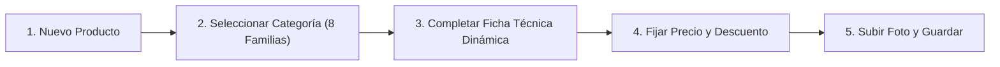
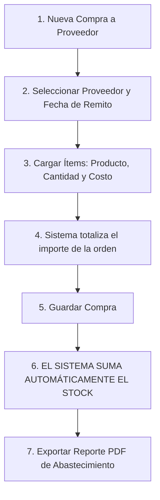

# 📦 Manual Operativo de Depósito, Stock y Proveedores
## Sistema Sound Heritage (Panel de Inventario `/stock`)

[⬅️ Volver al README Principal](../README.md)

> **Destinatarios:** Encargados de depósito, personal de almacén, responsables de compras y control de inventario.  
> **Propósito:** Esta guía práctica explica paso a paso cómo gestionar el catálogo de instrumentos musicales, registrar órdenes de compra a proveedores, controlar el ingreso físico de mercadería y auditar las existencias en depósito sin necesidad de conocimientos técnicos de programación.

---

## 🧭 1. Acceso y Navegación en el Panel de Depósito

### 1.1 Ingreso al Sistema
1. Abrir el navegador e ingresar a la URL exclusiva del área de logística e inventario:  
   `https://tu-dominio.com/stock`
2. Introducir el correo electrónico corporativo y contraseña del usuario con rol **`Encargado de Stock`** o **`Administrador`**.
3. El sistema cargará el entorno **Sound Heritage - Stock**, diseñado exclusivamente para la gestión de productos, compras y proveedores.

### 1.2 Estructura del Menú
El panel expone únicamente los recursos de abastecimiento y catálogo:

* **Productos / Catálogo:** Alta de nuevos instrumentos, actualización de fichas técnicas, control de existencias y precios.
* **Compras a Proveedores:** Registro de órdenes de compra, remitos de fábrica y abastecimiento con actualización automática de stock.
* **Proveedores:** Directorio y padrón de distribuidores oficiales de instrumentos y equipamiento musical.

---

## 🛡️ 2. Límites Operativos y Permisos del Encargado de Stock

Para mantener la coherencia contable y proteger los márgenes comerciales, el panel de depósito opera bajo las siguientes reglas de acceso:

| Acción Operativa | ¿Permitido en `/stock`? | Criterio de Control |
| :--- | :---: | :--- |
| **Dar de alta nuevos productos** | ✅ Sí | Incorporación de nuevos modelos al catálogo. |
| **Actualizar especificaciones y fotos** | ✅ Sí | Enriquecimiento de la ficha técnica web. |
| **Registrar compras a proveedores** | ✅ Sí | Carga de mercadería ingresada al depósito. |
| **Consultar existencias en tiempo real** | ✅ Sí | Monitoreo del inventario físico. |
| **Generar reportes PDF de compras** | ✅ Sí | Auditoría de adquisiciones y abastecimiento. |
| **Consultar padrón de proveedores** | ✅ Sí | Acceso a contactos, teléfonos y CUIT de distribuidores. |
| **Crear o editar proveedores** | 🔒 Solo Admin | Exige autorización gerencial en `/admin`. |
| **Emitir facturas o cobrar ventas** | ❌ No | Tarea exclusiva del personal de mostrador en `/vendedor`. |
| **Modificar precios de venta al público** | ⚠️ Supervisado | Se coordina con la gerencia comercial. |

---

## 🎸 3. Catálogo de Instrumentos y Gestión de Productos

### 3.1 Alta de un Producto Paso a Paso
1. En el menú, ingresar a **Productos / Catálogo**.
2. Presionar el botón superior **`[Nuevo Producto]`**.
3. **Paso 1: Identificación Principal:**
   * **Nombre Comercial:** Denominación clara del artículo (ej. *Fender American Professional II Stratocaster*).
   * **Marca:** Fabricante oficial (*Fender*, *Gibson*, *Yamaha*, *Roland*, *Shure*).
   * **Modelo:** Código o denominación de fábrica (*Stratocaster HSS*, *Stage 3 88*).
4. **Paso 2: Categoría / Familia de Producto (`type`):**
   * El sistema clasifica el catálogo en 8 familias oficiales:
     1. **Instrumentos de Cuerda:** Guitarras eléctricas, acústicas, bajos, ukeleles y violines.
     2. **Teclados y Sintetizadores:** Pianos digitales, sintetizadores analógicos, controladores MIDI.
     3. **Percusión:** Baterías acústicas, electrónicas, redoblantes y platillos.
     4. **Instrumentos de Viento:** Saxofones, trompetas, flautas y armónicas.
     5. **Equipos de Amplificación y Altavoces:** Cabezales, cajas 4x12, amplificadores valvulares y monitores.
     6. **Procesadores de Señal, Mezcladoras e Interfaces:** Placas de audio, consolas digitales y pedaleras multiefecto.
     7. **Micrófonos:** Dinámicos, de condensador y micrófonos inalámbricos de escenario.
     8. **Accesorios Generales:** Cables, correas, fundas rígidas, afinadores y cuerdas.

---

### 3.2 Ficha Técnica Dinámica (`specs`)
Al seleccionar la categoría, el formulario despliega de forma inteligente los campos técnicos específicos de esa familia para que el cliente web reciba información precisa:

* **Para Instrumentos de Cuerda:**
  * *Tipo de Cuerda:* Nailon, Acero, Níquel, Bronce o Entorchado plano.
  * *Cantidad de Cuerdas:* 4, 5, 6, 7 u 8 cuerdas.
  * *Configuración de Pastillas / Micrófonos:* SSS, HSS, HH, Pastilla Piezoeléctrica, etc.
  * *Maderas:* Mástil (Arce/Caoba), Diapasón (Palisandro/Ébano), Cuerpo (Aliso/Fresno).
* **Para Teclados y Pianos:**
  * *Tipo de Teclas:* Acción de martillo graduada (Hammer Action), semicontrapesadas o teclas sintetizador.
  * *Polifonía Máxima y Entradas:* USB MIDI, pedales de sustain y salidas balanceadas.
* **Para Amplificadores y Audio:**
  * *Potencia Real:* Vatios RMS (ej. 50W, 100W).
  * *Tecnología:* Valvular, Transistores o Digital / Modelado.

---

### 3.3 Precios, Descuentos e Imágenes
1. **Precio Base de Lista (`price`):**
   * Ingresar el precio en Pesos Argentinos (ARS) sin símbolos ni puntos de miles (ej. `1850000.00`).
2. **Porcentaje de Descuento Promocional (`discount_percentage`):**
   * Si el producto participa de una promoción especial, tipear el porcentaje (ej. `15` para 15% OFF).
   * El sistema recalculará automáticamente el precio promocional en la web. Si no tiene descuento, dejar el campo vacío.
3. **Fotografía del Instrumento:**
   * Subir una imagen con fondo blanco o neutro en formato JPG, PNG o WebP.
   * Se recomienda una resolución mínima de 800x800 píxeles.
4. Presionar **`[Crear Producto]`**. El artículo quedará incorporado al catálogo.

---

## 🏭 4. Directorio y Padrón de Proveedores

1. En el menú, ingresar a **Proveedores**.
2. El listado expone los distribuidores mayoristas homologados por la empresa:
   * **Razón Social:** Nombre comercial o fiscal de la distribuidora.
   * **Contacto Directo:** Nombre y apellido del ejecutivo de ventas asignado.
   * **Teléfono y Correo Electrónico:** Vías de comunicación para solicitud de listas de precios y reclamos.
   * **Dirección del Depósito:** Ubicación física para coordinación de fletes y logística.
3. **Consulta de Historial:** Al hacer clic sobre cualquier proveedor, se pueden auditar todas las compras históricas realizadas a esa firma y el volumen total de inversión acumulado.

---

## 🛒 5. Compras a Proveedores y Abastecimiento de Depósito

### 5.1 Cargar una Orden de Compra Paso a Paso
1. En el menú, ingresar a **Compras a Proveedores**.
2. Presionar el botón superior **`[Nueva Compra a Proveedor]`**.
3. **Datos de Cabecera:**
   * **Proveedor / Distribuidor:** Seleccionar la firma que emite la mercadería (ej. *Yamaha Music Latin America*, *Fender Distribuidora Oficial*).
   * **Fecha de Compra:** Fecha de recepción efectiva del pedido o fecha de la factura de compra.
4. **Detalle de Mercadería Ingresada (Renglón por Renglón):**
   * En la sección *Ítems Comprados*, presionar **`+ Agregar artículo`**.
   * **Producto:** Seleccionar el instrumento o accesorio que ingresa físicamente al almacén.
   * **Cantidad:** Número de unidades recibidas (ej. `5`).
   * **Precio de Compra Unitario:** Costo mayorista de adquisición acordado con el distribuidor.
   * El sistema totalizará el costo del renglón en pantalla.
   * Repetir para cada modelo que venga detallado en el remito o bulto de entrega.
5. Presionar **`[Crear Compra]`**.

---

### 5.2 El Mecanismo de Impacto Automático en el Stock
Para evitar errores humanos de tipeo o dobles cargas en planillas externas, el sistema opera con **actualización atómica automática**:

* **Al Guardar la Compra:**
  * En el momento exacto en que se presiona `[Crear Compra]`, el sistema toma cada renglón y **suma automáticamente las unidades al stock disponible** de cada producto en el catálogo.
  * No es necesario ingresar al producto a editar el stock a mano; la compra actúa como comprobante de ingreso.
* **En Caso de Anulación de una Compra Errónea:**
  * Si una orden de compra fue cargada por error o la mercadería fue devuelta al distribuidor, al anular la compra el sistema **descuenta inmediatamente las unidades del depósito** (`Product::decrement('stock')`), evitando que figure stock fantasma que no está en las estanterías.
* **Si se Reactiva una Compra:**
  * Si la orden anulada se restaura, las unidades vuelven a sumarse al stock de forma automática.

---

### 5.3 Exportación del Reporte PDF de Abastecimiento
1. En la pantalla principal de **Compras a Proveedores**, se puede filtrar por rango de fechas (ej. compras del mes) o por proveedor específico.
2. En la esquina superior derecha, presionar el botón azul **`[Exportar PDF]`**.
3. El sistema compilará y descargará un informe oficial en formato **A4 Apaisado (Landscape)** renderizado desde `/resources/views/reports/pdf-generic.blade.php`:
   * Cantidad total de órdenes de compra activas.
   * Cantidad consolidada de unidades físicas que ingresaron al depósito.
   * Inversión monetaria total erogada en compras.
   * Tabla detallada con número de orden, fecha, distribuidor, detalle de modelos ingresados, unidades y costo total.
4. Este documento sirve como comprobante físico para archivar en administración y balance de inventario.

---

## 📊 6. Control de Inventario Físico y Buenas Prácticas de Depósito

### 6.1 Auditoría Periódica de Existencias
Se recomienda realizar un recuento físico mensual para contrastar estanterías vs sistema:
1. Filtrar en **Productos** por categoría (ej. *Guitarras de Cuerda*).
2. Comparar la columna **Stock** del sistema contra el conteo físico en depósito.
3. Si existe una diferencia menor por rotura, defecto de fábrica o devolución de garantía:
   * Editar el producto y ajustar el campo **Stock**.
   * Dejar asentado el motivo del ajuste en la descripción o informe interno.

### 6.2 Alertas de Quiebre de Stock
* Cuando un producto llega a **0 unidades**, la tienda online automáticamente muestra la etiqueta de **"Agotado"** y desactiva el botón de agregar al carrito, impidiendo que los clientes web compren instrumentos sin stock físico disponible.
* El mostrador comercial (`/vendedor`) monitorea en su panel las alertas de productos con **menos de 3 unidades** para solicitar la reposición con tiempo.

---

## ❓ 7. Preguntas Frecuentes y Solución de Problemas de Depósito

### ¿Por qué un instrumento nuevo no se ve en la tienda online?
* **Causa 1:** El producto tiene `Stock = 0`. Al no tener unidades cargadas, la web oculta la opción de compra.
* **Causa 2:** El producto fue dado de baja lógica (*Soft Delete*). Verificar si en el listado de productos figura en la papelera y presionar restaurar.
* **Causa 3:** Falta asignarle fotografía. Asegurarse de subir una imagen representativa del modelo.

### ¿Qué hacer si un proveedor entregó 8 unidades pero la factura era por 10?
* **Procedimiento:** En el formulario de compra, ingresar en el campo **Cantidad** exactamente las **8 unidades que ingresaron físicamente al depósito**. De esta forma, el sistema sumará únicamente lo que realmente está en la estantería. Si luego el proveedor entrega las 2 unidades restantes en un segundo remito, se genera una nueva orden de compra complementaria por las 2 unidades faltantes.

### ¿Se pueden ingresar artículos con stock negativo?
* **Respuesta:** No. El sistema maneja stock real positivo o cero. Las ventas descuentan del stock existente; si un producto no tiene stock, el mostrador no podrá facturarlo hasta que se registre una compra de reposición o se ajuste el conteo.

