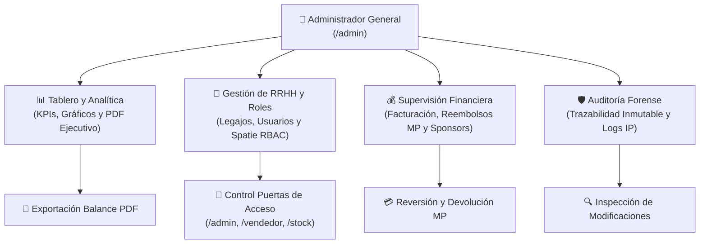
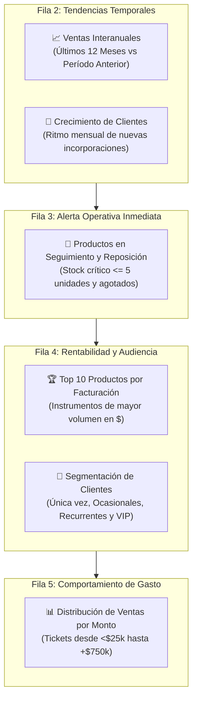
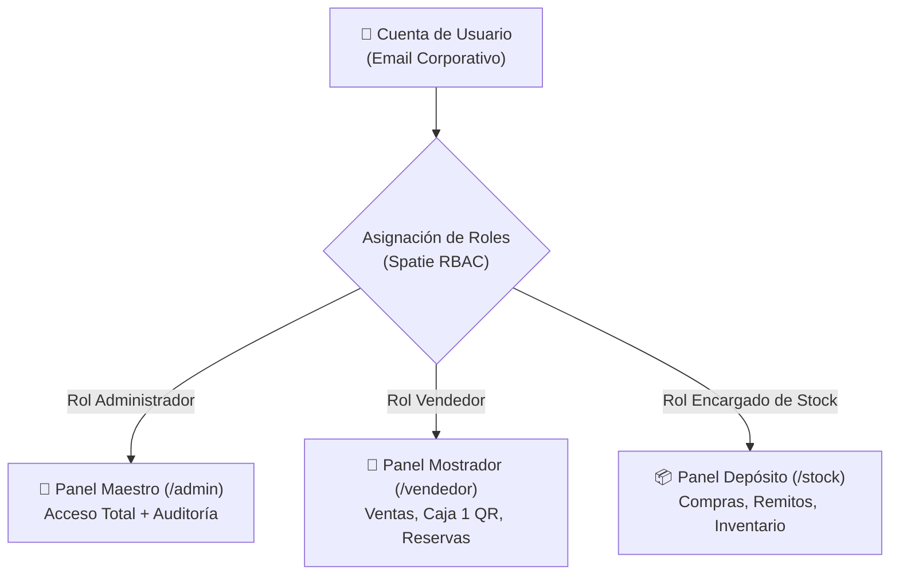
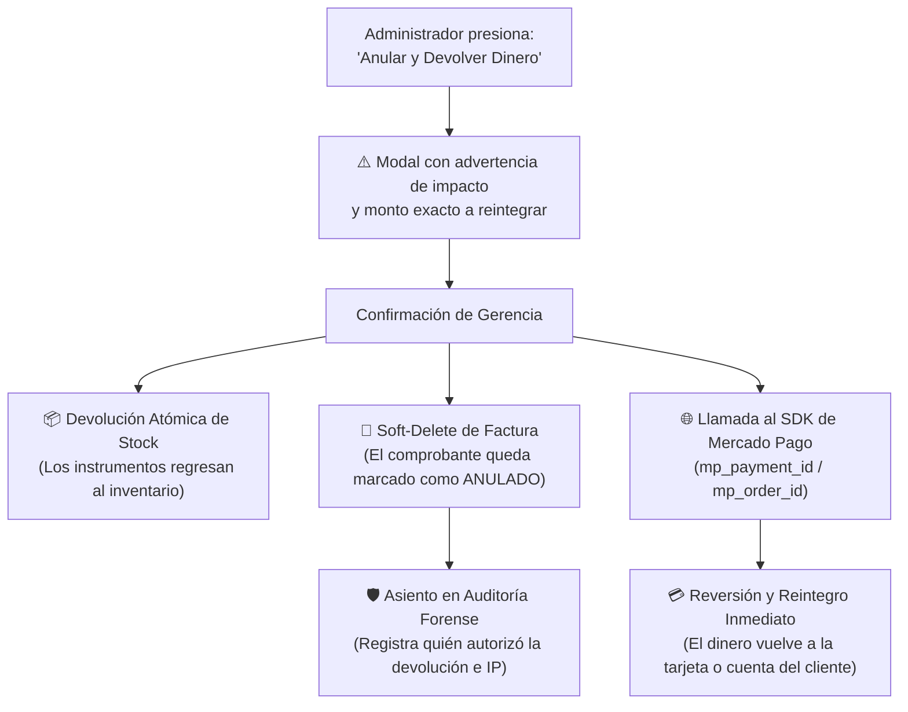

# 👑 Manual Operativo de Administración, Finanzas y Gerencia General
## Sistema Sound Heritage — Panel Maestro de Control ERP

[⬅️ Volver al README Principal](../README.md)

> **Perfil Destinatario:** Propietarios, Dirección General, Gerencia Comercial, Responsables Contables y Encargados de Recursos Humanos.  
> **Acceso al Panel:** Puerta de enlace `/admin` con credenciales de rol `'Administrador'`.  
> **Naturaleza del Documento:** Guía operativa, gerencial y analítica de alto nivel. Orientada a la toma de decisiones, control financiero, gestión de personal y trazabilidad forense. Sin código de programación.

---

## 📑 Índice General

1. [Capítulo 1: Acceso, Navegación y Perfil del Administrador General](#-capítulo-1-acceso-navegación-y-perfil-del-administrador-general)
2. [Capítulo 2: Tablero de Control y Métricas Ejecutivas (Dashboard)](#-capítulo-2-tablero-de-control-y-métricas-ejecutivas-dashboard)
3. [Capítulo 3: Gestión de Personal y Estructura Organizacional (RRHH)](#-capítulo-3-gestión-de-personal-y-estructura-organizacional-rrhh)
4. [Capítulo 4: Gestión de Usuarios, Roles y Seguridad de Acceso (RBAC)](#-capítulo-4-gestión-de-usuarios-roles-y-seguridad-de-acceso-rbac)
5. [Capítulo 5: Módulo de Auditoría Forense y Trazabilidad Inmutable](#-capítulo-5-módulo-de-auditoría-forense-y-trazabilidad-inmutable)
6. [Capítulo 6: Supervisión de Facturación, Cancelaciones y Reembolsos Automáticos](#-capítulo-6-supervisión-de-facturación-cancelaciones-y-reembolsos-automáticos)
7. [Capítulo 7: Segmentación Estratégica de Clientes y Exportación Comercial](#-capítulo-7-segmentación-estratégica-de-clientes-y-exportación-comercial)
8. [Capítulo 8: Preguntas Frecuentes y Protocolos de Decisión Gerencial](#-capítulo-8-preguntas-frecuentes-y-protocolos-de-decisión-gerencial)

---

## 🏛️ Mapa Conceptual de Módulos Administrativos

El panel maestro centraliza las 4 áreas neurálgicas de control de Sound Heritage a través de flujos directos y jerárquicos:



---

## 🚪 Capítulo 1: Acceso, Navegación y Perfil del Administrador General

### 1.1 Acceso al Panel Maestro
El panel general se encuentra disponible en la dirección web `/admin`.
* **Credenciales:** Correo electrónico corporativo y contraseña del usuario con rol `'Administrador'`.
* **Privilegios Plenos:** A diferencia de los paneles de mostrador o depósito, el rol de Administrador cuenta con una regla de superusuario que le otorga acceso y modificación irrestricta sobre la totalidad de los datos del sistema.

### 1.2 Organización de la Barra Lateral de Navegación
Los recursos del ERP se encuentran distribuidos en tres grandes áreas operativas:

| Grupo de Menú | Módulos Incluidos | Propósito Operativo |
| :--- | :--- | :--- |
| **Tienda** | Clientes, Facturas, Productos, Compras a Proveedores, Proveedores | Supervisión del circuito comercial, inventario, precios y abastecimiento. |
| **Eventos y Sala** | Reservas de Sala, Eventos Culturales, Asistencia y Entradas QR, Auspiciantes | Agenda artística, alquiler del auditorio, venta de entradas y patrocinadores. |
| **Administración y RRHH** | Empleados, Usuarios y Roles, Auditorías | Padrón de personal, permisos de operadores y trazabilidad de seguridad. |

### 1.3 Seguridad de la Sesión
* Toda sesión administrativa está blindada contra accesos cruzados.
* Al concluir la jornada o al retirarse del puesto de trabajo, el administrador debe cerrar su sesión haciendo clic sobre su nombre en la esquina superior derecha y seleccionando **"Cerrar Sesión"**.

---

## 📊 Capítulo 2: Tablero de Control y Métricas Ejecutivas (Dashboard)

Al iniciar sesión en `/admin`, la pantalla de bienvenida presenta el **Dashboard Central**, un centro de inteligencia de negocios en tiempo real alimentado por los componentes de `/app/Filament/Admin/Widgets/TiendaDashboardWidgets.php`.

### 2.1 Tarjetas Superiores de Rendimiento (KPIs)
En la parte superior se despliegan cuatro indicadores esenciales con minigráficos de tendencia (*sparklines*):

```
┌─────────────────────────┐ ┌─────────────────────────┐ ┌─────────────────────────┐ ┌─────────────────────────┐
│    CLIENTES ACTIVOS     │ │     ÍTEMS POR VENTA     │ │   TASA DE ANULACIÓN     │ │     TICKET PROMEDIO     │
│         38.5%           │ │          2.4 u.         │ │          1.2%           │ │      $ 145.800,00       │
│ 154 de 400 compraron    │ │ 240 u. en 100 ventas    │ │ 3 comprobantes anulados │ │ $ 14.580.000 total    │
└─────────────────────────┘ └─────────────────────────┘ └─────────────────────────┘ └─────────────────────────┘
```

1. **Clientes Activos (% de Conversión):** Porcentaje del padrón total de clientes registrados que concretó al menos una compra en la tienda. Refleja la efectividad comercial.
2. **Ítems por Venta:** Cantidad promedio de artículos por factura. Mide la eficacia de las promociones cruzadas (ej. cables, púas o fundas junto con instrumentos).
3. **Tasa de Anulación:** Proporción de comprobantes cancelados respecto al total emitido. Permite detectar irregularidades operativas o devoluciones excesivas.
4. **Ticket Promedio:** Gasto medio por cada operación de compra y cifra consolidada de facturación bruta acumulada.

---

### 2.2 Cuadrante de Gráficos Analíticos de Decisión

El tablero incluye 6 visualizaciones interactivas diseñadas para orientar la estrategia financiera y de aprovisionamiento:



1. **Ventas Interanuales (`VentasInteranualesChart`):** Curva azul continua (año corriente) versus línea punteada gris (año anterior). Permite comparar la estacionalidad (meses fuertes como diciembre o inicio de ciclos lectivos musicales).
2. **Crecimiento de Clientes (`CrecimientoClientesChart`):** Evolución mes a mes del número de compradores que se incorporan al sistema comercial de Sound Heritage.
3. **Productos en Seguimiento y Alertas de Reposición (`AlertasTiendaTable`):** Tabla en vivo que lista artículos cuyo inventario cayó a 5 unidades o menos (`En Reposición`) o a 0 unidades (`Agotado`), permitiendo emitir órdenes de compra a proveedores antes de que se produzca una rotura de stock.
4. **Top 10 Productos por Facturación (`TopProductosIngresosChart`):** Gráfico de barras horizontales que ranquea los instrumentos que generan el mayor ingreso bruto en pesos argentinos.
5. **Segmentación de Clientes (`SegmentacionClientesChart`):** Gráfico de dona que categoriza a los clientes según su frecuencia de compra en el último año:
   * *Única Compra (1 venta):* Compradores esporádicos.
   * *Ocasionales (2 a 3 ventas):* Clientes en desarrollo.
   * *Frecuentes (4 a 9 ventas):* Músicos activos y estudios de grabación recurrentes.
   * *Clientes VIP (10 o más ventas):* Cuentas de alto valor para atención preferencial.
6. **Distribución de Ventas por Monto (`DistribucionMontoFacturasChart`):** Desglose de operaciones por tramos de valor: `$0-$25k`, `$25k-$75k`, `$75k-$150k`, `$150k-$300k`, `$300k-$750k` y `$750k+`.

---

### 2.3 Generación del Reporte Ejecutivo del Dashboard en PDF
En la esquina superior derecha del Dashboard se encuentra el botón **"Descargar Reporte Dashboard (PDF)"**.

* **Plantilla Utilizada:** `/resources/views/reports/pdf-dashboard.blade.php`.
* **Formato:** Documento PDF en hoja A4 vertical, con membrete institucional oficial de Sound Heritage (CUIT 30-11223344-5, Responsable Inscripto, dirección física y teléfonos).
* **Contenido Consolidado:**
  * Tarjetas KPI con porcentajes y montos.
  * Tabla completa del Top 10 de productos con barras de distribución relativa.
  * Tabla de evolución mensual de ventas de los últimos 12 meses.
  * Resumen de segmentación de cartera de clientes.
  * Tabla de artículos en estado crítico de reposición.
  * Pie de página con numeración dinámica de hojas (`Página X de Y`) y registro del administrador que emitió el informe.
* **Uso Recomendado:** Balances para reuniones de directorio, rendición de cuentas ante socios y presentación contable.

---

## 👥 Capítulo 3: Gestión de Personal y Estructura Organizacional (RRHH)

El módulo de **Empleados** (`/app/Filament/Admin/Resources/EmployeeResource.php`) administra el legajo integral del personal operativo de Sound Heritage.

### 3.1 Alta de un Nuevo Empleado
Para incorporar un colaborador a la empresa:
1. Dirigirse al menú lateral y pulsar **"Empleados"** dentro de *Administración y RRHH*.
2. Hacer clic en el botón superior **"Nuevo Empleado"**.
3. Completar los campos requeridos del formulario:
   * **Foto de Credencial:** Fotografía formal del empleado (formato circular de credencial).
   * **Nombre y Apellido:** Datos filiatorios completos.
   * **DNI / Documento:** Identificación nacional única (obligatorio, sin puntos).
   * **Categoría / Puesto:** Puesto desempeñado (ej. *Cajero de Mostrador*, *Encargado de Depósito*, *Luthier*, *Operador de Sala*).
   * **Ciudad y Provincia:** Radicación del trabajador.
   * **Teléfono y Dirección:** Canales de contacto directo para legajo laboral.

> [!IMPORTANT]
> **Creación Automática de Cuenta de Acceso:**  
> Al guardar un nuevo empleado, el sistema da de alta automáticamente una cuenta de usuario vinculada con su correo y su **número de DNI como contraseña provisional inicial**. Posteriormente, el administrador solo debe asignarle el rol correspondiente en el módulo de usuarios.

---

### 3.2 Creación Ágil de Nuevos Puestos de Trabajo
Si el puesto a asignar no figura en la lista desplegable:
* Pulsar el botón `+` (Crear Opción) ubicado junto al selector de categoría.
* Escribir la denominación del nuevo cargo (ej. *"Jefe de Logística"* o *"Técnico de Sonido en Vivo"*).
* Confirmar; el puesto quedará guardado de inmediato en el catálogo de puestos de la empresa sin abandonar el formulario.

---

### 3.3 Métricas de Rendimiento Comercial por Legajo
La tabla principal de empleados incluye indicadores comerciales calculados en tiempo real:
* **Legajo:** Identificador formal con formato `#0001`, `#0002`.
* **Ventas Realizadas:** Cantidad de facturas de mostrador emitidas por ese empleado.
* **Total Facturado ($):** Monto acumulado en pesos argentinos generado por las ventas del legajo.

---

### 3.4 Procedimiento de Baja Laboral y Reactivación
Cuando un empleado deja de formar parte de la organización:
1. En la fila correspondiente, abrir el menú de tres puntos `...` y seleccionar **"Dar de baja"**.
2. El sistema solicitará confirmación explicando el impacto: la ficha pasará a estado `'De Baja'` y **su cuenta de acceso al sistema quedará suspendida en el mismo instante**, impidiéndole ingresar a cualquier panel de la empresa.
3. **Reactivación:** Si un empleado reingresa, filtrar la tabla por *"Solo Dados de Baja"*, abrir las acciones de la fila y seleccionar **"Reactivar"**.

---

## 🛡️ Capítulo 4: Gestión de Usuarios, Roles y Seguridad de Acceso (RBAC)

El módulo **"Usuarios y Roles"** (`/app/Filament/Admin/Resources/UserResource.php`) gobierna las puertas de entrada al ERP.



### 4.1 Principio de Origen de Cuentas (Regla Anti-Cuentas Fantasma)
En Sound Heritage **no existe el botón "Crear Usuario" manual**. Las cuentas nacen de manera trazable desde tres orígenes válidos:
1. **Ficha de Empleado:** Generada por Recursos Humanos al ingresar personal.
2. **Ficha de Cliente:** Creada en el mostrador para facturación formal.
3. **Registro Web:** Creada por el comprador online a través del storefront o inicio con Google.

Esto garantiza que jamás existan cuentas huérfanas sin una persona física responsable detrás.

---

### 4.2 Asignación y Cambio de Roles
Para otorgar o modificar las facultades operativas de un usuario:
1. Ingresar a **"Usuarios y Roles"**.
2. Localizar al operador por su nombre, correo o DNI.
3. Hacer clic en **"Editar"**.
4. En la sección **"Permisos de Acceso y Roles"**, seleccionar uno o varios perfiles:

| Perfil / Rol | Paneles Habilitados | Capacidades Principales |
| :--- | :--- | :--- |
| **Administrador** | `/admin`, `/vendedor`, `/stock` | Control total, anulación de facturas, auditorías, gestión de sueldos y roles. |
| **Vendedor** | `/vendedor` | Facturación de mostrador, cobro con QR Caja 1, reserva de auditorio y tickets. |
| **Encargado de Stock** | `/stock` | Carga de órdenes de compra, alta de proveedores, ajuste y control de inventario. |
| **Cliente / Web** | Tienda Pública (`/`) | Compras online, autogestión en "Mi Cuenta", descarga de entradas digitales con QR. |

---

### 4.3 Procedimiento de Reseteo Seguro de Contraseña
Por estrictas políticas de confidencialidad, las contraseñas están fuertemente encriptadas y ningún administrador puede leer la clave de un empleado:
* En la fila del usuario, desplegar las acciones y pulsar **"Resetear Clave"**.
* El sistema despachará de forma automática un correo electrónico oficial al buzón del operador con un enlace temporal y seguro para que establezca su nueva contraseña personal.

---

### 4.4 Regla de Protección del Administrador Activo
* El sistema contiene una cláusula de guarda que **impide que el administrador logueado pueda suspender su propia cuenta por error**.
* La opción *"Suspender"* aparece automáticamente oculta para la cuenta del usuario en sesión activa, evitando bloqueos accidentales del panel maestro.

---

## 🔍 Capítulo 5: Módulo de Auditoría Forense y Trazabilidad Inmutable

El módulo de **Auditorías** (`/app/Filament/Admin/Resources/AuditResource.php`) registra cada alteración que ocurre en la base de datos de Sound Heritage.

### 5.1 Principio de Inmutabilidad Absoluta
* **Solo Lectura:** El módulo de auditoría no posee botones de crear, editar ni borrar.
* Ningún usuario (incluyendo dueños y administradores generales) puede eliminar ni manipular un registro de auditoría desde la plataforma web. Lo ocurrido queda registrado para siempre.

---

### 5.2 Estructura de la Ficha Forense
Al hacer clic en **"Ver"** sobre cualquier registro, se abre una ventana modal con tres pestañas técnicas:

```
┌────────────────────────────────────────────────────────────────────────┐
│ DETALLE DEL REGISTRO DE AUDITORÍA                                      │
├──────────────────────┬──────────────────────────┬──────────────────────┤
│ [1. INFO GENERAL]    │ [2. VALORES ANTERIORES]  │ [3. VALORES NUEVOS]  │
├──────────────────────┴──────────────────────────┴──────────────────────┤
│ Operador Responsable: Carlos Gómez (Vendedor)                          │
│ Fecha y Hora Exacta:  29/10/2026 18:42:15 hs                           │
│ Dirección IP Origen:  192.168.1.45                                     │
│ Tipo de Acción:       Modificación (Updated)                           │
│ Módulo Afectado:      Producto (Fender Stratocaster Sunburst)          │
│                                                                        │
│ DIFERENCIA FORENSE DETECTADA:                                          │
│ * price (Precio):    De: $ 1.200.000,00  ───►  A: $ 950.000,00         │
└────────────────────────────────────────────────────────────────────────┘
```

1. **Pestaña Información General:**
   * **Usuario:** Nombre de la persona que ejecutó la acción (o `"Sistema / Web"` si fue un cron o webhook automático).
   * **Fecha y Hora:** Sellado de tiempo al segundo, junto con el tiempo transcurrido (ej. *"hace 2 horas"*).
   * **Evento:** Alta (`Creado`), Modificación (`Modificado`) o Baja (`Anulado / Borrado`).
   * **Módulo:** Identificación de la entidad y registro específico.
   * **Metadatos de Red:** Dirección IP física y agente de usuario (navegador y sistema operativo).
2. **Pestaña Valores Anteriores (`old_values`):** Muestra el estado exacto de cada columna antes del cambio.
3. **Pestaña Valores Nuevos (`new_values`):** Muestra los nuevos valores que sustituyeron a los anteriores.

---

### 5.3 Protocolos de Investigación Gerencial

| Escenario de Discrepancia | Cómo Auditarlo en el Módulo |
| :--- | :--- |
| **Disminución sospechosa de stock** | Filtrar por Módulo *Producto*, acción *Modificado*, e inspeccionar quién modificó el campo `stock` sin una orden de venta o compra asociada. |
| **Factura de mostrador anulada** | Filtrar por Módulo *Factura*, acción *Anulado / Borrado*. Revisar usuario responsable, fecha exacta y justificación del reintegro. |
| **Alteración de tarifa en reserva** | Filtrar por Módulo *Reserva de Sala*. Verificar si un operador alteró el campo `total_price` o forzó un descuento manual indebido. |

---

## 💰 Capítulo 6: Supervisión de Facturación, Cancelaciones y Reembolsos Automáticos

Desde el módulo **"Facturas"** (`/app/Filament/Admin/Resources/InvoiceResource.php`), la gerencia supervisa tanto las ventas generadas en mostrador presencial como las compras electrónicas de la tienda web.

### 6.1 Auditoría del Listado de Comprobantes
La tabla gerencial de facturación exhibe:
* **Nº Comprobante:** Formato fiscal oficial (`FC-0001-00000123`).
* **Origen:** Venta de Mostrador (Caja 1), Venta Tienda Web o Reserva de Salón.
* **Cliente y Condición:** Nombre, DNI/CUIT y situación frente al IVA.
* **Medio de Cobro:** Efectivo, Mercado Pago (Checkout Pro / QR Dinámico) o Transferencia.
* **Estado Operativo:** Cobrado (`completed`), Pendiente (`pending`) o Anulado (`trashed`).

---

### 6.2 Procedimiento de Anulación y Devolución Automática en Mercado Pago
A diferencia de los vendedores que tienen bloqueada la anulación de comprobantes por seguridad de caja, el Administrador General cuenta con la potestad de anular facturas y procesar devoluciones comerciales:



#### Pasos para Ejecutar la Anulación:
1. En la fila de la factura, pulsar **"Ver Detalle"** o desplegar el menú de acciones `...`.
2. Seleccionar la acción **"Anular y Devolver Dinero"**.
3. El sistema verificará cómo fue pagada la orden:
   * **Si fue en Efectivo:** Informará que la factura se dará de baja y que los productos retornarán al stock de depósito para que caja entregue el efectivo.
   * **Si fue por Mercado Pago:** La ventana modal mostrará una advertencia destacada en color ámbar:  
     > *"⚠️ Esta venta fue cobrada mediante Mercado Pago ($ XX.XXX,XX). Al anularla, el sistema ordenará la DEVOLUCIÓN AUTOMÁTICA DEL DINERO al comprador."*
4. Al confirmar, el sistema ejecuta de manera atómica:
   * El reintegro de las unidades vendidas al stock de depósito.
   * La anulación de la factura en el balance contable.
   * La orden de reembolso a la pasarela de pagos para reintegrar el dinero a la tarjeta del comprador sin trámites bancarios manuales.
   * El asiento inmutable en la tabla de auditorías.

---

### 6.3 Liberación Forzada de Punto de Cobro ("Liberar Caja")
Si un cliente solicitó pagar con QR en mostrador pero se retiró sin escanear el código, el tótem de la Caja 1 queda bloqueado impidiendo cobrar a la siguiente persona:
* El administrador (o el vendedor) puede presionar el botón rojo **"Liberar Caja"**.
* Esta acción cancela la orden pendiente en la API de Mercado Pago y desocupa inmediatamente el mostrador físico.

---

### 6.4 Padrón de Auspiciantes y Patrocinadores (`SponsorResource.php`)
En el menú *Eventos y Sala*, el administrador gestiona las empresas auspiciantes que financian las masterclasses y festivales musicales:
* **Rubros Disponibles:** Instrumentos Musicales, Accesorios e Insumos, Prensa y Medios, Gastronomía y Bebidas, Productora / Audio.
* **Trazabilidad:** La tabla indica cuántos eventos ha patrocinado cada marca y permite mantener actualizados los teléfonos y correos corporativos para convenios de sponsoreo.

---

## 🎯 Capítulo 7: Segmentación Estratégica de Clientes y Exportación Comercial

El recurso de **Clientes** (`/app/Filament/Admin/Resources/CustomerResource.php`) ofrece a la gerencia herramientas de inteligencia comercial sobre la cartera de compradores.

### 7.1 Filtro Estratégico por Segmento de Valor
En la cabecera de la tabla de clientes, el selector **"Segmento Comercial"** permite aislar grupos específicos:

| Segmento Seleccionable | Criterio de Inclusión | Objetivo Gerencial |
| :--- | :--- | :--- |
| **Clientes VIP** | Clientes con 3 o más compras o gasto superior a **$300.000 ARS**. | Programas de fidelización, invitaciones a pruebas exclusivas de instrumentos importados. |
| **Clientes Activos** | Clientes con al menos 1 compra histórica registrada. | Envío de promociones de accesorios o insumos complementarios. |
| **Prospectos** | Cuentas registradas en la web que aún no han comprado. | Campañas de remarketing y cupones de bienvenida. |
| **Alquilaron Sala de Ensayo** | Músicos y bandas que reservaron el auditorio. | Difusión de promociones en horas valle de ensayo o grabación. |
| **Asistieron a Eventos** | Compradores de entradas para recitales culturales. | Campañas de difusión para próximas fechas y espectáculos artísticos. |

---

### 7.2 Exportación de Padrón en PDF
Al pulsar **"Exportar Listado (PDF)"**, el sistema respeta los filtros seleccionados (por ejemplo, *Solo Clientes VIP de Posadas*) y produce un informe formal imprimible con DNI, CUIT, teléfonos, condición frente al IVA y total gastado, ideal para el equipo de ventas o el contador.

---

## ❓ Capítulo 8: Preguntas Frecuentes y Protocolos de Decisión Gerencial

### P1: Desvinculamos a un empleado de forma imprevista. ¿Cuál es el protocolo de seguridad inmediato?
1. Ingresar a `/admin` ➔ **Administración y RRHH** ➔ **Empleados**.
2. Buscar al empleado y seleccionar **"Dar de baja"**.
3. *Resultado:* En ese mismo segundo, su cuenta de usuario en el sistema queda suspendida. Ya no podrá ingresar ni al panel de mostrador, ni al de depósito, ni al panel maestro. Sus registros históricos y ventas pasadas quedan preservados intactos para auditoría.

---

### P2: El contador nos solicita el balance mensual de ventas. ¿Cómo se extrae?
1. Ingresar al **Dashboard** principal en `/admin`.
2. Presionar el botón superior **"Descargar Reporte Dashboard (PDF)"**.
3. El sistema descargará el informe oficial consolidado en hoja A4 membretada con los totales de facturación, ticket promedio, ventas interanuales mes a mes y desglose del Top 10 de productos.
4. Si requiere el detalle factura por factura, ingresar a **Tienda** ➔ **Facturas**, filtrar por el rango de fechas del mes y exportar el listado completo en PDF.

---

### P3: Un cliente compró una guitarra por la tienda web pero se equivocó de modelo y pide la devolución de su dinero. ¿Cómo se procede?
1. Ingresar a **Facturas**.
2. Localizar la factura del cliente mediante su número de comprobante o DNI.
3. Presionar la acción **"Anular y Devolver Dinero"**.
4. Confirmar la operación en la ventana modal.
5. El sistema gestionará el reintegro automático de los fondos a través de la pasarela de Mercado Pago de regreso al medio de pago del comprador y restituirá la guitarra al stock físico de depósito.

---

### P4: Queremos que un vendedor de confianza también pueda ingresar mercadería en el depósito los días sábados. ¿Cómo se configura?
1. Ingresar a **Usuarios y Roles**.
2. Localizar al vendedor y hacer clic en **"Editar"**.
3. En el campo múltiple **"Roles Asignados"**, mantener seleccionado `'Vendedor'` y agregar también el rol `'Encargado de Stock'`.
4. Guardar los cambios.
5. *Resultado:* A partir de ese momento, el usuario tendrá habilitadas ambas puertas de acceso: podrá entrar a `/vendedor` para cobrar y a `/stock` para gestionar proveedores y remitos.

---

> **Control de Versión del Documento:** Sound Heritage ERP v1.0 — Manual Gerencial y Administrativo.  
> **Ubicación en Repositorio:** `/docs/03_MANUAL_ADMINISTRADOR_Y_GERENCIA.md`.  
> **Políticas de Integridad:** Prohibida la eliminación de registros de auditoría y la alteración manual de bases de datos sin trazabilidad institucional.

