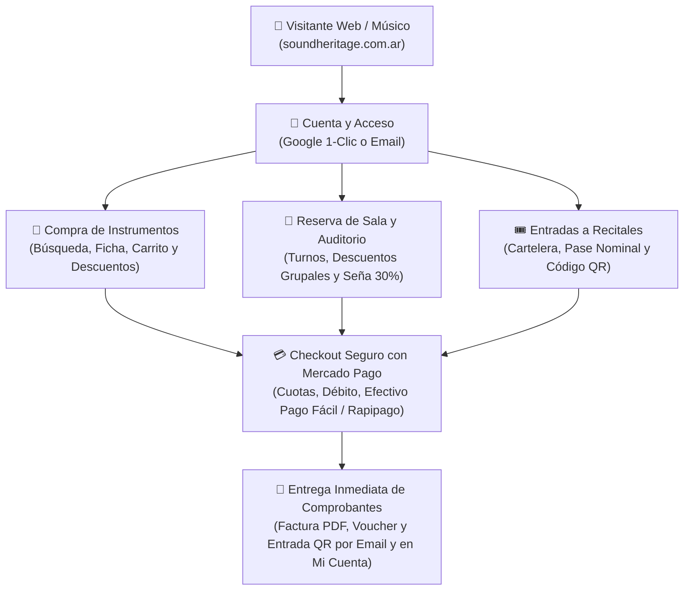
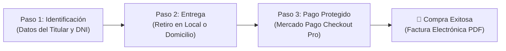

# 🎸 Manual del Usuario y Guía de Compra Online
## Sound Heritage — Tienda Web, Reservas de Salón y Entradas a Recitales

[⬅️ Volver al README Principal](../README.md)

> **Perfil Destinatario:** Músicos, estudiantes de música, clientes finales, asistentes a recitales y público general.  
> **Acceso a la Plataforma:** Sitio web oficial de Sound Heritage (Portal público, Tienda, Reservas y Mi Cuenta).  
> **Naturaleza del Documento:** Guía 100% práctica, accesible y explicativa. Orientada a navegar el catálogo, realizar compras seguras con Mercado Pago, reservar turnos de sala y gestionar entradas digitales. Completamente libre de código o tecnicismos de programación.

---

## 📑 Índice General

1. [Capítulo 1: Registro, Inicio de Sesión y Perfil del Comprador](#-capítulo-1-registro-inicio-de-sesión-y-perfil-del-comprador)
2. [Capítulo 2: Búsqueda y Elección de Instrumentos y Sonido](#-capítulo-2-búsqueda-y-elección-de-instrumentos-y-sonido)
3. [Capítulo 3: El Carrito Lateral y el Checkout Seguro](#-capítulo-3-el-carrito-lateral-y-el-checkout-seguro)
4. [Capítulo 4: Reserva Online de Salas de Ensayo y Auditorio](#-capítulo-4-reserva-online-de-salas-de-ensayo-y-auditorio)
5. [Capítulo 5: Compra de Entradas Digitales a Recitales y Eventos Culturales](#-capítulo-5-compra-de-entradas-digitales-a-recitales-y-eventos-culturales)
6. [Capítulo 6: Portal de Autogestión "Mi Cuenta"](#-capítulo-6-portal-de-autogestión-mi-cuenta)
7. [Capítulo 7: Preguntas Frecuentes y Asistencia al Comprador](#-capítulo-7-preguntas-frecuentes-y-asistencia-al-comprador)

---

## 🧭 Mapa de Experiencia del Usuario en Sound Heritage

El sitio web integra todas las necesidades del músico y del público cultural en una experiencia fluida y transparente:



---

## 👤 Capítulo 1: Registro, Inicio de Sesión y Perfil del Comprador

Tener una cuenta en Sound Heritage te permite guardar tus direcciones de entrega, acceder al historial de compras, descargar facturas fiscales oficiales, consultar tus turnos de sala reservados y llevar tus entradas a recitales en el celular.

### 1.1 Opciones para Crear tu Cuenta o Ingresar
Puedes registrarte de dos formas muy sencillas desde el botón **"Mi Cuenta"** ubicado en el menú superior:

```
┌────────────────────────────────────────────────────────┐
│ ACCESO A SOUND HERITAGE                                │
├────────────────────────────────────────────────────────┤
│ [ G ] Continuar con Google (1 Clic)                    │
│                                                        │
│ ────────────── O con tu correo electrónico ─────────── │
│ Correo Electrónico:  [ usuario@ejemplo.com           ] │
│ Contraseña:          [ ********************          ] │
│                                                        │
│ [ Ingresar a Mi Cuenta ]     [ ¿Olvidaste tu clave? ]  │
└────────────────────────────────────────────────────────┘
```

1. **Ingreso en 1 Clic con Google:** Si tienes una cuenta de Gmail o Google, pulsa el botón **"Continuar con Google"**. Tu cuenta quedará creada e iniciada de forma instantánea sin necesidad de recordar contraseñas.
2. **Registro Tradicional con Correo:** Completa tu nombre, apellido, correo electrónico y una contraseña segura de al menos 8 caracteres. Recibirás un enlace de validación en tu casilla para confirmar tu identidad.

---

### 1.2 Recuperación Segura de Contraseña
Si no recuerdas tu contraseña:
1. En la pantalla de ingreso, haz clic en **"¿Olvidaste tu contraseña?"**.
2. Escribe el correo con el que te registraste y pulsa **"Enviar enlace de restablecimiento"**.
3. Abre el mensaje en tu bandeja de entrada y sigue el enlace para definir una nueva clave personal.

---

### 1.3 Regla de Protección de Identidad y DNI
Si anteriormente realizaste una compra de mostrador en nuestro local físico de Posadas y dejaste asentado tu número de DNI o CUIT:
* Al intentar reservar una sala o comprar por la web ingresando ese mismo DNI, el sistema te solicitará amablemente:  
  > *"El DNI ingresado pertenece a una cuenta registrada. Iniciá sesión para continuar."*
* **¿Por qué ocurre esto?** Es una medida de seguridad pensada para protegerte: evita que un tercero utilice tu documento para emitir facturas o reservar a tu nombre, garantizando que todos tus comprobantes queden unificados en tu cuenta personal.

---

## 🔍 Capítulo 2: Búsqueda y Elección de Instrumentos y Sonido

### 2.1 Búsqueda Reactiva en Tiempo Real
En la parte superior de todas las páginas de la tienda encontrarás la barra de búsqueda interactiva:
* Comienza a escribir la marca, modelo o tipo de instrumento (ej. *"Stratocaster"*, *"Yamaha"*, *"Micrófono condensador"* o *"Cables de audio"*).
* El buscador te mostrará coincidencias al instante mientras escribes, sin demoras ni necesidad de presionar Enter ni recargar la pantalla.

---

### 2.2 Exploración del Catálogo y Filtros
Al ingresar a **"Productos"**, podrás organizar la exhibición según tus preferencias:
* **Filtros por Familia de Instrumentos:** Guitarras, Bajos, Baterías y Percusión, Teclados y Pianos, Vientos, Audio Profesional, Iluminación y Accesorios.
* **Ordenamiento Inteligente:** Puedes ordenar los resultados por *Menor Precio*, *Mayor Precio*, *Novedades* o *Mayor Descuento*.
* **Etiquetas de Descuento (OFF):** Los artículos con promociones especiales exhiben una insignia visible (ej. `10% OFF`, `15% OFF` o `25% OFF`), indicando el ahorro directo respecto del precio de lista.

---

### 2.3 Cómo Leer la Ficha Detallada de un Instrumento
Al hacer clic en cualquier artículo, accederás a su ficha técnica completa:

```
┌──────────────────────────────────┬──────────────────────────────────────────┐
│ FOTO Y GALERÍA DEL PRODUCTO      │ DATOS COMERCIALES Y DISPONIBILIDAD       │
│                                  │                                          │
│ [ Fender Stratocaster Sunburst ] │ FENDER · Gama Profesional                │
│                                  │ Fender Player Stratocaster MN Sunburst   │
│ Insignia: [ 10% OFF ]            │ SKU: SH-00104 | ID: 104                  │
│                                  │                                          │
│ Miniaturas interactivas:         │ PRECIO DE LISTA: $ 1.350.000 (Tachado)   │
│ [Vista Frontal] [Detalle Madera] │ CONTADO / TRANSFERENCIA: $ 1.215.000     │
│                                  │ ¡Ahorrás $ 135.000 pagando al contado!   │
│                                  │                                          │
│                                  │ DISPONIBILIDAD:                          │
│                                  │ ✔ Stock Disponible: 4 unidades en local  │
│                                  │                                          │
│                                  │ [ - ] [ 1 ] [ + ]  [ AÑADIR AL CARRITO ] │
└──────────────────────────────────┴──────────────────────────────────────────┘
```

* **Galería Interactiva:** Permite alternar entre diferentes ángulos del instrumento para observar los acabados, maderas y detalles de construcción.
* **Indicador de Stock Real:** Indica con total transparencia cuántas unidades físicas existen en el depósito central de Sound Heritage.
* **Ficha de Especificaciones:** En la parte inferior encontrarás la tabla técnica detallada: maderas del cuerpo y mástil, tipo de micrófonos, cantidad de trastes, selector de pastillas y accesorios incluidos (funda, llaves de calibración o cable).

---

## 🛒 Capítulo 3: El Carrito Lateral y el Checkout Seguro

### 3.1 El Carrito Deslizante (Slide-over Cart)
Al pulsar **"Añadir al carrito"** en cualquier producto o entrada de recital, se abrirá suavemente el carrito lateral sin sacarte de la página en la que estás navegando:
* **Modificar Unidades:** Utiliza los botones `+` y `-` para sumar o restar cantidades en tiempo real.
* **Quitar Artículos:** Pulsa el ícono de la papelera roja junto a cualquier ítem para removerlo de la selección.
* **Transparencia de Precios:** El carrito desglosa claramente el precio de lista, el descuento aplicado por pago de contado y el total final exacto a abonar.
* **Acciones:** Puedes pulsar **"Seguir viendo"** para continuar explorando o hacer clic en **"Iniciar Compra / Checkout"** para avanzar al pago.

---

### 3.2 Paso a Paso del Proceso de Checkout (Pago y Facturación)

El proceso de compra en Sound Heritage consta de tres pasos rápidos y seguros:



#### Paso 1: Identificación y Facturación
* Completa tu Nombre, Apellido, DNI/CUIT, Correo Electrónico y Teléfono/WhatsApp de contacto.
* **Condición Fiscal:** Puedes emitir tu comprobante como *Consumidor Final* o ingresar tu CUIT y Razón Social si precisas comprobante comercial para deducir gastos.

#### Paso 2: Modalidad de Entrega de tu Pedido
Puedes optar por dos opciones:
1. **Retiro Gratuito en Local Sound Heritage:**  
   * **Dirección:** Calle Colón 1234, Posadas, Misiones.
   * **Horarios:** Lunes a Sábados de 09:00 a 13:00 y de 16:30 a 20:30 hs.
   * *Costo:* $0 (Sin ningún tipo de recargo).
2. **Envío a Domicilio:**  
   * Ingresa tu calle, número, ciudad (Posadas, Garupá, Candelaria, Oberá, etc.) y código postal.
   * Puedes agregar notas de entrega (ej. *"Timbre blanco"*, *"Dejar en portería"* o *"Piso 4 depto B"*).

#### Paso 3: Medio de Pago Protegido con Mercado Pago
Sound Heritage opera con la pasarela oficial **Mercado Pago Checkout Pro**, lo que garantiza que tus datos bancarios viajen cifrados y protegidos:
* **Tarjetas de Crédito:** Hasta en cuotas con las principales tarjetas (Visa, Mastercard, American Express, Cabal).
* **Tarjetas de Débito:** Pago directo e instantáneo.
* **Dinero en Cuenta de Mercado Pago:** Acreditación en 1 segundo con tu saldo disponible.
* **Efectivo en Puntos de Cobro:** Si prefieres abonar en efectivo, selecciona *Pago Fácil* o *Rapipago*. El sistema te generará un cupón con código de barras para abonar en cualquier sucursal.

---

### 3.3 Confirmación y Recepción de Comprobantes
Una vez acreditado el pago:
* Se presentará la pantalla de **"Compra Finalizada con Éxito"** con tu número de factura oficial (ej. `Factura B 0001-00000123`).
* **Descarga Inmediata:** Encontrarás botones directos para descargar tu **Factura / Ticket Fiscal en PDF** y tus entradas digitales si adquiriste pases para espectáculos.
* **Copia al Correo:** Simultáneamente, el sistema te despacha un correo electrónico con el detalle de la compra y los archivos PDF adjuntos.

---

## 📅 Capítulo 4: Reserva Online de Salas de Ensayo y Auditorio

Sound Heritage cuenta con un **Auditorio y Sala Acústica Principal** de nivel profesional, equipada con backline completo (batería acústica profesional, amplificadores valvulares de guitarra, cabezales de bajo y microfonía de condensador y dinámica).

Puedes agendar y congelar tu turno de sala 100% online desde la sección **"Reservar Salón"**.

---

### 4.1 Reglas y Políticas de Turnos

```
┌────────────────────────────────────────────────────────────────────────┐
│ CALENDARIO DE RESERVAS DE AUDITORIO                                    │
├────────────────────────────────────────────────────────────────────────┤
│ 1. ANTICIPACIÓN MÍNIMA:  7 días en adelante (Regla de Sala)            │
│ 2. TURNOS DISPONIBLES:   • Mañana: 09:00 a 13:00 hs                    │
│                          • Tarde:  15:00 a 19:00 hs                    │
│                          • Noche:  19:00 a 23:00 hs                    │
│ 3. CAPACIDAD DE SALA:    De 1 a 150 personas                           │
│ 4. CONGELAMIENTO:        Seña obligatoria del 30% con Mercado Pago     │
└────────────────────────────────────────────────────────────────────────┘
```

> [!IMPORTANT]
> **Anticipación Mínima de 7 Días:**  
> Por normas de calidad y acondicionamiento técnico, el calendario solo permite seleccionar fechas con un mínimo de 7 días hacia el futuro. Esto asegura que los técnicos preparen la consola, el monitoreo y el backline especialmente para tu sesión.

---

### 4.2 Tarifario Base Oficial según el Tipo de Sesión

Al reservar, selecciona el propósito de tu visita al salón:

| Tipo de Sesión | Descripción del Servicio | Tarifa Base |
| :--- | :--- | :--- |
| **Ensayo de Banda** | Uso de sala acústica con backline completo (amplificadores, batería y microfonía vocal). | **$ 35.000** |
| **Ensayo General** | Puesta en escena con consola digital, monitoreo in-ear, prueba integral de escenario y luces. | **$ 50.000** |
| **Masterclass / Taller** | Auditorio dispuesto con sonido, proyector, micrófonos inalámbricos y sillas para público. | **$ 60.000** |
| **Grabación Acústica** | Sesión en sala tratada con par estéreo de condensador, ruteo a control room y monitoreo. | **$ 70.000** |
| **Lanzamiento de Videoclip** | Uso integral del escenario con parrilla de iluminación, backline y soporte técnico de sala. | **$ 85.000** |
| **Evento Privado** | Alquiler del auditorio a puertas cerradas con operador de sonido y personal de sala. | **$ 110.000** |

---

### 4.3 Calculadora Inteligente de Descuentos Grupales (Por Tramos de 5 Asistentes)
Si asistes con banda, equipo de producción o invitados, el sistema bonifica automáticamente el costo del salón por tramos:

| Cantidad de Asistentes | Descuento Aplicado | Beneficio Económico |
| :---: | :---: | :--- |
| **1 a 4 personas** | **0% OFF** | Tarifa base estándar de sala. |
| **5 a 9 personas** | **10% OFF** | Descuento grupal inicial automático. |
| **10 a 14 personas** | **15% OFF** | Descuento intermedio para bandas y elencos. |
| **15 a 19 personas** | **20% OFF** | Descuento avanzado para ensambles y clínicas. |
| **20 a 150 personas** | **25% OFF** | **Beneficio máximo** para masterclasses y conciertos. |

* **Avisos Proactivos en Pantalla:** Cuando ingresas la cantidad de asistentes, el sistema te avisa amablemente si estás a solo una persona de saltar al siguiente tramo:  
  * *"Sumando 1 persona más alcanzás el bloque de 5 y obtenés un 10% de descuento grupal."*  
  * *"Sumando 1 persona más alcanzás el bloque de 20 y obtenés el beneficio máximo de 25% de descuento grupal."*

---

### 4.4 Validación de Disponibilidad en Vivo
Antes de avanzar al pago, el sistema comprueba la agenda en tiempo real:
* Si la fecha seleccionada coincide con un recital propio de Sound Heritage, te avisará: *"El salón ya se encuentra ocupado por un Recital propio en esa fecha. Por favor elegí otro día."*
* Si otro grupo ya reservó ese turno exacto, te invitará a elegir otro de los tres turnos disponibles (Mañana, Tarde o Noche).

---

### 4.5 Modalidad de Pago: Congelamiento con Seña del 30%
Para que no tengas que desembolsar el valor completo al reservar con semanas de antelación, Sound Heritage te ofrece dos modalidades de pago:
1. **Abonar Seña del 30% (Recomendado):** Pagas únicamente el 30% del valor total mediante Mercado Pago para congelar la fecha y el turno. El **saldo restante del 70%** lo abonas tranquilamente el mismo día del ensayo en el mostrador del local (en efectivo, tarjeta o transferencia).
2. **Abonar el 100% Total:** Pagas la totalidad anticipada y tu turno queda 100% cancelado.

Al finalizar, recibirás un **Voucher Oficial de Reserva por Correo Electrónico** con el código de turno, los horarios contratados y el detalle de la seña abonada.

---

## 🎟️ Capítulo 5: Compra de Entradas Digitales a Recitales y Eventos Culturales

Sound Heritage promueve la cultura musical organizando recitales en vivo, shows acústicos íntimos, clínicas de batería y guitarra, y masterclasses con músicos reconocidos.

### 5.1 Cartelera Cultural y Elección de Shows
Al ingresar a la sección **"Eventos"**:
* Podrás explorar todos los espectáculos programados, ver la fecha, horario exacto de apertura de puertas, artistas en escena y precio de la entrada individual.
* Cada espectáculo detalla las pautas de ingreso y si incluye consumición de cortesía.

---

### 5.2 Compra de Entradas Online
1. Selecciona el evento deseado y presiona **"Añadir al carrito"**.
2. Puedes comprar tus entradas juntas con otros artículos o adquirir pases para varios amigos en la misma orden.
3. Completa el checkout y abona mediante Mercado Pago con cualquiera de los medios disponibles.

---

### 5.3 Cómo Funciona la Entrada Digital con Código QR
* Inmediatamente después de la compra, recibirás un correo electrónico con tus **Entradas Oficiales en formato PDF**.
* Cada entrada cuenta con un **Código QR Único e Intransferible** que contiene tu número de acreditación fiscal.
* **Cero Impresión de Papel:** El día del recital no necesitas imprimir nada. Simplemente abre tu correo o ingresa a tu perfil de Sound Heritage desde el celular y exhibe la pantalla con el código QR ante el personal de control en el acceso al auditorio.

---

## 📱 Capítulo 6: Portal de Autogestión "Mi Cuenta"

Al ingresar con tu usuario y hacer clic en **"Mi Cuenta"** en la barra superior, accederás a tu panel de control personal:

```
┌────────────────────────────────────────────────────────┐
│ PANEL PERSONAL DE AUTOGESTIÓN                          │
│ Usuario: Juan Pérez  (juan.perez@gmail.com)            │
├──────────────────────────┬─────────────────────────────┤
│ 📄 MIS COMPRAS Y FACTURAS │ 📅 MIS RESERVAS DE SALÓN    │
│ Historial de pedidos y   │ Turnos de ensayo agendados, │
│ descarga de facturas PDF │ seña y saldo a abonar en sala│
├──────────────────────────┼─────────────────────────────┤
│ 🎟️ MIS ENTRADAS A SHOWS  │ 📍 DOMICILIOS DE ENTREGA    │
│ Pases nominales con QR   │ Administrar direcciones     │
│ listos para mostrar      │ para envíos a domicilio     │
├──────────────────────────┼─────────────────────────────┤
│ 👤 DATOS PERSONALES      │ 🔒 SEGURIDAD DE LA CUENTA   │
│ Nombre, apellido, email  │ Cambio de contraseña y      │
│ y teléfono de contacto   │ verificación de correo      │
└──────────────────────────┴─────────────────────────────┘
```

### 6.1 Qué Puedes Hacer en Cada Sección
* **Mis Facturas y Compras:** Consulta el historial cronológico de todas tus compras en la tienda. Puedes descargar en cualquier momento la copia oficial de tu Factura en PDF para garantías o trámites fiscales.
* **Mis Reservas de Salón:** Supervisa los ensayos y fechas que tienes agendadas en el auditorio. Aquí verás la fecha, el turno exacto, el comprobante de la seña pagada y cuánto resta cancelar al ingresar a la sala.
* **Mis Entradas:** Tu billetera digital de espectáculos. Guarda todas tus entradas vigentes con su código QR en pantalla completa para que no tengas que buscarlas en tu casilla de correo a la hora de entrar al show.
* **Domicilios de Entrega:** Modifica tu dirección postal habitual, piso, departamento y ciudad para que tus futuros pedidos se despachen más rápido.
* **Seguridad:** Cambia tu contraseña periódicamente y mantén tu correo electrónico validado.

---

### 6.2 Por Qué Ciertos Datos Fiscales Están Protegidos
En tu perfil notarás que datos como tu **DNI / CUIT y Condición frente al IVA** aparecen bloqueados para edición libre:
* **Explicación Transparente:** La normativa fiscal argentina (AFIP / ARCA) exige que las facturas emitidas correspondan inalterablemente a la persona declarada en el primer comprobante. Si cometiste un error tipográfico al ingresar tu DNI o necesitas cambiar tu razón social a Responsable Inscripto, solo debes comunicarte con el soporte de Sound Heritage para que un administrador realice la validación formal.

---

## ❓ Capítulo 7: Preguntas Frecuentes y Asistencia al Comprador

### P1: Pagué mediante Pago Fácil / Rapipago y mi orden figura "Pendiente". ¿Qué debo hacer?
* **Respuesta:** Los pagos en efectivo en redes de cobranza pueden demorar entre 1 y 2 horas hábiles en impactar en el sistema. Tu orden y los productos quedan reservados temporalmente. En cuanto la red nos envíe la confirmación bancaria, tu estado pasará automáticamente a *Confirmado* y te enviaremos la factura y comprobantes por email.

---

### P2: ¿Qué documentación debo presentar para retirar una compra en el local físico?
* **Respuesta:** Para entregar tu pedido en el mostrador de Calle Colón 1234, Posadas, te solicitaremos:
  1. Tu **DNI físico original**.
  2. El número de factura o exhibir el comprobante PDF desde la pantalla de tu celular.  
  Si retira otra persona en tu nombre, debe presentar fotocopia o foto del DNI del comprador y el número de comprobante de compra.

---

### P3: ¿Puedo reprogramar o cancelar una reserva de sala de ensayo si mi banda no puede asistir?
* **Respuesta:** Sí. Siempre que avises con al menos **48 horas de anticipación** a la fecha del turno, el equipo de Sound Heritage podrá reasignar tu turno y transferir tu seña del 30% a una nueva fecha disponible. Para coordinarlo, comunícate vía WhatsApp o llamada a nuestro teléfono oficial de atención.

---

### P4: Compré 3 entradas para un recital y todas tienen mi nombre. ¿Pueden ingresar mis amigos?
* **Respuesta:** Sí, totalmente. Cada entrada cuenta con un **código QR único e independiente**. Al momento del ingreso en la puerta del auditorio, el lector escaneará cada uno de los 3 códigos QR de forma individual. Cada persona ingresará con su respectivo código sin inconvenientes.

---

### P5: ¿Qué garantía tienen los instrumentos comprados en la tienda web?
* **Respuesta:** Todos los instrumentos nuevos cuentan con **garantía oficial de fábrica** (de 6 a 12 meses según la marca) respaldada directamente por Sound Heritage como distribuidor autorizado. Además, ofrecemos calibración y puesta a punto gratuita de cortesía en nuestro taller de luthería dentro de los primeros 30 días posteriores a la compra.

---

> **Sound Heritage — Tienda de Instrumentos, Sonido Profesional & Auditorio Cultural**  
> **Ubicación:** Calle Colón 1234, Posadas, Misiones, Argentina.  
> **Atención al Cliente:** Lunes a Sábados de 09:00 a 13:00 y de 16:30 a 20:30 hs.  
> **Documento de Ayuda al Usuario:** `/docs/04_MANUAL_CLIENTE_TIENDA_WEB.md`.

