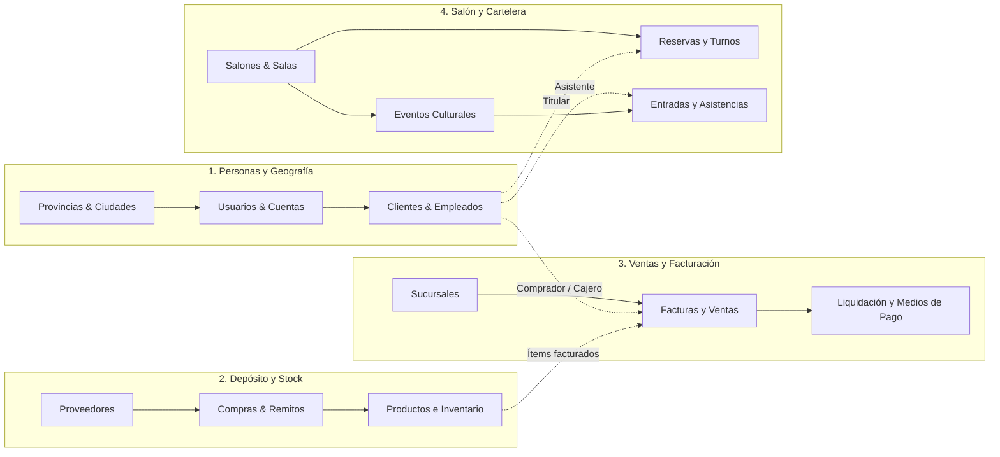
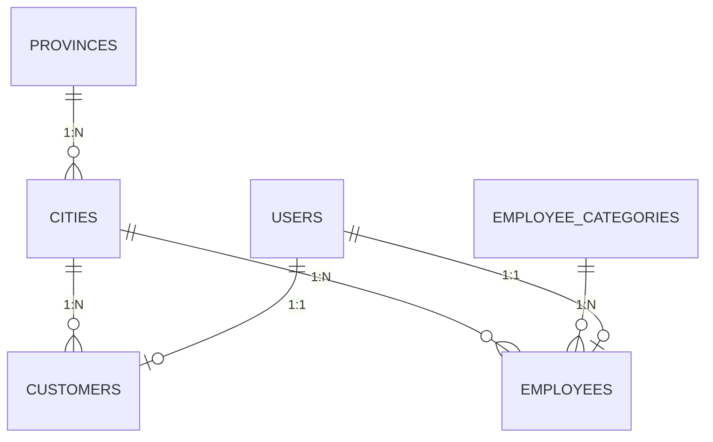
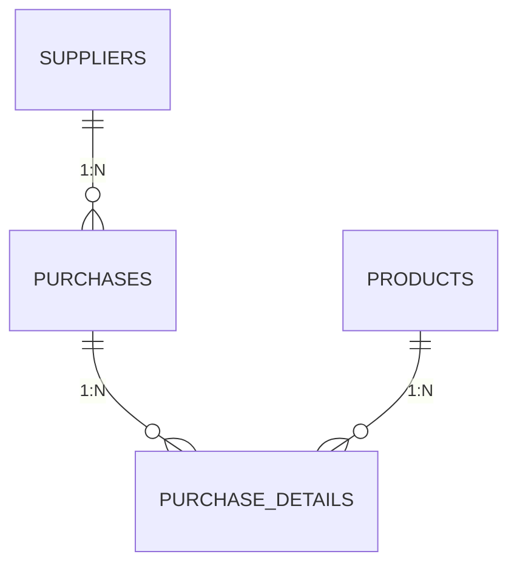
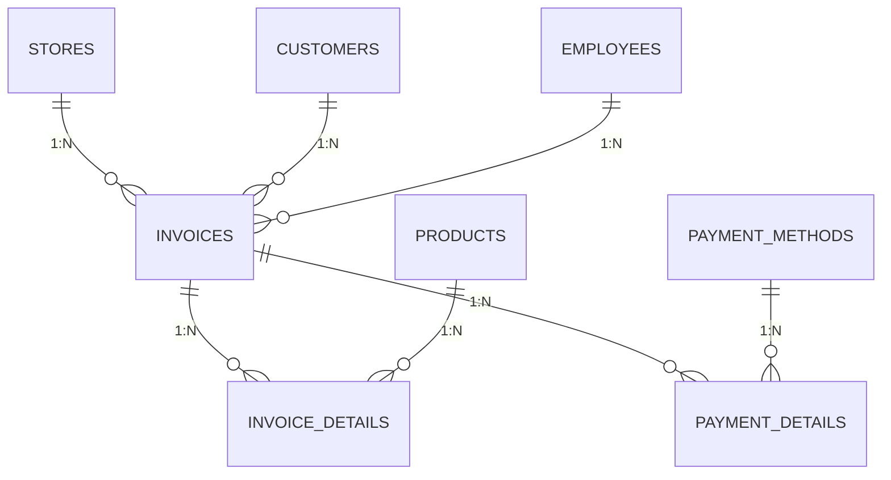
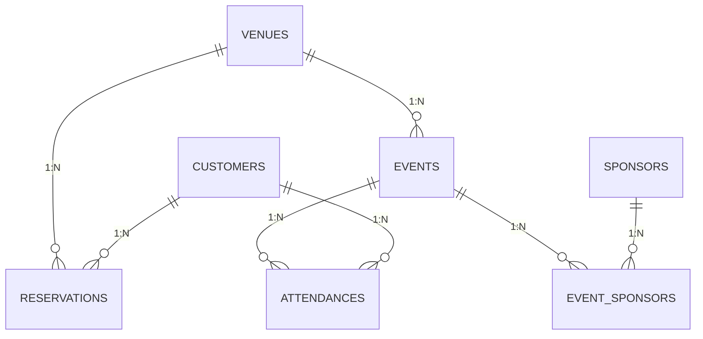

# 🗄️ Diccionario de Base de Datos y Modelo Entidad-Relación (ERD)
## Sistema Sound Heritage (E-Commerce, Reservas de Salón y Triple Panel ERP)

[⬅️ Volver al README Principal](../README.md)

> **Propósito del documento:** Este manual técnico define de manera exhaustiva el esquema relacional de datos del sistema **Sound Heritage**. Incluye las 21 tablas de dominio, sus modificaciones históricas, tipos de datos SQL, restricciones de integridad referencial, claves foráneas, casts de Eloquent, eventos reactivos de stock y el padrón de auditoría forense.

---

## 1. Convenciones Generales del Esquema

1. **Motor de Almacenamiento:** MySQL / MariaDB (Motor InnoDB con soporte para transacciones ACID y Foreign Keys).
2. **Juego de Caracteres y Cotejamiento:** `utf8mb4` con `utf8mb4_unicode_ci` (soporte completo para caracteres internacionales y emojis).
3. **Estrategia de Claves Primarias:** Cada tabla de dominio utiliza un identificador `id` de tipo `BIGINT UNSIGNED` auto-incremental (`$table->id()`).
4. **Marcas de Tiempo (Timestamps):** Todas las tablas incorporan `created_at` y `updated_at` de tipo `TIMESTAMP NULL` administradas automáticamente por Eloquent.
5. **Bajas Lógicas (Soft Deletes):** Nueve modelos críticos implementan `deleted_at TIMESTAMP NULL` para preservar el historial contable y legal sin destruir registros físicos:
   * `users`, `customers`, `employees`, `suppliers`, `sponsors`, `products`, `purchases`, `invoices`, `attendances`.
6. **Auditoría Forense Inmutable:** Siete modelos implementan el contrato `OwenIt\Auditing\Contracts\Auditable` mediante el paquete `owen-it/laravel-auditing`:
   * `users`, `customers`, `employees`, `sponsors`, `events`, `invoices`, `attendances`.
   * Cada modificación (`created`, `updated`, `deleted`, `restored`) inserta una fila en la tabla `audits` con `old_values`, `new_values`, `user_id`, `ip_address` y `user_agent`.
7. **Nomenclatura Limpia de Archivos:** Toda referencia a modelos, componentes y migraciones se expresa partiendo estrictamente desde la carpeta del proyecto (ejemplo: `/app/Models/PaymentMethod.php`), eliminando cualquier ruta del servidor local o prefijo `file:///`.

---

## 2. Diagramas Entidad-Relación Organizados (Cero Spaghetti / Líneas Rectas)

Para evitar diagramas sobrecargados con líneas cruzadas ("efecto spaghetti"), el modelo de datos de **Sound Heritage** se organiza en **4 diagramas ERD modulares y lineales**, complementados por un **mapa general de arquitectura**.

### 2.1 Mapa de Integración entre Subdominios

---

### 2.2 Diagramas ERD Detallados por Subdominio

#### A) Subdominio: Personas, Estructura Laboral y Geografía

#### B) Subdominio: Cadena de Suministro y Reposición de Inventario

#### C) Subdominio: Ventas, Facturación y Caja

#### D) Subdominio: Salón, Agenda Cultural y Entradas

---

## 3. Subdominio 1: Ventas, Facturación y Caja

### 3.1 Tabla: `invoices` (Facturas y Comprobantes de Venta)
* **Modelo Eloquent:** `App\Models\Invoice` (`/app/Models/Invoice.php`)
* **Propósito:** Registro cabecera de todas las transacciones comerciales emitidas por caja física o tienda web.
* **Traits e Interfaces:** `SoftDeletes`, `Auditable`.

| Columna | Tipo SQL | Nulo | Default | Descripción Funcional |
| :--- | :--- | :---: | :---: | :--- |
| `id` | `BIGINT UNSIGNED` | No | Auto | Identificador primario de la factura. |
| `invoice_type` | `VARCHAR(255)` | No | - | Tipo de comprobante fiscal (`Factura B`, `Ticket`, `Comprobante Web`). |
| `point_of_sale` | `VARCHAR(255)` | No | - | Punto de venta emisor (ej. `0001` Caja Mostrador, `0002` Web). |
| `receipt_number` | `VARCHAR(255)` | No | - | Número correlativo del comprobante fiscal. |
| `issue_date` | `DATE` | No | - | Fecha formal de emisión de la factura. |
| `due_date` | `DATE` | No | - | Fecha de vencimiento del pago. |
| `total` | `DECIMAL(10,2)` | No | - | Monto total final liquidado. |
| `store_id` | `BIGINT UNSIGNED` | No | - | FK hacia `stores.id` (Sucursal emisora). |
| `customer_id` | `BIGINT UNSIGNED` | Sí | `NULL` | FK hacia `customers.id` (Cliente receptor, nulo en ventas rápidas). |
| `tax_condition` | `VARCHAR(255)` | No | `'Consumidor Final'` | Condición fiscal ante AFIP/Rentas. |
| `employee_id` | `BIGINT UNSIGNED` | No | - | FK hacia `employees.id` (Vendedor/Cajero responsable). |
| `mp_order_id` | `VARCHAR(100)` | Sí | `NULL` | Identificador de orden externa en Mercado Pago (Indexado). |
| `mp_payment_id` | `VARCHAR(100)` | Sí | `NULL` | Identificador de cobro aprobado en Mercado Pago (Indexado). |
| `payment_status` | `VARCHAR(50)` | No | `'completed'` | Estado transaccional (`completed`, `pending`, `refunded`). |
| `mp_refund_id` | `VARCHAR(255)` | Sí | `NULL` | Identificador de devolución en Mercado Pago si hubo reintegro. |
| `refunded_at` | `TIMESTAMP` | Sí | `NULL` | Fecha y hora en la que se efectuó el reembolso. |
| `deleted_at` | `TIMESTAMP` | Sí | `NULL` | Marca de borrado lógico / anulación de la factura. |
| `created_at` / `updated_at` | `TIMESTAMP` | Sí | `NULL` | Marcas de auditoría temporal de Laravel. |

* **Relaciones Eloquent:**
  * `belongsTo(Store::class)`
  * `belongsTo(Customer::class)`
  * `belongsTo(Employee::class)`
  * `hasMany(InvoiceDetail::class)`
  * `hasMany(PaymentDetail::class)`
* **Regla Reactiva en `booted()`:** Al anular la factura (`static::deleting`), si no es borrado forzado, recorre sus líneas `invoiceDetails` y reincorpora el stock de los productos con `Product::increment('stock', $detail->quantity)`.

---

### 3.2 Tabla: `invoice_details` (Líneas y Renglones de Factura)
* **Modelo Eloquent:** `App\Models\InvoiceDetail` (`/app/Models/InvoiceDetail.php`)
* **Propósito:** Detalle de los ítems comercializados en una factura (instrumentos, señas de reservas o entradas).

| Columna | Tipo SQL | Nulo | Default | Descripción Funcional |
| :--- | :--- | :---: | :---: | :--- |
| `id` | `BIGINT UNSIGNED` | No | Auto | Identificador primario del renglón. |
| `invoice_id` | `BIGINT UNSIGNED` | No | - | FK hacia `invoices.id` (Comprobante contenedor). |
| `product_id` | `BIGINT UNSIGNED` | Sí | `NULL` | FK hacia `products.id` (Opcional, nulo en conceptos o servicios). |
| `description` | `VARCHAR(255)` | Sí | `NULL` | Concepto libre cuando se factura sin producto de catálogo. |
| `quantity` | `INT` | No | - | Cantidad de unidades facturadas. |
| `unit_price` | `DECIMAL(10,2)` | No | - | Precio unitario aplicado al momento de la venta. |
| `subtotal` | `DECIMAL(10,2)` | No | - | Resultado matemático de `quantity * unit_price`. |
| `created_at` / `updated_at` | `TIMESTAMP` | Sí | `NULL` | Marcas temporales. |

* **Relaciones Eloquent:**
  * `belongsTo(Invoice::class)`
  * `belongsTo(Product::class)`
* **Regla Reactiva en `booted()`:** Al insertar el renglón (`static::created`), si `product_id` no es nulo, ejecuta de forma atómica: `Product::where('id', $detail->product_id)->decrement('stock', $detail->quantity)`.

---

### 3.3 Tabla: `payment_methods` (Medios de Cobro)
* **Modelo Eloquent:** `App\Models\PaymentMethod` (`/app/Models/PaymentMethod.php`)
* **Propósito:** Catálogo de medios de pago autorizados en el sistema.

| Columna | Tipo SQL | Nulo | Default | Descripción Funcional |
| :--- | :--- | :---: | :---: | :--- |
| `id` | `BIGINT UNSIGNED` | No | Auto | Identificador primario. |
| `name` | `VARCHAR(255)` | No | - | Denominación (`Efectivo`, `Mercado Pago QR`, `Transferencia Bancaria`). |
| `created_at` / `updated_at` | `TIMESTAMP` | Sí | `NULL` | Marcas temporales. |

* **Relaciones Eloquent:**
  * `hasMany(PaymentDetail::class)`

---

### 3.4 Tabla: `payment_details` (Imputación de Pagos a Facturas)
* **Modelo Eloquent:** `App\Models\PaymentDetail` (`/app/Models/PaymentDetail.php`)
* **Propósito:** Desglose de cómo fue abonada una factura (permite pagos mixtos: efectivo + QR).

| Columna | Tipo SQL | Nulo | Default | Descripción Funcional |
| :--- | :--- | :---: | :---: | :--- |
| `id` | `BIGINT UNSIGNED` | No | Auto | Identificador primario de la transacción de cobro. |
| `invoice_id` | `BIGINT UNSIGNED` | No | - | FK hacia `invoices.id`. |
| `payment_method_id` | `BIGINT UNSIGNED` | No | - | FK hacia `payment_methods.id`. |
| `created_at` / `updated_at` | `TIMESTAMP` | Sí | `NULL` | Marcas temporales. |

* **Relaciones Eloquent:**
  * `belongsTo(Invoice::class)`
  * `belongsTo(PaymentMethod::class)`

---

## 4. Subdominio 2: E-Commerce, Catálogo y Depósito

### 4.1 Tabla: `products` (Catálogo de Instrumentos y Productos)
* **Modelo Eloquent:** `App\Models\Product` (`/app/Models/Product.php`)
* **Propósito:** Catálogo unificado de instrumentos musicales y accesorios para venta online y mostrador.
* **Traits e Interfaces:** `SoftDeletes`.

| Columna | Tipo SQL | Nulo | Default | Descripción Funcional |
| :--- | :--- | :---: | :---: | :--- |
| `id` | `BIGINT UNSIGNED` | No | Auto | Identificador del producto / SKU. |
| `type` | `VARCHAR(255)` | No | - | Categoría del producto (`Guitarras`, `Baterías`, `Teclados`, `Audio`). |
| `name` | `VARCHAR(255)` | No | - | Nombre comercial del instrumento. |
| `brand` | `VARCHAR(255)` | Sí | `NULL` | Marca fabricante (`Fender`, `Gibson`, `Yamaha`, `Roland`). |
| `model` | `VARCHAR(255)` | Sí | `NULL` | Modelo específico de fábrica. |
| `image` | `VARCHAR(255)` | Sí | `NULL` | Ruta de la imagen principal almacenada en `storage/app/public`. |
| `price` | `DECIMAL(10,2)` | No | - | Precio base de venta al público en ARS. |
| `discount_percentage` | `TINYINT UNSIGNED` | Sí | `NULL` | Porcentaje de descuento promocional (0 a 100%). |
| `stock` | `INT` | No | `0` | Existencia física en depósito / almacén central. |
| `specs` | `JSON` | Sí | `NULL` | Ficha técnica en formato JSON estructurado (maderas, pastillas, trastes). |
| `deleted_at` | `TIMESTAMP` | Sí | `NULL` | Baja lógica de producto. |
| `created_at` / `updated_at` | `TIMESTAMP` | Sí | `NULL` | Marcas temporales. |

* **Casts de Eloquent:** `'specs' => 'array'`, `'price' => 'decimal:2'`.
* **Relaciones Eloquent:**
  * `hasMany(InvoiceDetail::class)`
  * `hasMany(PurchaseDetail::class)`

---

### 4.2 Tabla: `stores` (Sucursales y Tiendas Físicas)
* **Modelo Eloquent:** `App\Models\Store` (`/app/Models/Store.php`)
* **Propósito:** Sedes físicas de la empresa emisoras de facturas y puntos de entrega.

| Columna | Tipo SQL | Nulo | Default | Descripción Funcional |
| :--- | :--- | :---: | :---: | :--- |
| `id` | `BIGINT UNSIGNED` | No | Auto | Identificador de sucursal. |
| `company_name` | `VARCHAR(255)` | No | - | Razón social de la sede (`Sound Heritage Central`). |
| `address` | `VARCHAR(255)` | No | - | Domicilio comercial. |
| `tax_condition` | `VARCHAR(255)` | No | - | Condición tributaria de la empresa. |
| `phone` | `VARCHAR(255)` | No | - | Teléfono institucional. |
| `tax_id` | `VARCHAR(255)` | No | - | CUIT tributario de la sede. |
| `start_date` | `DATE` | No | - | Fecha de inicio de actividades comerciales. |
| `created_at` / `updated_at` | `TIMESTAMP` | Sí | `NULL` | Marcas temporales. |

* **Relaciones Eloquent:**
  * `hasMany(Invoice::class)`

---

### 4.3 Tabla: `suppliers` (Proveedores Comerciales)
* **Modelo Eloquent:** `App\Models\Supplier` (`/app/Models/Supplier.php`)
* **Propósito:** Registro de distribuidores y fabricantes a quienes se adquiere mercadería.
* **Traits e Interfaces:** `SoftDeletes`.

| Columna | Tipo SQL | Nulo | Default | Descripción Funcional |
| :--- | :--- | :---: | :---: | :--- |
| `id` | `BIGINT UNSIGNED` | No | Auto | Identificador del proveedor. |
| `name` | `VARCHAR(255)` | No | - | Razón social o nombre comercial del proveedor. |
| `contact_name` | `VARCHAR(255)` | Sí | `NULL` | Nombre de la persona o ejecutivo de cuentas. |
| `phone` | `VARCHAR(255)` | Sí | `NULL` | Teléfono directo de contacto. |
| `email` | `VARCHAR(255)` | Sí | `NULL` | Correo electrónico comercial. |
| `address` | `VARCHAR(255)` | Sí | `NULL` | Domicilio del depósito o fábrica. |
| `deleted_at` | `TIMESTAMP` | Sí | `NULL` | Baja lógica de proveedor. |
| `created_at` / `updated_at` | `TIMESTAMP` | Sí | `NULL` | Marcas temporales. |

* **Relaciones Eloquent:**
  * `hasMany(Purchase::class)`

---

### 4.4 Tabla: `purchases` (Órdenes de Compra y Reposición)
* **Modelo Eloquent:** `App\Models\Purchase` (`/app/Models/Purchase.php`)
* **Propósito:** Cabecera de compras mayoristas que abastecen el stock del depósito.
* **Traits e Interfaces:** `SoftDeletes`.

| Columna | Tipo SQL | Nulo | Default | Descripción Funcional |
| :--- | :--- | :---: | :---: | :--- |
| `id` | `BIGINT UNSIGNED` | No | Auto | Identificador de la orden de compra. |
| `purchase_date` | `DATE` | No | - | Fecha de recepción/facturación del proveedor. |
| `total` | `DECIMAL(10,2)` | No | `0.00` | Monto total erogado en la compra. |
| `supplier_id` | `BIGINT UNSIGNED` | No | - | FK hacia `suppliers.id`. |
| `deleted_at` | `TIMESTAMP` | Sí | `NULL` | Baja lógica / anulación de orden de compra. |
| `created_at` / `updated_at` | `TIMESTAMP` | Sí | `NULL` | Marcas temporales. |

* **Relaciones Eloquent:**
  * `belongsTo(Supplier::class)`
  * `hasMany(PurchaseDetail::class)`
* **Reglas Reactivas en `booted()`:**
  * Al anular la compra (`static::deleting`): Descuenta del depósito el stock que había ingresado con `Product::decrement('stock', $detail->quantity)`.
  * Al restaurar la compra (`static::restoring`): Vuelve a sumar el stock con `Product::increment(...)`.

---

### 4.5 Tabla: `purchase_details` (Renglones de Compra a Proveedor)
* **Modelo Eloquent:** `App\Models\PurchaseDetail` (`/app/Models/PurchaseDetail.php`)
* **Propósito:** Desglose de instrumentos y cantidades recibidas en una orden de compra.

| Columna | Tipo SQL | Nulo | Default | Descripción Funcional |
| :--- | :--- | :---: | :---: | :--- |
| `id` | `BIGINT UNSIGNED` | No | Auto | Identificador del renglón de compra. |
| `purchase_id` | `BIGINT UNSIGNED` | No | - | FK hacia `purchases.id`. |
| `product_id` | `BIGINT UNSIGNED` | No | - | FK hacia `products.id`. |
| `quantity` | `INT` | No | - | Cantidad de unidades físicas ingresadas. |
| `price` | `DECIMAL(10,2)` | No | - | Costo unitario de adquisición mayorista. |
| `created_at` / `updated_at` | `TIMESTAMP` | Sí | `NULL` | Marcas temporales. |

* **Relaciones Eloquent:**
  * `belongsTo(Purchase::class)`
  * `belongsTo(Product::class)`
* **Regla Reactiva en `booted()`:** Al crearse (`static::created`), ejecuta `Product::increment('stock', $detail->quantity)`, actualizando inmediatamente el inventario disponible.

---

## 5. Subdominio 3: Salón, Auditorio y Agenda Cultural

### 5.1 Tabla: `venues` (Salones y Salas de Ensayo)
* **Modelo Eloquent:** `App\Models\Venue` (`/app/Models/Venue.php`)
* **Propósito:** Espacios físicos de Sound Heritage habilitados para alquiler o recitales.

| Columna | Tipo SQL | Nulo | Default | Descripción Funcional |
| :--- | :--- | :---: | :---: | :--- |
| `id` | `BIGINT UNSIGNED` | No | Auto | Identificador del salón. |
| `name` | `VARCHAR(255)` | No | - | Nombre de la sala (`Auditorio Principal`, `Sala Acústica`). |
| `capacity` | `INT` | No | - | Capacidad máxima autorizada de personas. |
| `location` | `VARCHAR(255)` | No | - | Ubicación interna dentro de las instalaciones. |
| `created_at` / `updated_at` | `TIMESTAMP` | Sí | `NULL` | Marcas temporales. |

* **Relaciones Eloquent:**
  * `hasMany(Reservation::class)`
  * `hasMany(Event::class)`

---

### 5.2 Tabla: `reservations` (Reservas de Salón y Turnos)
* **Modelo Eloquent:** `App\Models\Reservation` (`/app/Models/Reservation.php`)
* **Propósito:** Solicitudes y reservas formales de alquiler de salones para ensayos o recitales.

| Columna | Tipo SQL | Nulo | Default | Descripción Funcional |
| :--- | :--- | :---: | :---: | :--- |
| `id` | `BIGINT UNSIGNED` | No | Auto | Identificador primario de la reserva. |
| `venue_id` | `BIGINT UNSIGNED` | No | - | FK hacia `venues.id` (Salón reservado). |
| `customer_id` | `BIGINT UNSIGNED` | No | - | FK hacia `customers.id` (Cliente titular). |
| `type` | `VARCHAR(255)` | No | - | Finalidad de la reserva (`Ensayo de Banda`, `Grabación`). |
| `date` | `DATE` | No | - | Fecha de la reserva (mínimo 7 días de anticipación). |
| `shift` | `VARCHAR(255)` | Sí | `NULL` | Turno de horario (`Tarde (15:00 a 19:00 hs)`, `Noche`). |
| `attendees_count` | `SMALLINT UNSIGNED` | No | `1` | Asistentes previstos (rango permitido de 1 a 150). |
| `notes` | `TEXT` | Sí | `NULL` | Requisitos técnicos o notas del solicitante. |
| `price` | `DECIMAL(10,2)` | No | `0.00` | Precio total cotizado del alquiler. |
| `deposit_amount` | `DECIMAL(12,2)` | Sí | `NULL` | Monto de la seña pagada (30% o total 100%). |
| `payment_method` | `VARCHAR(255)` | Sí | `NULL` | Medio de pago utilizado (`Mercado Pago`, `Efectivo`). |
| `payment_status` | `VARCHAR(255)` | No | `'Pendiente de Seña'` | Estado del cobro (`Pendiente de Seña`, `Señada`, `Pagado Total`). |
| `status` | `VARCHAR(255)` | No | `'Pendiente'` | Estado operativo (`Pendiente`, `Confirmada`, `Cancelada`). |
| `mp_order_id` | `VARCHAR(100)` | Sí | `NULL` | Identificador de orden en Mercado Pago. |
| `mp_payment_id` | `VARCHAR(100)` | Sí | `NULL` | Identificador de cobro en Mercado Pago. |
| `mp_refund_id` | `VARCHAR(255)` | Sí | `NULL` | Identificador de reintegro en Mercado Pago si canceló. |
| `refunded_at` | `TIMESTAMP` | Sí | `NULL` | Fecha de devolución de la seña. |
| `created_at` / `updated_at` | `TIMESTAMP` | Sí | `NULL` | Marcas temporales. |

* **Relaciones Eloquent:**
  * `belongsTo(Venue::class)`
  * `belongsTo(Customer::class)`

---

### 5.3 Tabla: `events` (Cartelera Cultural y Recitales)
* **Modelo Eloquent:** `App\Models\Event` (`/app/Models/Event.php`)
* **Propósito:** Recitales, clínicas de música y eventos culturales públicos.
* **Traits e Interfaces:** `SoftDeletes`, `Auditable`.

| Columna | Tipo SQL | Nulo | Default | Descripción Funcional |
| :--- | :--- | :---: | :---: | :--- |
| `id` | `BIGINT UNSIGNED` | No | Auto | Identificador del evento. |
| `name` | `VARCHAR(255)` | No | - | Título o nombre de la función cultural. |
| `date` | `DATE` | No | - | Fecha de realización del evento. |
| `time` | `TIME` | Sí | `NULL` | Hora de apertura o inicio del show. |
| `type` | `VARCHAR(255)` | No | - | Género / tipo (`Recital`, `Masterclass`, `Festival`). |
| `description` | `TEXT` | Sí | `NULL` | Sinopsis y detalle informativo para el público. |
| `capacity` | `INT` | No | - | Cupo total de tickets disponibles para la venta. |
| `price` | `DECIMAL(10,2)` | No | `0.00` | Costo por entrada unitaria en ARS. |
| `venue_id` | `BIGINT UNSIGNED` | No | - | FK hacia `venues.id` (Salón sede). |
| `deleted_at` | `TIMESTAMP` | Sí | `NULL` | Baja lógica de evento. |
| `created_at` / `updated_at` | `TIMESTAMP` | Sí | `NULL` | Marcas temporales. |

* **Relaciones Eloquent:**
  * `belongsTo(Venue::class)`
  * `hasMany(Attendance::class)`
  * `hasMany(EventSponsor::class)`
  * `belongsToMany(Sponsor::class, 'event_sponsors')`

---

### 5.4 Tabla: `attendances` (Entradas Vendidas y Asistencia)
* **Modelo Eloquent:** `App\Models\Attendance` (`/app/Models/Attendance.php`)
* **Propósito:** Registro individual de entradas emitidas y control de acceso al auditorio.
* **Traits e Interfaces:** `SoftDeletes`, `Auditable`.

| Columna | Tipo SQL | Nulo | Default | Descripción Funcional |
| :--- | :--- | :---: | :---: | :--- |
| `id` | `BIGINT UNSIGNED` | No | Auto | Identificador primario de la entrada / ticket. |
| `registration_date` | `DATE` | No | - | Fecha en que se adquirió el ticket. |
| `customer_id` | `BIGINT UNSIGNED` | No | - | FK hacia `customers.id` (Cliente comprador). |
| `event_id` | `BIGINT UNSIGNED` | No | - | FK hacia `events.id` (Evento cultural asociado). |
| `price` | `DECIMAL(10,2)` | No | `0.00` | Importe unitario cobrado por la entrada. |
| `quantity` | `INT UNSIGNED` | No | `1` | Cantidad de pases representados en este ticket. |
| `payment_method` | `VARCHAR(255)` | Sí | `NULL` | Medio de cobro de la entrada. |
| `payment_status` | `VARCHAR(255)` | No | `'completed'` | Estado del pago (`completed`, `refunded`). |
| `mp_order_id` | `VARCHAR(255)` | Sí | `NULL` | Orden asociada de Mercado Pago. |
| `mp_payment_id` | `VARCHAR(255)` | Sí | `NULL` | ID de cobro en Mercado Pago. |
| `mp_refund_id` | `VARCHAR(255)` | Sí | `NULL` | ID de reembolso en caso de anulación. |
| `refunded_at` | `TIMESTAMP` | Sí | `NULL` | Fecha de cancelación de la entrada. |
| `deleted_at` | `TIMESTAMP` | Sí | `NULL` | Baja lógica de la entrada. |
| `created_at` / `updated_at` | `TIMESTAMP` | Sí | `NULL` | Marcas temporales. |

* **Relaciones Eloquent:**
  * `belongsTo(Customer::class)`
  * `belongsTo(Event::class)`

---

### 5.5 Tablas: `sponsors` y `event_sponsors` (Patrocinadores)
* **Modelos Eloquent:** `App\Models\Sponsor` (`/app/Models/Sponsor.php`) y `App\Models\EventSponsor` (`/app/Models/EventSponsor.php`)
* **Propósito:** Auspiciantes corporativos y relación de marcas con la cartelera cultural.
* **Traits e Interfaces:** `Sponsor` implementa `SoftDeletes` y `Auditable`.

**Estructura de `sponsors`:**
| Columna | Tipo SQL | Nulo | Default | Descripción |
| :--- | :--- | :---: | :---: | :--- |
| `id` | `BIGINT UNSIGNED` | No | Auto | ID del auspiciante. |
| `name` | `VARCHAR(255)` | No | - | Marca o nombre corporativo. |
| `type` | `VARCHAR(255)` | No | - | Categoría (`Bebidas`, `Indumentaria`, `Equipamiento`). |
| `phone` / `email` | `VARCHAR(255)` | No | - | Datos de contacto institucional. |
| `deleted_at` | `TIMESTAMP` | Sí | `NULL` | Baja lógica. |
| `created_at` / `updated_at` | `TIMESTAMP` | Sí | `NULL` | Marcas temporales. |

**Estructura de `event_sponsors` (Tabla Pivote):**
| Columna | Tipo SQL | Nulo | Default | Descripción |
| :--- | :--- | :---: | :---: | :--- |
| `id` | `BIGINT UNSIGNED` | No | Auto | ID de la asignación. |
| `event_id` | `BIGINT UNSIGNED` | No | - | FK hacia `events.id`. |
| `sponsor_id` | `BIGINT UNSIGNED` | No | - | FK hacia `sponsors.id`. |
| `created_at` / `updated_at` | `TIMESTAMP` | Sí | `NULL` | Marcas temporales. |

---

## 6. Subdominio 4: Personas, Seguridad, Auditoría y Geografía

### 6.1 Tabla: `users` (Cuentas de Acceso al Sistema)
* **Modelo Eloquent:** `App\Models\User` (`/app/Models/User.php`)
* **Propósito:** Credenciales de autenticación, sesión y roles de seguridad Spatie.
* **Traits e Interfaces:** `HasRoles` (Spatie), `FilamentUser`, `MustVerifyEmail`, `SoftDeletes`, `Auditable`.

| Columna | Tipo SQL | Nulo | Default | Descripción Funcional |
| :--- | :--- | :---: | :---: | :--- |
| `id` | `BIGINT UNSIGNED` | No | Auto | Identificador primario de usuario. |
| `name` | `VARCHAR(255)` | No | - | Nombre completo del usuario. |
| `email` | `VARCHAR(255)` | No | - | Correo electrónico único para inicio de sesión. |
| `email_verified_at` | `TIMESTAMP` | Sí | `NULL` | Fecha en que verificó su casilla de correo. |
| `password` | `VARCHAR(255)` | No | - | Hash Bcrypt/Argon2 de la contraseña. |
| `remember_token` | `VARCHAR(100)` | Sí | `NULL` | Token de persistencia de sesión segura en navegador. |
| `deleted_at` | `TIMESTAMP` | Sí | `NULL` | Suspensión lógica de la cuenta. |
| `created_at` / `updated_at` | `TIMESTAMP` | Sí | `NULL` | Marcas temporales. |

* **Relaciones Eloquent:**
  * `hasOne(Customer::class)` (Vínculo 1 a 1 con padrón de clientes).
  * `hasOne(Employee::class)` (Vínculo 1 a 1 con legajo de empleado).
* **Control de Acceso a Paneles (`canAccessPanel`):**
  * Si `$panel->getId() === 'admin'`: Exige `$user->hasRole('Administrador')`.
  * Si `$panel->getId() === 'vendedor'`: Exige `$user->hasAnyRole(['Administrador', 'Vendedor'])`.
  * Si `$panel->getId() === 'stock'`: Exige `$user->hasAnyRole(['Administrador', 'Encargado de Stock'])`.
* **Sincronizador de Perfiles (`syncProfileFromRoles`):** Al modificar roles, crea o vincula automáticamente la ficha de `Customer` o `Employee`.

---

### 6.2 Tabla: `customers` (Padrón de Clientes)
* **Modelo Eloquent:** `App\Models\Customer` (`/app/Models/Customer.php`)
* **Propósito:** Ficha física y fiscal de compradores de la tienda y solicitantes de reservas.
* **Traits e Interfaces:** `SoftDeletes`, `Auditable`.

| Columna | Tipo SQL | Nulo | Default | Descripción Funcional |
| :--- | :--- | :---: | :---: | :--- |
| `id` | `BIGINT UNSIGNED` | No | Auto | Identificador primario del cliente. |
| `user_id` | `BIGINT UNSIGNED` | Sí | `NULL` | FK 1:1 única hacia `users.id` (Enlace de sesión web). |
| `document_number` | `VARCHAR(255)` | No | - | DNI o CUIT numérico del cliente (Validado 7 a 11 dígitos). |
| `last_name` | `VARCHAR(255)` | No | - | Apellido del titular. |
| `first_name` | `VARCHAR(255)` | No | - | Nombres del titular. |
| `address` | `VARCHAR(255)` | No | - | Dirección particular o comercial para envíos. |
| `phone` | `VARCHAR(255)` | No | - | Teléfono / WhatsApp de contacto directo. |
| `email` | `VARCHAR(255)` | Sí | `NULL` | Correo electrónico para notificaciones. |
| `tax_id` | `VARCHAR(255)` | Sí | `NULL` | Identificador fiscal CUIT/CUIL adicional. |
| `tax_condition` | `VARCHAR(255)` | No | `'Consumidor Final'` | Categoría fiscal (`Consumidor Final`, `Responsable Inscripto`). |
| `city_id` | `BIGINT UNSIGNED` | No | - | FK hacia `cities.id` (Localidad de radicación). |
| `deleted_at` | `TIMESTAMP` | Sí | `NULL` | Baja lógica de cliente. |
| `created_at` / `updated_at` | `TIMESTAMP` | Sí | `NULL` | Marcas temporales. |

* **Relaciones Eloquent:**
  * `belongsTo(User::class)`
  * `belongsTo(City::class)`
  * `hasMany(Invoice::class)`
  * `hasMany(Reservation::class)`
  * `hasMany(Attendance::class)`
* **Regla Reactiva en `booted()`:** Al crearse un cliente con email (`static::creating`), si no tiene `user_id`, se crea automáticamente su cuenta en `users` con contraseña temporal igual a su DNI y se le asigna el rol `'Cliente'`. Al suspender el cliente, se desactiva su usuario web.

---

### 6.3 Tablas: `employees` y `employee_categories` (Personal y Puestos)
* **Modelos Eloquent:** `App\Models\Employee` (`/app/Models/Employee.php`) y `App\Models\EmployeeCategory` (`/app/Models/EmployeeCategory.php`)
* **Propósito:** Estructura de recursos humanos y personal de atención de la empresa.
* **Traits e Interfaces:** `Employee` implementa `SoftDeletes` y `Auditable`.

**Estructura de `employees`:**
| Columna | Tipo SQL | Nulo | Default | Descripción |
| :--- | :--- | :---: | :---: | :--- |
| `id` | `BIGINT UNSIGNED` | No | Auto | ID del empleado / Legajo. |
| `user_id` | `BIGINT UNSIGNED` | Sí | `NULL` | FK 1:1 única hacia `users.id` para acceso a paneles. |
| `document_number` | `VARCHAR(255)` | No | - | DNI del empleado. |
| `last_name` / `first_name` | `VARCHAR(255)` | No | - | Nombres y apellidos. |
| `photo` | `VARCHAR(255)` | Sí | `NULL` | Fotografía de perfil en storage. |
| `address` / `phone` | `VARCHAR(255)` | No | - | Datos de contacto. |
| `city_id` | `BIGINT UNSIGNED` | No | - | FK hacia `cities.id`. |
| `employee_category_id` | `BIGINT UNSIGNED` | No | - | FK hacia `employee_categories.id`. |
| `deleted_at` | `TIMESTAMP` | Sí | `NULL` | Baja laboral lógica. |
| `created_at` / `updated_at` | `TIMESTAMP` | Sí | `NULL` | Marcas temporales. |

**Estructura de `employee_categories`:**
| Columna | Tipo SQL | Nulo | Default | Descripción |
| :--- | :--- | :---: | :---: | :--- |
| `id` | `BIGINT UNSIGNED` | No | Auto | ID de la categoría laboral. |
| `name` | `VARCHAR(255)` | No | - | Puesto (`Cajero / Vendedor`, `Jefe de Almacén`, `Administrador`). |
| `created_at` / `updated_at` | `TIMESTAMP` | Sí | `NULL` | Marcas temporales. |

* **Regla Reactiva en `booted()`:** Al crearse un empleado (`static::creating`), si no tiene `user_id`, genera su email corporativo (`nombre.apellido.dni@soundheritage.com`), crea su cuenta en `users` con contraseña igual a su DNI y le asigna el rol `'Vendedor'` por defecto.

---

### 6.4 Tablas: `provinces` y `cities` (División Geográfica)
* **Modelos Eloquent:** `App\Models\Province` (`/app/Models/Province.php`) y `App\Models\City` (`/app/Models/City.php`)
* **Propósito:** Estandarización geográfica para logística de envíos y radicación de clientes.

**Estructura de `provinces`:**
| Columna | Tipo SQL | Nulo | Default | Descripción |
| :--- | :--- | :---: | :---: | :--- |
| `id` | `BIGINT UNSIGNED` | No | Auto | ID de la provincia. |
| `name` | `VARCHAR(255)` | No | - | Nombre (`Buenos Aires`, `Córdoba`, `Santa Fe`, etc.). |
| `created_at` / `updated_at` | `TIMESTAMP` | Sí | `NULL` | Marcas temporales. |

**Estructura de `cities`:**
| Columna | Tipo SQL | Nulo | Default | Descripción |
| :--- | :--- | :---: | :---: | :--- |
| `id` | `BIGINT UNSIGNED` | No | Auto | ID de la ciudad / localidad. |
| `name` | `VARCHAR(255)` | No | - | Nombre de la ciudad. |
| `province_id` | `BIGINT UNSIGNED` | No | - | FK hacia `provinces.id` (`provinces` onDelete restrict). |
| `created_at` / `updated_at` | `TIMESTAMP` | Sí | `NULL` | Marcas temporales. |

---

### 6.5 Tabla: `audits` (Registro Forense de Trazabilidad)
* **Manejador:** Paquete `owen-it/laravel-auditing`
* **Propósito:** Registro inmutable de cada creación, edición o baja efectuada sobre modelos auditables.

| Columna | Tipo SQL | Nulo | Default | Descripción Funcional |
| :--- | :--- | :---: | :---: | :--- |
| `id` | `BIGINT UNSIGNED` | No | Auto | ID de auditoría. |
| `user_type` / `user_id` | `VARCHAR(255)` / `BIGINT` | Sí | `NULL` | Usuario que ejecutó la operación (Mapeo polimórfico). |
| `event` | `VARCHAR(255)` | No | - | Tipo de operación (`created`, `updated`, `deleted`, `restored`). |
| `auditable_type` / `auditable_id` | `VARCHAR(255)` / `BIGINT` | No | - | Modelo y registro afectado (ej. `App\Models\Invoice`, ID `45`). |
| `old_values` | `TEXT` | Sí | `NULL` | JSON con los valores antes de la modificación. |
| `new_values` | `TEXT` | Sí | `NULL` | JSON con los valores después de la modificación. |
| `url` | `TEXT` | Sí | `NULL` | Ruta o endpoint HTTP desde donde se originó la petición. |
| `ip_address` | `VARCHAR(45)` | Sí | `NULL` | Dirección IP del cliente u operador. |
| `user_agent` | `VARCHAR(1023)` | Sí | `NULL` | Navegador y sistema operativo del usuario. |
| `tags` | `VARCHAR(255)` | Sí | `NULL` | Etiquetas de contexto si fueron configuradas. |
| `created_at` / `updated_at` | `TIMESTAMP` | Sí | `NULL` | Marca de tiempo inmutable del suceso. |

---

## 7. Resumen de Integridad Referencial y Políticas de Cascada

| Tabla Hija | Clave Foránea (`foreignId`) | Tabla Padre | Comportamiento en Eliminación (`onDelete`) | Justificación de Negocio |
| :--- | :--- | :--- | :--- | :--- |
| `customers` | `user_id` | `users` | `nullOnDelete()` | Si se borra la cuenta web, la ficha del cliente y su historial contable permanecen. |
| `employees` | `user_id` | `users` | `nullOnDelete()` | El legajo histórico de sueldos no se pierde si se suspende el acceso del empleado. |
| `cities` | `province_id` | `provinces` | `RESTRICT` (Default) | No se permite eliminar una provincia si tiene ciudades asociadas. |
| `purchases` | `supplier_id` | `suppliers` | `RESTRICT` | No se puede borrar un proveedor que tiene órdenes de compra históricas. |
| `purchase_details`| `purchase_id` | `purchases` | `RESTRICT` | Las líneas de mercadería están protegidas por integridad contable. |
| `purchase_details`| `product_id` | `products` | `RESTRICT` | Un instrumento con historial de compras no puede eliminarse físicamente. |
| `invoices` | `store_id` | `stores` | `RESTRICT` | Protección fiscal de sucursal. |
| `invoices` | `employee_id` | `employees` | `RESTRICT` | Protección de autoría de cobro. |
| `invoice_details` | `invoice_id` | `invoices` | `RESTRICT` | Los renglones de factura pertenecen indisolublemente a la cabecera. |
| `invoice_details` | `product_id` | `products` | `RESTRICT` (Nullable) | Puede tener `product_id = null` para conceptos libres sin violar la FK. |
| `payment_details` | `invoice_id` | `invoices` | `RESTRICT` | La liquidación no puede desligarse del comprobante. |
| `reservations` | `venue_id` | `venues` | `RESTRICT` | No se puede eliminar una sala que tiene reservas asignadas. |
| `reservations` | `customer_id` | `customers` | `RESTRICT` | No se puede eliminar un cliente con reservas activas. |
| `events` | `venue_id` | `venues` | `RESTRICT` | Los shows culturales requieren sala física asignada. |
| `attendances` | `event_id` | `events` | `RESTRICT` | Entradas emitidas requieren evento activo. |
| `attendances` | `customer_id` | `customers` | `RESTRICT` | Titularidad de la entrada asegurada. |

