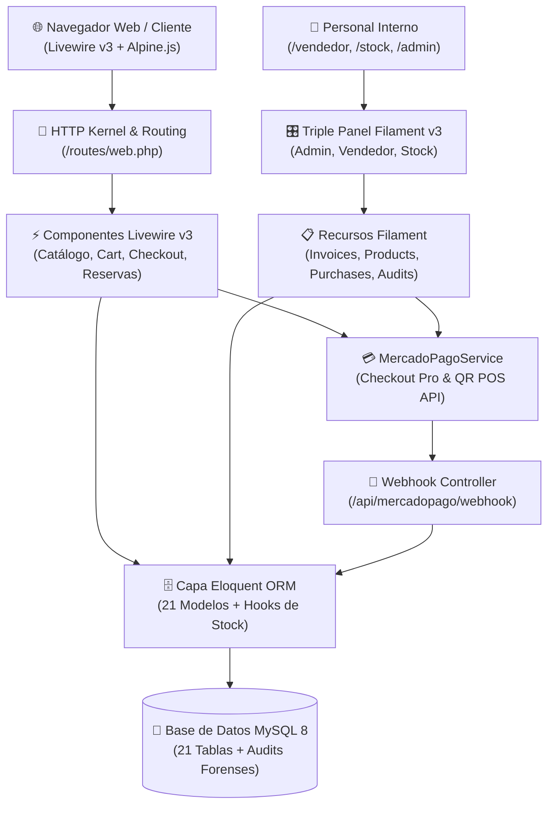
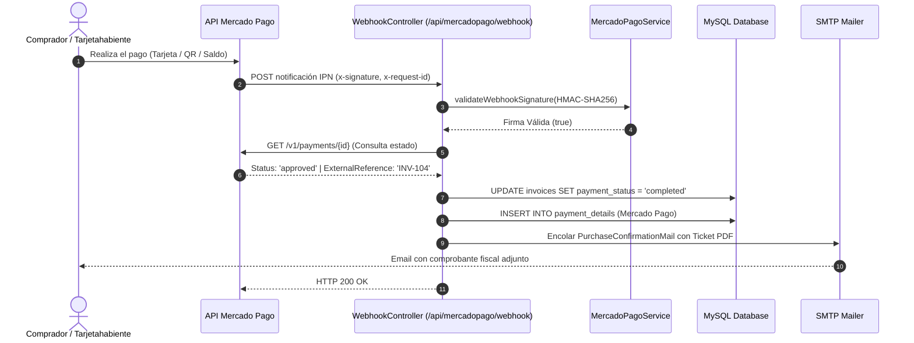
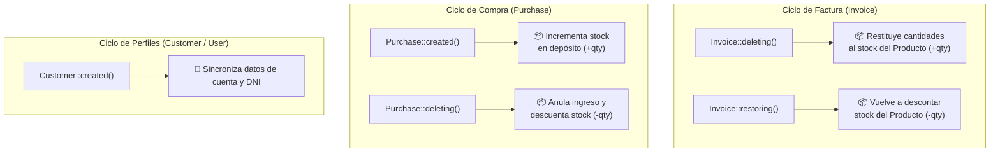

# 🛠️ Manual Técnico, Arquitectura de Software e Infraestructura
## Sistema Sound Heritage — Especificación Técnica para Desarrolladores y DevOps

[⬅️ Volver al README Principal](../README.md)

> **Perfil Destinatario:** Desarrolladores Backend y Frontend, Arquitectos de Software, Administradores de Sistemas (SysAdmins) y DevOps.  
> **Stack Tecnológico:** Laravel 11 + Livewire v3 + Filament v3 + Tailwind CSS + Alpine.js + MySQL 8 + Mercado Pago SDK.  
> **Naturaleza del Documento:** Especificación técnica de ingeniería profunda. Detalla la topología de la aplicación, el ciclo de vida reactivo, los hooks de pasarelas de pago, los cron jobs, la seguridad basada en roles (RBAC) y los protocolos de despliegue.

---

## 📑 Índice General

1. [Capítulo 1: Arquitectura General del Sistema y Stack Tecnológico](#-capítulo-1-arquitectura-general-del-sistema-y-stack-tecnológico)
2. [Capítulo 2: Capa Reactiva Frontend y Storefront (Livewire v3 & Alpine.js)](#-capítulo-2-capa-reactiva-frontend-y-storefront-livewire-v3--alpinejs)
3. [Capítulo 3: Integración Profunda con Mercado Pago (SDK, Checkout Pro, QR y Webhooks IPN)](#-capítulo-3-integración-profunda-con-mercado-pago-sdk-checkout-pro-qr-y-webhooks-ipn)
4. [Capítulo 4: Automatizaciones, Tareas Programadas y Comandos CLI (Crons)](#-capítulo-4-automatizaciones-tareas-programadas-y-comandos-cli-crons)
5. [Capítulo 5: Matriz de Seguridad, Políticas y Control de Acceso (RBAC)](#-capítulo-5-matriz-de-seguridad-políticas-y-control-de-acceso-rbac)
6. [Capítulo 6: Auditoría Forense y Ciclo de Vida de Modelos (Eloquent Hooks)](#-capítulo-6-auditoría-forense-y-ciclo-de-vida-de-modelos-eloquent-hooks)
7. [Capítulo 7: Motor de Reportes PDF y Correos Transaccionales](#-capítulo-7-motor-de-reportes-pdf-y-correos-transaccionales)
8. [Capítulo 8: Guía de Despliegue, Mantenimiento y Troubleshooting para DevOps](#-capítulo-8-guía-de-despliegue-mantenimiento-y-troubleshooting-para-devops)

---

## 🏛️ Capítulo 1: Arquitectura General del Sistema y Stack Tecnológico

### 1.1 Topología de la Aplicación
Sound Heritage está construido como una plataforma monolítica modular de alto rendimiento bajo el framework **Laravel 11**, combinando una capa reactiva de comercio electrónico para clientes con un triple panel ERP administrativo para la operación física.



### 1.2 Componentes Centrales del Stack
* **Framework:** Laravel 11.x (PHP 8.2+).
* **Storefront Reactivo:** Livewire v3 + MaryUI + Alpine.js v3 + Tailwind CSS v3.
* **Paneles de Gestión (ERP):** Filament v3 (Panel Builder, Form Builder, Table Builder, Infolists).
* **Motor de Base de Datos:** MySQL 8.0 con motor InnoDB y soporte nativo de transacciones ACID y columnas JSON.
* **Pasarela de Pagos:** Mercado Pago REST API v1/v2 (Checkout Pro + QR Dinámico en Caja 1 + Webhooks IPN).
* **Autenticación Social:** Laravel Socialite (Google OAuth 2.0).
* **Control de Acceso:** Spatie Laravel-Permission v6 (Roles y Permisos en base de datos).
* **Auditoría Forense:** OwenIt Laravel-Auditing v13.
* **Motor de Comprobantes:** Barryvdh Laravel-DomPDF v3.

---

### 1.3 Flujo de Arranque en Laravel 11 (`/bootstrap/app.php`)
A diferencia de versiones anteriores con directorios HTTP pesados, Laravel 11 utiliza una configuración fluida en `/bootstrap/app.php`:

```php
return Application::configure(basePath: dirname(__DIR__))
    ->withRouting(
        web: __DIR__.'/../routes/web.php',
        api: __DIR__.'/../routes/api.php',
        commands: __DIR__.'/../routes/console.php',
        health: '/up',
    )
    ->withMiddleware(function (Middleware $middleware): void {
        $middleware->alias([
            'role'               => \Spatie\Permission\Middleware\RoleMiddleware::class,
            'permission'         => \Spatie\Permission\Middleware\PermissionMiddleware::class,
            'role_or_permission' => \Spatie\Permission\Middleware\RoleOrPermissionMiddleware::class,
        ]);
    })
    ->withExceptions(function (Exceptions $exceptions): void {
        // Manejadores personalizados de excepción
    })->create();
```

---

### 1.4 Configuración de Entorno Crítica (`.env` y `/config/services.php`)
El sistema depende de variables de entorno estrictamente tipadas:

```ini
# Configuración Principal
APP_NAME="Sound Heritage"
APP_ENV=production
APP_DEBUG=false
APP_URL=https://soundheritage.com.ar

# Base de Datos
DB_CONNECTION=mysql
DB_HOST=127.0.0.1
DB_PORT=3306
DB_DATABASE=sound_heritage
DB_USERNAME=usuario_bd
DB_PASSWORD=clave_segura

# Pasarela Mercado Pago
MP_SANDBOX=false
MP_WEB_PUBLIC_KEY=APP_USR-xxxx-xxxx
MP_WEB_ACCESS_TOKEN=APP_USR-xxxx-xxxx
MP_QR_ACCESS_TOKEN=APP_USR-xxxx-xxxx
MP_USER_ID=3791683102
MP_POS_ID=CAJA_1
MP_EXTERNAL_STORE_ID=SUCURSAL_CENTRAL
MP_WEBHOOK_SECRET=whsec_xxxx-xxxx

# Autenticación Social Google
GOOGLE_CLIENT_ID=xxxx.apps.googleusercontent.com
GOOGLE_CLIENT_SECRET=GOCSPX-xxxx
GOOGLE_REDIRECT_URI=https://soundheritage.com.ar/auth/google/callback
```

---

## ⚡ Capítulo 2: Capa Reactiva Frontend y Storefront (Livewire v3 & Alpine.js)

La tienda online prescinde de frameworks JavaScript pesados del lado del cliente (como React o Vue SPA) y adopta **Livewire v3** para renderizar componentes reactivos directamente desde el servidor con comunicación asíncrona mediante WebSockets o XHR.

### 2.1 Ciclo de Vida de los Componentes Livewire
Todos los componentes de `/app/Livewire/` implementan el ciclo de vida reactivo estándar:

```
┌────────────────────────────────────────────────────────────────────────┐
│ CICLO DE VIDA DE UN COMPONENTE LIVEWIRE V3                             │
├────────────────────────────────────────────────────────────────────────┤
│ 1. mount()            ──► Inicializa estado, precarga cliente y params │
│ 2. hydrate()          ──► Rehidrata propiedades entre peticiones XHR   │
│ 3. updating*()        ──► Intercepta cambios antes de mutar la prop    │
│ 4. updated*()         ──► Ejecuta validación y cálculos en vivo        │
│ 5. render()           ──► Compila la vista Blade y envía el HTML diff  │
│ 6. dehydrate()        ──► Serializa el estado seguro al navegador      │
└────────────────────────────────────────────────────────────────────────┘
```

---

### 2.2 Optimistic UI en el Carrito Deslizante (`CartDrawer.php` / `HasCartActions.php`)
Para evitar retrasos perceptuales al hacer clic en los botones `+` o `-` del carrito, la vista `/resources/views/livewire/cart-drawer.blade.php` utiliza **Optimistic UI con Alpine.js**:
* El navegador incrementa o decrementa la cifra visualmente con **0 ms de latencia**.
* En paralelo, Alpine.js dispara la llamada en segundo plano a Livewire: `$wire.incrementarCantidad(id)`.
* Si la llamada al backend tiene éxito, el estado queda sincronizado; si ocurre un fallo de red o stock insuficiente, Livewire emite un evento revertiendo el valor.

```html
<div x-data="{ 
    qty: {{ (int) ($item['cantidad'] ?? 1) }},
    inc() { this.qty++; $wire.incrementarCantidad('{{ $id }}'); },
    dec() { if (this.qty > 1) { this.qty--; } $wire.decrementarCantidad('{{ $id }}'); }
}">
    <button type="button" @click="dec()">-</button>
    <span x-text="qty"></span>
    <button type="button" @click="inc()">+</button>
</div>
```

---

### 2.3 Sistema de Eventos Globales de Carrito
La sincronización entre diferentes componentes desacoplados (como la barra superior `SearchBar`, la ficha de producto `DetalleProducto` y el carrito `CartDrawer`) se realiza mediante eventos globales de Livewire:

| Evento Emitido | Emisor | Receptor | Propósito |
| :--- | :--- | :--- | :--- |
| `cart-updated` | `HasCartActions` | Navbar, CartDrawer | Notifica cambio en la cantidad total de artículos seleccionados. |
| `open-cart` | Ficha / Detalle | CartDrawer | Despliega el panel lateral tras añadir un ítem. |
| `close-cart` | CartDrawer | Global | Oculta el panel lateral al hacer clic en el backdrop o pulsar Escape. |

---

### 2.4 Motor Reactivo de Disponibilidad y Descuentos en Reservas (`ReservarSalon.php`)
El componente `/app/Livewire/ReservarSalon.php` valida en tiempo real la disponibilidad y las tarifas mediante listeners reactivos de Livewire v3:
* **`updatedDate()` y `updatedShift()`:** Ejecutan `validateDateAvailability()`, que consulta si existe un recital programado en la tabla `events` o una reserva activa en `reservations` para esa fecha y turno exactos.
* **`updatedAttendeesCount()`:** Dispara el recálculo dinámico de tramos de descuento grupal (`getDiscountPercentProperty()`):
  * 1 a 4 asistentes: `0%`
  * 5 a 9 asistentes: `10%`
  * 10 a 14 asistentes: `15%`
  * 15 a 19 asistentes: `20%`
  * 20 a 150 asistentes: `25%`
* **Cálculo de Seña del 30% (`getDepositAmountProperty()`):** Se calcula automáticamente como `round($this->totalPrice * 0.30, 2)`.

---

## 💳 Capítulo 3: Integración Profunda con Mercado Pago (SDK, Checkout Pro, QR y Webhooks IPN)

La pasarela de pagos está centralizada en la clase de servicio `/app/Services/MercadoPagoService.php` y el controlador de notificaciones `/app/Http/Controllers/MercadoPagoWebhookController.php`.

### 3.1 Arquitectura del Servicio `MercadoPagoService`

El servicio soporta dos canales de recaudación complementarios:
1. **Canal Tienda Web (Checkout Pro):** Creación de preferencias de pago con redirección.
2. **Canal Mostrador Físico (QR Dinámico Caja 1):** Inyección de órdenes en el tótem de cobro presencial mediante la API de Orders de Mercado Pago.

---

### 3.2 Creación de Preferencias para Checkout Pro (`createCheckoutPreference`)
* **Endpoint de la API:** `POST https://api.mercadopago.com/checkout/preferences`
* **Payload Generado:**
  * `items`: Matriz con títulos, cantidades, precios unitarios en `ARS`.
  * `payer`: Datos del cliente (nombre, apellido y correo). En modo Sandbox (`MP_SANDBOX=true`), el sistema transforma automáticamente correos reales a `test_user_xxxx@testuser.com` para evitar rechazos del SDK.
  * `back_urls`: Retornos automáticos hacia `/checkout/success`, `/checkout/pending` y `/checkout/failure`.
  * `auto_return`: Configurado en `'approved'` (solo habilitado si la URL base corre bajo HTTPS para cumplir con los estándares de seguridad de Mercado Pago).
  * `notification_url`: Endpoint del webhook público `/api/mercadopago/webhook`.
  * `external_reference`: Clave alfanumérica de conciliación unívoca (`INV-{id}`, `RES-{id}` o `ATT-{id}`).

---

### 3.3 Creación de Órdenes QR Presenciales (`createQrOrder`)
* **Endpoint de la API:** `POST https://api.mercadopago.com/v1/orders`
* **Headers:** `X-Idempotency-Key` (UUIDv4 generado con `Str::uuid()`) para prevenir cargos duplicados ante reintentos de red.
* **Payload Generado:**
  * `type`: `'qr'`
  * `total_amount`: Monto formateado con 2 decimales.
  * `expiration_time`: `'PT15M'` (15 minutos de vigencia en la pantalla antes de expirar).
  * `config.qr.external_pos_id`: `'CAJA_1'` (Identificador de caja en el panel de Mercado Pago).
  * `config.qr.mode`: `'static'` (QR fijo de mostrador sobre el cual se proyecta la orden dinámica).

---

### 3.4 Protocolo de Reembolso Automático (`executeRefund`)
Al anular un comprobante en el ERP:
* **Endpoint de la API:** `POST https://api.mercadopago.com/v1/payments/{paymentId}/refunds`
* **Mapeo de Atributos:** Si la pasarela responde con código HTTP 200/201, el modelo almacena:
  * `mp_refund_id`: ID oficial del reintegro emitido por Mercado Pago.
  * `refunded_at`: Marca temporal de auditoría.
  * `payment_status`: `'refunded'`.

---

### 3.5 Arquitectura y Conciliación del Webhook IPN



#### Validación Criptográfica de la Firma (HMAC-SHA256):
El webhook verifica la autenticidad del mensaje extrayendo las claves del encabezado `x-signature`:
1. Separa `ts` (timestamp) y `v1` (hash criptográfico recibido).
2. Construye el manifiesto oficial: `id:[data_id];request-id:[x-request-id];ts:[ts];`.
3. Calcula el hash local con la clave secreta: `hash_hmac('sha256', $manifest, $webhookSecret)`.
4. Compara ambos hashes mediante `hash_equals()` para prevenir ataques de temporización (*timing attacks*).

#### Mapeo de `external_reference`:
* **`INV-{id}`:** Concilia facturas de mostrador o tienda web, marca `payment_status = 'completed'` y despacha `PurchaseConfirmationMail`.
* **`RES-{id}` / `RES-{id}-TOTAL` / `RES-{id}-SENA`:** Concilia reservas de auditorio, marca `payment_status = 'Totalmente Abonada'` o `'Señada (Resta 70%)'`, manteniendo el estado operativo en `'Pendiente'` hasta que el encargado confirme la viabilidad técnica de la sala.
* **`ATT-{id}`:** Concilia pases a recitales y despacha `EventTicketsMail` con los códigos QR adjuntos.

---

## ⏰ Capítulo 4: Automatizaciones, Tareas Programadas y Comandos CLI (Crons)

### 4.1 Comando de Limpieza de Órdenes Expiradas (`CancelExpiredQrOrders.php`)
* **Firma del Comando:** `php artisan invoices:cancel-expired-qr`
* **Ubicación:** `/app/Console/Commands/CancelExpiredQrOrders.php`
* **Lógica de Ejecución:**
  1. Consulta facturas con `payment_status = 'pending'`, creadas hace más de 24 horas y asociadas a órdenes de Mercado Pago o con detalle de medio de pago MP.
  2. Invoca `$mpService->cancelAnyActiveCajaOrder()` para liberar la Caja 1 en la nube.
  3. Actualiza el estado a `'failed'` y ejecuta el método `$invoice->delete()`.
  4. El soft-delete dispara los hooks del modelo restituyendo las cantidades vendidas al stock del producto y asentando la trazabilidad en la tabla de auditorías.

---

### 4.2 Programación en el Scheduler (`/routes/console.php`)
En entornos de producción, el Scheduler de Laravel ejecuta la limpieza periódica:

```php
use Illuminate\Support\Facades\Schedule;

Schedule::command('invoices:cancel-expired-qr')->hourly();
```

---

## 🛡️ Capítulo 5: Matriz de Seguridad, Políticas y Control de Acceso (RBAC)

El control de acceso descansa en una arquitectura de tres capas: Middlewares HTTP, Políticas Eloquent (Policies) y Reglas de Superusuario en Providers.

### 5.1 Roles del Sistema (Spatie Permission)
1. `'Administrador'`: Control irrestricto, configuración, auditoría y finanzas.
2. `'Vendedor'`: Facturación de mostrador, cobros con QR Caja 1, catálogo y reservas de sala.
3. `'Encargado de Stock'`: Gestión de inventario, compras a proveedores y remitos.
4. `'Cliente'`: Perfil público de compradores online y asistentes culturales.

---

### 5.2 El Bypass Maestro de Superusuario (`Gate::before`)
En `/app/Providers/Filament/AdminPanelProvider.php`, se declara una cláusula de intercepción previa en el método `boot()`:

```php
public function boot(): void
{
    Gate::before(function ($user, $ability) {
        return $user->hasRole('Administrador') ? true : null;
    });
}
```
* Si el usuario autenticado posee el rol `'Administrador'`, `Gate::before` devuelve `true` de inmediato, omitiendo cualquier política restrictiva.
* Si no posee el rol, retorna `null`, derivando la autorización a las 21 Policies específicas.

---

### 5.3 Catálogo Exhaustivo de las 21 Políticas (`/app/Policies/`)

Cada modelo Eloquent cuenta con una política dedicada que implementa los métodos estándar de autorización:

| Modelo | Archivo de Política | Métodos Cubiertos |
| :--- | :--- | :--- |
| `Attendance` | `/app/Policies/AttendancePolicy.php` | `viewAny`, `view`, `create`, `update`, `delete`, `restore`, `forceDelete` |
| `City` | `/app/Policies/CityPolicy.php` | `viewAny`, `view`, `create`, `update`, `delete`, `restore`, `forceDelete` |
| `Customer` | `/app/Policies/CustomerPolicy.php` | `viewAny`, `view`, `create`, `update`, `delete`, `restore`, `forceDelete` |
| `Employee` | `/app/Policies/EmployeePolicy.php` | `viewAny`, `view`, `create`, `update`, `delete`, `restore`, `forceDelete` |
| `EmployeeCategory` | `/app/Policies/EmployeeCategoryPolicy.php` | `viewAny`, `view`, `create`, `update`, `delete`, `restore`, `forceDelete` |
| `Event` | `/app/Policies/EventPolicy.php` | `viewAny`, `view`, `create`, `update`, `delete`, `restore`, `forceDelete` |
| `EventSponsor` | `/app/Policies/EventSponsorPolicy.php` | `viewAny`, `view`, `create`, `update`, `delete`, `restore`, `forceDelete` |
| `Invoice` | `/app/Policies/InvoicePolicy.php` | `viewAny`, `view`, `create`, `update`, `delete`, `restore`, `forceDelete` |
| `InvoiceDetail` | `/app/Policies/InvoiceDetailPolicy.php` | `viewAny`, `view`, `create`, `update`, `delete`, `restore`, `forceDelete` |
| `PaymentDetail` | `/app/Policies/PaymentDetailPolicy.php` | `viewAny`, `view`, `create`, `update`, `delete`, `restore`, `forceDelete` |
| `PaymentMethod` | `/app/Policies/PaymentMethodPolicy.php` | `viewAny`, `view`, `create`, `update`, `delete`, `restore`, `forceDelete` |
| `Product` | `/app/Policies/ProductPolicy.php` | `viewAny`, `view`, `create`, `update`, `delete`, `restore`, `forceDelete` |
| `Province` | `/app/Policies/ProvincePolicy.php` | `viewAny`, `view`, `create`, `update`, `delete`, `restore`, `forceDelete` |
| `Purchase` | `/app/Policies/PurchasePolicy.php` | `viewAny`, `view`, `create`, `update`, `delete`, `restore`, `forceDelete` |
| `PurchaseDetail` | `/app/Policies/PurchaseDetailPolicy.php` | `viewAny`, `view`, `create`, `update`, `delete`, `restore`, `forceDelete` |
| `Reservation` | `/app/Policies/ReservationPolicy.php` | `viewAny`, `view`, `create`, `update`, `delete`, `restore`, `forceDelete` |
| `Sponsor` | `/app/Policies/SponsorPolicy.php` | `viewAny`, `view`, `create`, `update`, `delete`, `restore`, `forceDelete` |
| `Store` | `/app/Policies/StorePolicy.php` | `viewAny`, `view`, `create`, `update`, `delete`, `restore`, `forceDelete` |
| `Supplier` | `/app/Policies/SupplierPolicy.php` | `viewAny`, `view`, `create`, `update`, `delete`, `restore`, `forceDelete` |
| `User` | `/app/Policies/UserPolicy.php` | `viewAny`, `view`, `create`, `update`, `delete`, `restore`, `forceDelete` |
| `Venue` | `/app/Policies/VenuePolicy.php` | `viewAny`, `view`, `create`, `update`, `delete`, `restore`, `forceDelete` |

---

### 5.4 Flujo OAuth 2.0 con Google (`SocialAuthController.php`)
* **Ruta de Inicio:** `GET /auth/google` ➔ `Socialite::driver('google')->redirect()`.
* **Callback:** `GET /auth/google/callback` ➔ `Socialite::driver('google')->user()`.
* **Manejo de Cuentas:**
  1. Si el usuario existe en `users` y está en estado `trashed()`, aborta con error de cuenta suspendida.
  2. Si existe y no tenía validado su correo, actualiza `email_verified_at = now()`.
  3. Si no existe, crea el registro con contraseña aleatoria `Hash::make(Str::random(32))` y le asigna el rol `'Cliente'`.
  4. Invoca `$user->syncProfileFromRoles()` para asegurar la creación de su ficha en `customers`.
  5. Redirige según el rol evitando desvíos cruzados de sesión.

---

## 🗄️ Capítulo 6: Auditoría Forense y Ciclo de Vida de Modelos (Eloquent Hooks)

### 6.1 Configuración de Auditoría Inmutable (`config/audit.php`)
* **Modelo Audit:** `OwenIt\Auditing\Models\Audit`.
* **Resolvers Activos:**
  * `ip_address`: Resuelve la dirección IP real del cliente (soportando proxys inversos mediante cabeceras `X-Forwarded-For`).
  * `user_agent`: Captura la cadena completa del navegador y sistema operativo.
  * `url`: Almacena el endpoint exacto que originó la mutación.
* **Eventos Auditados:** `created`, `updated`, `deleted`, `restored`.

---

### 6.2 Hooks de Ciclo de Vida (`booted()`) y Consistencia Atómica

Los modelos implementan reglas de negocio atómicas en su método `booted()`:



* **`/app/Models/Invoice.php`:** En el evento `deleting()`, recorre cada `invoiceDetail` y ejecuta `$detail->product->increment('stock', $detail->quantity)`, garantizando que cualquier venta anulada devuelva el inventario sin intervención manual.
* **`/app/Models/Purchase.php`:** En el evento `deleting()`, revierte el ingreso de mercadería ejecutando `$detail->product->decrement('stock', $detail->quantity)`.

---

## 📄 Capítulo 7: Motor de Reportes PDF y Correos Transaccionales

### 7.1 Plantillas PDF con DomPDF (`barryvdh/laravel-dompdf`)

El sistema utiliza tres plantillas optimizadas para impresión en `/resources/views/reports/`:

1. **Ticket de Caja Térmica 80mm (`invoice-ticket-pdf.blade.php`):**
   * Configuración de página: `@page { size: 80mm 297mm; margin: 4mm; }`.
   * Membrete fiscal formal con CUIT, número de comprobante, código de barras y leyenda de IVA.
2. **Reporte Ejecutivo del Dashboard A4 (`pdf-dashboard.blade.php`):**
   * Configuración de página: `@page { margin: 125px 28px 45px 28px; }` en orientación portrait.
   * Encabezado y pie fijos en todas las hojas con contador dinámico KaTeX/CSS: `.numero-pagina:after { content: counter(page); }`.
   * Gráficos representados mediante barras CSS relativas sin dependencias de JavaScript en tiempo de compilación PDF.
3. **Pase Oficial de Evento con Código QR (`event-ticket-pdf.blade.php`):**
   * Incorpora el código QR del pase renderizado directamente en SVG vectorial para escaneo inmediato en puerta.

---

### 7.2 Arquitectura de Mailables Transaccionales (`/app/Mail/`)
Los correos se despachan utilizando clases Mailable estructuradas que adjuntan los PDFs generados en memoria binaria mediante `attachData()`, evitando la escritura innecesaria de archivos temporales en el disco del servidor:

* `PurchaseConfirmationMail`: Factura de compra adjunta en PDF.
* `ReservationConfirmedMail`: Voucher oficial de reserva de auditorio.
* `EventTicketsMail`: Colección de entradas digitales con código QR para recitales.
* `WelcomeUserMail`: Correo de bienvenida y activación de cuenta.

---

## 🚀 Capítulo 8: Guía de Despliegue, Mantenimiento y Troubleshooting para DevOps

### 8.1 Secuencia de Despliegue en Entorno de Producción
Al desplegar una nueva versión en el servidor:

```bash
# 1. Navegar a la raíz del proyecto
cd /ruta/al/proyecto

# 2. Descargar dependencias optimizadas de Composer
composer install --no-dev --optimize-autoloader --no-interaction

# 3. Ejecutar migraciones de base de datos en modo forzado
php artisan migrate --force

# 4. Asegurar el enlace simbólico de almacenamiento público
php artisan storage:link

# 5. Compilar y cachear configuraciones y rutas de Laravel
php artisan config:cache
php artisan route:cache
php artisan view:cache
php artisan filament:cache-components
php artisan icons:cache

# 6. Reiniciar trabajadores de cola si existen
php artisan queue:restart
```

---

### 8.2 Configuración del Cron Scheduler en Linux
Para que las tareas programadas (como la cancelación de órdenes QR expiradas) se ejecuten puntualmente, el sistema operativo debe tener configurado en el crontab del usuario del servidor web (`crontab -e`):

```bash
* * * * * cd /ruta/al/proyecto && php artisan schedule:run >> /dev/null 2>&1
```

---

### 8.3 Guía de Resolución de Problemas (Troubleshooting)

| Síntoma o Error Detectado | Origen Técnico | Solución DevOps Inmediata |
| :--- | :--- | :--- |
| **Error 400 en Mercado Pago Checkout Pro** | La variable `APP_URL` no tiene prefijo `https://` y se intentó enviar `auto_return = 'approved'`. | Mercado Pago prohíbe `auto_return` bajo HTTP. El código en `MercadoPagoService.php` lo detecta automáticamente; verificar que el dominio cuente con certificado SSL activo. |
| **Webhook de MP devuelve error 401** | La firma criptográfica en `x-signature` no coincide con `MP_WEBHOOK_SECRET`. | Verificar en el panel de desarrolladores de Mercado Pago el secreto de webhook de la aplicación y sincronizarlo en el archivo `.env`. |
| **Error al generar PDFs en DomPDF** | Falta de permisos de escritura en carpetas temporales o fuentes tipográficas incompatibles. | Asegurar permisos `chmod -R 775 storage bootstrap/cache` y propiedad sobre el usuario del servidor web (`chown -R www-data:www-data`). |
| **Caja 1 bloqueada sin poder cobrar** | Quedó una orden pendiente anterior en la API de Mercado Pago. | Presionar *"Liberar Caja"* desde el panel o ejecutar por consola el método `cancelAnyActiveCajaOrder()`. |

---

> **Control de Versión de Ingeniería:** Sound Heritage ERP v1.0 — Manual Técnico de Arquitectura.  
> **Ubicación en Repositorio:** `/docs/06_MANUAL_TECNICO_Y_ARQUITECTURA.md`.  
> **Estándar de Calidad:** Cumple con PSR-12, directrices de arquitectura modular de Laravel 11 y estándares oficiales de la API de Mercado Pago.

